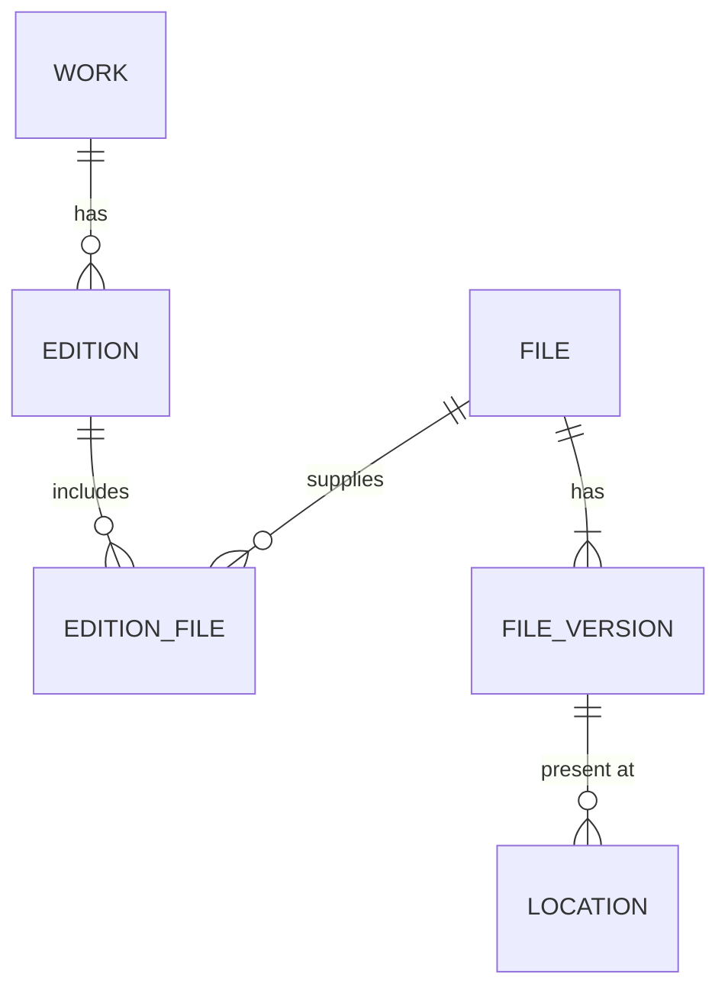
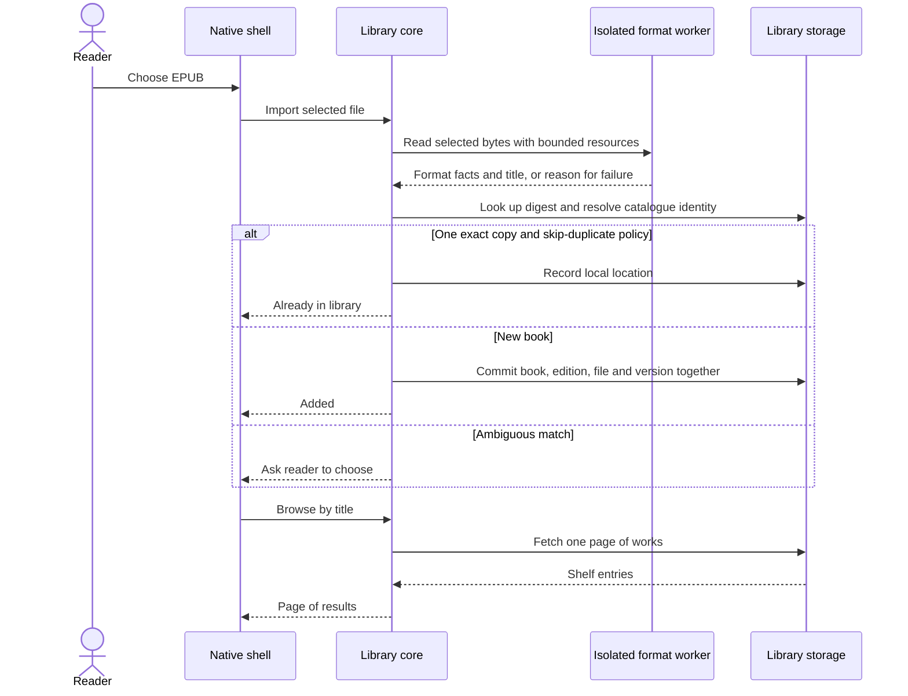

# From an EPUB to a shelf entry

A reader drops an EPUB into a library and searches for it by title. The shelf shows
one entry. The reader only needs to choose an edition or a copy when that choice
changes what opens. This design is for the first desktop implementation.

## The records to distinguish from day one

A work can sit on a wish list before a reader owns a copy. A translation or a
different narration gets an edition ID. The same anthology file can supply two
editions. A file ID follows the logical file through a replacement. A version ID
names particular bytes of that file. Each installation records where it last found
those bytes. Two copies can therefore stay readable at different revisions. A digest
finds candidates for reuse. It cannot establish that two catalogue records describe
the same work.

## Import path for the first desktop build

On a worker failure the core returns a reason and leaves the catalogue intact.
Hash and parse the same stable input. A changed source during import requires a
fresh read. The storage decision defines when an edit can be acknowledged and
how the local catalogue catches up after interruption. [Library storage](library-storage.md)

## Reproduce the model check

Run `python3 docs/design/catalogue-example.py` from the repository root with a
standard Python 3 installation. The example creates its own EPUB, reads its
package title, hashes its bytes and loads a disposable SQLite catalogue. It
accepts no user files. The [SQL](catalogue.sql) and [driver](catalogue-example.py)
are an executable sketch of the query model. The fixture uses the publication
container and package metadata defined in [EPUB 3.3](https://www.w3.org/TR/epub-33/).

The example checks duplicate import, two locations for one version, a move, an
explicit replacement at just one location, rollback after an occupied path, a
shared anthology file and a work with no file. It also seeks to the last five
rows of 100,000 generated works with repeated titles and prints SQLite's query
plan. A composite index can resume within a tied title. Locale-aware sort keys,
interactive search latency and concurrent edits during paging still need trials.

The Rust implementation must add the isolated worker, source-labelled metadata,
journal and portable recovery path before accepting real libraries. Run one
import from the native picker, interrupt it at each storage boundary, then reopen
the library and find the title. The wider import requirements include undo,
cancellation, folder import and duplicate choices. [Library requirements](../requirements/01-library.md#importing)
