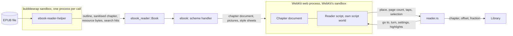

# Reading an EPUB in the app

For [reading EPUB books in the app](https://github.com/endqwerty/ebook-manager/issues/29).
How the reader looks is settled in [the interface design](interface.md) and
[its reader page](interface-reader.md). This page says how the EPUB helper and
the Linux shell supply it, and where untrusted book content stops.

## Problem

The desktop reader puts each chapter's text into a `GtkTextView`. The helper in
[`crates/ebook-reader`](../../crates/ebook-reader/README.md) returns blocks of
text with five style flags, so the reader has no pictures, no tables, none of
the book's styling, one fixed font and no pages. A turn is a scroll of the text
view. The saved place is a block, so a long paragraph resumes at its top. There
is no search, no table of contents beyond a chapter list, and no progress
beyond "Chapter 2 of 14".

A book file is untrusted. Whatever draws it must not run the publisher's
scripts, fetch anything from the network, or give book content a way to reach
the app or the reader's files
([SEC-1, SEC-2, SEC-5 and SEC-7](../requirements/10-constraints.md#opening-untrusted-files)).

## Goals

Requirement identifiers are from [reading](../requirements/04-reading.md#text).

- Open a book at the place it was left, to the character and not the paragraph.
  Show its table of contents, its landmarks and its page list (READ-1).
- Pages or continuous scrolling, one or two columns, a slide, a cross-fade or no
  page-turn animation, and full screen (READ-2).
- Font, size, weight, line, letter and word spacing, margins, justification,
  hyphenation, and the book's own styles or the reader's (READ-3).
- The four page colours of the reader design, colours of the reader's own, and
  a page colour that follows the system's appearance (READ-4).
- Progress as a percentage, the chapter, and pages and time left (READ-7).
- Search inside the book with each result in its sentence (READ-8).
- Select text and copy it. Footnotes open in place (part of READ-9).
- Go back after following a link or jumping (READ-10).
- Scripts in a book never run and nothing remote loads (the default of
  READ-18).

## Non-goals

Each has, or gets, its own issue. The [task list](#tasks) names them.

- Stored highlights, notes and bookmarks. They need annotation records in the
  library ([annotations](../requirements/05-annotations-history.md)).
- Allowing scripts or remote resources for one book, the other half of READ-18.
  This work only keeps them off.
- A page colour that follows the time of day, the other half of READ-4's
  automatic change.
- Fonts embedded in the book, fonts the reader loads (READ-6), and the settings
  scope chain (READ-5). Settings here are global.
- Print page numbers' edition name and EPUB 2 `guide` landmarks. Both are read
  from the package document, which
  [the browsing work](https://github.com/endqwerty/ebook-manager/issues/25) is
  changing now.
- Fixed-layout books, vertical text, media overlays, and a screen reader
  reading across chapters (READ-16, READ-17, READ-61, READ-70).
- The reader as a page inside the library window. The browsing work owns the
  window. The reader keeps its own window until that lands. See
  [The reader's window](#the-readers-window).
- Shells other than Linux.

## How a chapter is drawn

This is the decision the rest depends on. Three shapes were sketched.

- **A. Native text.** The helper's block model grows pictures and more inline
  styles, and the shell lays it out with Pango in a page widget of its own. No
  web engine runs.
- **B. A web view on sanitised book markup.** The helper turns each chapter
  into a strict subset of XHTML and each style sheet into a strict subset of
  CSS. A WebKitGTK 6.0 web view lays that out. The helper serves the book's
  pictures through a URI scheme the app owns. Publisher scripts never run and
  the view can reach nothing but that scheme.
- **C. A web view on app-written markup.** The shell writes its own HTML from
  the helper's existing blocks. No publisher markup or CSS reaches the engine.

| | A. Native text | B. Sanitised markup in a web view | C. App markup in a web view |
|---|---|---|---|
| The book's own styles (READ-3, and the reader design's default) | Not possible without writing a CSS engine | Yes | No |
| Tables, floats, pictures in text, ruby, vertical text later | Each is new layout code | The engine's | Flattened by the block model |
| Columns, pages, justification, hyphenation | New layout code. Pango has no dictionary hyphenation. | CSS | CSS |
| Selection, search highlights | `GtkTextView` has them. A custom page widget needs them written. | The engine's selection, and the CSS highlight API | The same as B |
| What parses book-controlled bytes outside the helper | Image decoders only | WebKit's XML, CSS, layout and image code, in WebKit's own sandboxed web process | WebKit's layout and image code |
| Shared with the macOS, iOS, Android and Windows shells, which [the platform plan](platforms.md#shared-core-and-native-shells) gives a web view | Nothing | The helper's output, the reader script and the style sheet | The same as B |

**B is chosen.** The reader design makes the book's own styles the default, and
only B can show them. A is the safest and the least capable: it would spend the
milestone writing a layout engine and still not show a table. C is B with the
publisher's CSS and most of its markup removed, so B built in the right order
passes through C. The second pull request below shows sanitised structure with
the app's style sheet only. Publisher CSS arrives in a later pull request behind
its own review, and the reader can always turn it off.

What B costs is the engine. WebKit parses and lays out bytes the book chose,
and a WebKit bug is then a bug in the reader. Three things bound that. The
helper has already reduced the markup to an allow-list, so the engine sees no
script, no frame, no form, no plug-in and no address outside the book. WebKitGTK
6.0 always runs its web process in a sandbox of its own
([migration notes](https://webkitgtk.org/reference/webkitgtk/stable/migrating-to-webkitgtk-6.0.html)).
And the app treats every message from the page as untrusted input, as it treats
the helper's reply.

A second designer on another model provider (GPT-6.2 Astra), given the three
shapes and no preference, also chose B. Its case for the opposite view was C:
most of this issue is about finding and keeping a place, and C does that on the
helper's existing text. It would switch to C if the safe CSS subset shows no
real gain over app styles on real books, and to A if WebKit cannot be contained
as [SEC-5](../requirements/10-constraints.md#opening-untrusted-files) asks.
That second condition is check 5 below. Its other points taken here are a
positive control in check 2 and running the checks before any interface work.

### What would show this is wrong

The first build step on the shell side is a test that settles these before any
interface is written. Each one failing sends the design back to C or A.

1. **The app's script cannot run where the book's cannot.** With
   `enable-javascript-markup` off and the response's content security policy
   forbidding scripts, the app's own script, added through
   `WebKitUserContentManager` in a named script world, must still run, measure
   the layout and post messages. If it cannot, pages need scripts enabled for
   the document, and B loses its second layer.
2. **The engine alone lets something out.** The test serves a hostile chapter
   straight to the view, skipping the helper's sanitiser: inline and external
   scripts, event handler attributes, a `javascript:` link, a meta refresh, a
   frame, a form that submits itself, and pictures, style sheets, fonts and
   `@import` rules that point at a listener on `127.0.0.1`. The listener must
   see no connection and the page must show no sign a script ran. The same test
   run with the view's protections off must reach the listener and run the
   script, so a silent detector cannot pass it.
3. **Offsets disagree.** A place is a count of text the helper made and the
   page reads back. If the page's count differs from the helper's for any
   fixture chapter, resume and search results land in the wrong place.
4. **It cannot run in CI.** The smoke driver runs under Xvfb on GitHub's
   `ubuntu-latest`. The view must draw there with software rendering.
5. **The drawing process can reach the network or grow without limit.** SEC-5
   asks that drawing run in a separate process with no network and limits on
   time and memory. The test finds the view's web process and checks it cannot
   open a socket to the listener, that a `WebKitMemoryPressureSettings` limit
   ends a chapter that allocates past it, and that the shell's watchdog ends a
   chapter that never finishes loading. If WebKit's own sandbox leaves the web
   process a network route, the fallback is the reader host process under
   [Alternatives](#alternatives).

## Plan



### What the helper returns

The helper gains three requests. Each is a method on `ebook_reader::Book`, runs
one sandboxed helper process like the existing calls, and passes the same reply
checks in `host.rs`. `read_chapter` and its block model stay for import, tests
and footnote text.

```rust
impl Book {
    /// One chapter as sanitised markup.
    pub fn read_content(&self, index: u32) -> Result<ChapterContent, ReaderError>;
    /// One picture or style sheet the chapter's markup names.
    pub fn read_resource(&self, id: ResourceId) -> Result<Resource, ReaderError>;
    /// Matches for `query` in one chapter, in reading order.
    pub fn search(&self, chapter: u32, query: &str) -> Result<Vec<SearchHit>, ReaderError>;
    /// EPUB 3 landmarks and page list, from the navigation document.
    pub fn landmarks(&self) -> &[TocEntry];
    pub fn page_list(&self) -> &[TocEntry];
}

pub struct ChapterContent {
    pub index: u32,
    pub title: Option<String>,
    /// Children of `<body>`: well-formed XML holding only allow-listed
    /// elements and attributes.
    pub markup: String,
    /// Length of the chapter's text in UTF-16 code units. See "A place in the book".
    pub length: u32,
    /// The book's style sheets for this chapter, in cascade order.
    pub styles: Vec<ResourceId>,
    pub language: Option<String>,
    pub right_to_left: bool,
    pub truncated: bool,
    pub warnings: Vec<ChapterWarning>,
}

/// An index into the package manifest. The shell never sees a path.
pub struct ResourceId(pub u32);

pub enum ResourceKind { Png, Jpeg, Gif, Webp, Css }
pub struct Resource { pub kind: ResourceKind, pub bytes: Vec<u8> }

pub struct SearchHit {
    pub offset: u32,
    pub length: u32,
    /// Up to 80 characters of the same block on either side.
    pub before: String,
    pub matched: String,
    pub after: String,
}
```

`ChapterInfo` gains `size: u32`, the chapter document's unpacked size in bytes
as the archive directory states it, capped at the chapter limit. It weighs
chapters for [progress](#progress). The book controls that number, so it is
used for nothing else.

**The markup sanitiser** lives in a new `engine/markup.rs` and walks the same
tokens as `engine/text.rs`.

- It writes an element only if it is on the allow-list: sections and headings,
  paragraphs, lists, quotations, preformatted text, tables, figures, line
  breaks, rules, the inline text elements, ruby, `a` and `img`. A `div` or
  `span` is kept. Any other element is dropped and its text kept. An element
  that `text.rs` skips with its content (`script`, `style`, `iframe`, `object`,
  `audio`, `video`, `canvas`, `template`) is skipped with its content. So are
  forms and their controls.
- It writes an attribute only if it is `id`, `class`, `lang`, `dir`, `title`,
  `alt`, `colspan`, `rowspan`, `start`, `value` or `epub:type`, which becomes
  `data-epub-type`. Every `on…` attribute, `style`, `srcset` and anything
  namespaced is dropped. Inline `style` returns with publisher CSS, through the
  CSS sanitiser.
- `a href` becomes `ebook:/c/<chapter>#<anchor>` for a place in the book.
  For an `http`, `https` or `mailto` address it is kept and the element gains
  `data-external`. Any other link loses its `href`.
- `img src` becomes `ebook:/r/<id>` when it resolves to a manifest item with a
  picture media type. Otherwise the element becomes its text alternative. An
  `svg` element whose only drawn child is one `image` is written as that `img`,
  because many books wrap their cover that way. Other inline SVG is dropped
  with the unsupported-content warning.
- Text is written with `&`, `<` and `>` escaped, line ends as `\n`, and the
  control characters `text.rs` already removes left out. Nothing else in the
  text changes, so the count in `length` is the count the page will see.
- The remote-references warning, the block limit and the malformed-markup
  warning keep their meaning from R6, R8 and R9 of
  [the reader spec](../../specs/epub-reader-mvp.md#reading).

**Resources.** `read_resource` unpacks one manifest item and checks its first
bytes against the type it claims: PNG, JPEG, GIF and WebP by signature. A
mismatch, an SVG picture, or anything else is refused. A picture is at most
32 MiB. Bytes cross the helper's reply as base64, inside the reply limit.

**The CSS sanitiser** (`engine/css.rs`, in the pull request that adds the
book's own styles) reads a style sheet with a tokenizer written to the
[CSS Syntax](https://www.w3.org/TR/css-syntax-3/) rules and writes back only
what it understood. It drops `@import` and `@font-face`, drops any declaration
whose value has a `url()` that does not resolve to a picture in the manifest,
rewrites the ones that do to `ebook:/r/<id>`, and drops `position: fixed` and
`position: sticky`. It is not what keeps the network closed. The web view does
that. It keeps the page from asking, and keeps a book from covering the app's
controls.

### The trust boundary

Book content passes two checks the book cannot influence, the helper's
allow-list and the web view's configuration. Either one alone must keep
scripts from running and requests from leaving. The tests check each alone.

`reader/view.rs` builds one `WebKitWebView` per reader window:

- **Its own context and an ephemeral `WebKitNetworkSession`.** No cookies,
  cache or storage reach disk.
- **Settings.** `enable-javascript-markup` is off, so the engine removes script
  elements and handler attributes while parsing
  ([documentation](https://webkitgtk.org/reference/webkitgtk/stable/property.Settings.enable-javascript-markup.html)).
  `enable-javascript` stays on for the app's script. Off as well: WebGL, WebRTC,
  media streams, media source, encrypted media, web audio, local storage and
  databases, the page cache, DNS prefetching, hyperlink auditing, file access
  from file URLs, opening windows from script, and back-forward gestures.
  Developer extras are on only in a debug build.
- **A URI scheme the app owns.** `ebook://<token>/c/<n>` is chapter `n` and
  `ebook://<token>/r/<id>` is a resource. The token is 128 random bits made
  when the window opens its book. The handler knows only that token, parses
  the rest as two integers, and calls `read_content` or `read_resource` on a
  worker thread. No part of a request becomes a file path.
- **Response headers.** A chapter is served as `application/xhtml+xml`, so the
  engine's XML parser reads it and never repairs markup into something the
  sanitiser did not write. Its content security policy is
  `default-src 'none'; img-src ebook:; style-src ebook: 'unsafe-inline'; form-action 'none'; base-uri 'none'`.
  Resources are served with their checked type and `X-Content-Type-Options: nosniff`.
- **A content filter.** One `WebKitUserContentFilter` rule list blocks every
  load whose address does not start with `ebook:`. If the filter cannot be
  compiled or added, no book opens.
- **A dead proxy.** The session's proxy is set to a closed port on
  `127.0.0.1`, so a request that passed every other layer still goes nowhere.
- **Limits.** The context's `WebKitMemoryPressureSettings` cap the web process
  at 1 GiB. The shell ends a chapter load that has not finished in 15 seconds
  with `terminate_web_process` and shows the error.
- **Navigation.** `decide-policy` allows the one chapter load the shell itself
  started and ignores everything else. A link is handled by the shell: a place
  in the book is a jump, and an external address asks the reader first and then
  goes to the system's handler (SEC-7). Permission requests are denied. New
  windows and downloads are refused.
- **The bridge.** The app's script is a `WebKitUserScript` in a script world
  named `ebook-reader`, and the one message handler is registered for that
  world only. Script in the page's own world, if any ever ran, has no
  `window.webkit.messageHandlers`. The shell validates every message: a known
  kind, numbers in range, strings cut to a limit. It never evaluates, opens or
  resolves anything a message carries, other than a link target it looks up in
  the book's own outline.

A message from the page can therefore move the reading place, report a
selection, or ask for a jump or an external link the reader then confirms. It
can do nothing else. That is the protection a
[defensive review](../../AGENTS.md#start-a-fresh-reader-automatically) of this
boundary should test.

### Pages and layout

`reader/reader.css` and `reader/reader.js` are the app's, compiled into the
binary. The style sheet is a user style sheet, so its `!important` rules win
over anything the book's sheets say.

- **Pages** are CSS columns. The root element is one page high and scrolls
  sideways a page at a time. One column per page, or two when the reader asks
  and the window fits them. A turn sets the scroll offset. The slide and the
  cross-fade are CSS transitions, skipped when
  `gtk-interface-reduced-motion` asks.
- **Scrolling** is the same document in normal flow.
- **Settings** reach the page as CSS custom properties and a few classes on the
  root: font family, size step, weight, line height, letter and word spacing,
  margin scale, justification with hyphenation, columns, page colours. Changing
  one updates the properties and the page reflows, then goes back to the saved
  place.
- **Page colours** are the four in the reader design. The window's background
  takes the page colour, so the view and the window are one surface.
- **The book's own styles** means its sanitised sheets are linked after the
  app's base rules and before the reader's `!important` choices. Off, no book
  sheet is linked and `class` does nothing.

The shell turns pages from GTK key and click handlers as today. The script
answers `turn(±1)` with whether it moved. At a chapter's edge it did not, and
the shell loads the next or previous chapter, landing on its first or last
page.

### A place in the book

A place is a chapter index and an **offset**: the number of UTF-16 code units
of text before it, counting the chapter's text nodes in document order. The
helper counts while it writes `markup`. The script counts the same nodes in the
page. UTF-16 is the unit because the DOM measures text that way, and the helper
can count it as cheaply as bytes.

- To save, the script finds the first character of the page with
  `caretRangeFromPoint` and reports its offset. The shell stores it in
  `ReadingPosition { chapter, offset }` as today, for the file version.
- To restore, the script turns the offset into a `Range`, finds its column, and
  shows that page. This is the same after the font or the window changes.
- An anchor is resolved in the page: the script finds the element by `id`.
- A position saved by the block reader holds a block index in `offset`. Read as
  a text offset it lands near the top of the chapter. The project has no users
  yet, so no conversion is written.
- When the script reports the document's length after loading, the shell
  compares it with `ChapterContent::length`. A difference is logged and counted
  by a test over every fixture chapter. See
  [What would show this is wrong](#what-would-show-this-is-wrong).

`Position` and its `epubpos1:` text form stay for the block reader's callers.

### Progress

- **The fraction read** is the sizes of the linear chapters before this one,
  plus this chapter's size times the fraction of its pages turned, over the
  sizes of all linear chapters. Sizes are `ChapterInfo::size`. Counting
  chapters equally would call a book with a cover, a title page, a copyright
  page and a dedication one fifth read at the start of chapter one of sixteen.
  The shell passes this fraction to the library with the position. A position
  in a chapter that is not linear counts as the start of the next linear one,
  and showing the end of the last linear chapter stores exactly 1, as
  [the browsing design](https://github.com/endqwerty/ebook-manager/blob/library/browsing-design/docs/design/library-browsing.md)
  asks.
- **Pages left in the chapter** comes from the layout.
- **Time left** is text left, in offsets, over the reader's pace. The pace is
  the median of offsets per second over the last 30 page turns that took
  between 5 seconds and 10 minutes, kept across sessions. Until ten such turns
  exist the line shows no time. Text left in the book is estimated from chapter
  sizes and this chapter's offsets per byte.
- **Print pages.** When the book has a page list, the page shown is the last
  entry at or before the place.

The pace and the text settings live in
`$XDG_CONFIG_HOME/ebook-manager/reader.json`, written by the shell. They never
leave the machine (READ-76).

### Contents, search, footnotes and going back

- **Contents** lists `Book::toc()` with nesting, `landmarks()` above it and a
  Go to page field when `page_list()` is not empty, in an
  `AdwOverlaySplitView` sidebar.
- **Search** runs `Book::search` chapter by chapter on a worker thread, from
  the chapter being read onward and around. A new query cancels the old one.
  It stops at 1,000 results and says so. A match ignores case, by Unicode
  simple case folding, and can cross inline elements but not blocks. Choosing a
  result jumps to its chapter and offset. The script marks the result with the
  [CSS highlight API](https://www.w3.org/TR/css-highlight-api-1/), which paints
  ranges without changing the document, so offsets stay true.
- **Selection** is the engine's. The `context-menu` signal replaces WebKit's
  menu with the app's items. Copy is the only one until annotations exist.
- **A footnote** is an internal link marked `noteref` in `data-epub-type`, or a
  short superscript link to an anchor. The shell reads the target's blocks with
  `read_chapter` and `block_for_anchor`, and shows them in a `GtkPopover` at
  the link. A link that is neither is a jump.
- **Going back.** Each jump pushes the place left onto a list kept for the
  window. Back returns to it. The button stays until ten pages are turned.

### Controls and text settings

The controls follow [the reader design](interface-reader.md#the-controls): an
`AdwToolbarView` with the web view under both bars, revealed and hidden by the
shell. Taps on the page reach the shell as a zone (leading quarter, middle,
trailing quarter) from the script, which ignores a tap that ends a selection or
lands on a link. The progress control, the foot line and the text settings
popover are GTK widgets. Nothing the reader operates is drawn in the page.

### The reader's window

`reader::open(&Shelf, &Rc<Book>)` stays the entry point and still opens its own
window, because [the browsing work](https://github.com/endqwerty/ebook-manager/issues/25)
is rewriting the library window. The reader builds its content as one widget so
that the window can later hold it as a navigation page, as the reader design
asks.

## Behaviour

Each statement is checked by the test named after it. Tests of the engine are
in `crates/ebook-reader/tests`. Tests of the view run a real `WebKitWebView`
under Xvfb in `apps/desktop/tests`.

1. A chapter's markup holds only allow-listed elements and attributes,
   whatever the source holds. `markup_keeps_only_the_allow_list`.
2. A chapter with scripts, handlers, frames, forms, remote pictures and remote
   styles yields markup with none of them and carries the remote-references
   warning. `hostile_markup_is_removed`.
3. `length` equals the UTF-16 length of the text in `markup`, and the page
   reports the same number for every fixture chapter.
   `length_counts_the_markup_text`, `page_and_helper_agree_on_length`.
4. A resource whose bytes are not the type it claims is refused.
   `resources_are_checked_by_signature`.
5. A hostile chapter served unsanitised runs no script and opens no
   connection. `the_view_alone_blocks_scripts_and_requests`.
6. The page's own script world has no message handler.
   `book_script_world_cannot_reach_the_app`.
7. A place saved at one font size and window size opens on the page holding
   the same text at another. `a_place_survives_reflow`.
8. A turn forward on a chapter's last page opens the next chapter's first
   page, and a turn back on its first page opens the previous chapter's last.
   `turns_cross_chapters`.
9. Each of the four page colours draws its page and text colour from
   [the reader design's table](interface-reader.md#page-colours).
   `page_colours_match_the_design`.
10. A search for a word split across an `em` boundary finds it, and choosing
    the result shows the page holding it. `search_crosses_inline_elements`.
11. The fraction read weighs chapters by size and is exactly 1 at the end of
    the last linear chapter. `fraction_weighs_chapters_by_size`.
12. An external link opens nothing until the reader confirms.
    `external_links_ask_first`.

The [desktop smoke run](../../apps/desktop/README.md#exercise-the-desktop)
keeps its walk: read chapter two, turn pages, restart, and find the same text
on screen.

## Alternatives

- **Native text (A)** and **app markup in a web view (C)** are compared
  [above](#how-a-chapter-is-drawn).
- **Serve the book's files to the view unchanged and rely on the view's
  settings.** One layer instead of two, and every WebKit parser sees raw
  publisher bytes. Turned down.
- **Sanitise in the page with a script.** The unsanitised markup would already
  be inside the engine. Turned down.
- **Load each chapter in a sandboxed `iframe` under an app page.** That is how
  a reader that allows scripts would isolate them, and
  [the platform plan](platforms.md#rendering-and-isolation) keeps it for the
  day scripts can be allowed. With scripts never run, a frame adds a second
  document to keep in step for no protection. Not now.
- **Run the whole web view in a reader host process of the app's own, inside a
  network namespace with no route.** This was the second designer's proposal.
  It puts WebKit's network process behind the same wall as the helper. It also
  puts the reader's window in another process, which cannot then become a page
  of the library window, and needs its own channel for book data and reader
  actions. It is the fallback if check 5 fails.
- **A place as a block index plus a character in the block.** It needs the
  helper to mark blocks in the markup and the page to find them. A single text
  offset serves resume, search and later highlights with one rule.
- **Search in the page with WebKit's find controller.** It searches only the
  loaded chapter.

## Implementation

| Where | What |
|---|---|
| `crates/ebook-reader/src/engine/markup.rs` | The markup sanitiser and the text count. |
| `…/engine/resource.rs` | Resolving a reference to a manifest index, and reading a checked picture. |
| `…/engine/css.rs` | The CSS sanitiser. |
| `…/engine/search.rs` | Matching in a chapter's text. |
| `…/engine/toc.rs` | Landmarks and the page list from the navigation document. |
| `…/engine/run.rs`, `wire.rs`, `host.rs`, `model.rs` | The `content`, `resource` and `search` requests, their reply checks and public types. The browsing work also edits these files, for metadata and its survey request. This work only adds items, and rebases on that work before each handoff. |
| `apps/desktop/src/reader.rs` | The window, the bars, keys, chapter changes and saving the place. |
| `apps/desktop/src/reader/view.rs` | The web view, its settings, the `ebook:` scheme, the content filter and the bridge. |
| `…/reader/reader.js`, `reader.css` | The app's script and style sheet. |
| `…/reader/settings.rs` | Text settings, their file, and the properties sent to the page. |
| `…/reader/panel.rs` | Contents, landmarks, Go to page and search results. |
| `…/reader/progress.rs` | The fraction, the pace and the progress control. |
| `apps/desktop/Cargo.toml`, `.github/workflows/check.yml`, `apps/desktop/README.md` | `webkit6`, the `libwebkitgtk-6.0-dev` package in CI, and WebKitGTK 6.0 (2.44 or later) as a requirement. |

The crate README gains the three requests and what callers can rely on from
them. [The reader spec](../../specs/epub-reader-mvp.md) and
[the desktop spec](../../specs/desktop-mvp.md) change in the pull request that
changes the behaviour.

## Tasks

Each is one pull request that ends in a check.

1. **This design.** Check: a fresh reader can plan task 2 from it.
2. **Sanitised content from the helper.** `read_content`, `read_resource`,
   `ChapterInfo::size`. No change on screen. Check: behaviours 1 to 4 on the
   engine side. Covers the engine half of READ-18.
3. **The web view reader.** WebKitGTK, the trust boundary, pages, turning,
   resume by offset, the four page colours following light and dark, pictures.
   It starts with the test from
   [What would show this is wrong](#what-would-show-this-is-wrong). Check:
   behaviours 3 and 5 to 9, the smoke run, and screenshots in light and dark.
   Covers READ-1's resume, READ-2's pages and full screen, READ-4's built-in
   colours, and READ-18's default.
4. **Text settings and the book's own styles.** The settings popover, the CSS
   sanitiser, columns, scrolling, the page turn, colours of the reader's own.
   Check: a test per setting that the page's computed style follows it, and the
   boundary tests again with book styles on. Covers READ-2, READ-3 and READ-4
   apart from time of day.
5. **Contents, progress and going back.** The panel, landmarks, the page list,
   the progress control and popover, the pace, the back button, footnotes.
   Check: behaviours 11 and 12 and a test per control. Covers READ-1, READ-7
   apart from the edition name, READ-10, and READ-9's footnotes.
6. **Search and the selection menu.** Check: behaviour 10. Covers READ-8 and
   READ-9's copy.

Left for other issues: highlights, notes and bookmarks; allowing scripts and
remote resources per book; page colour by time of day; embedded and loaded
fonts; the print edition name and `guide` landmarks; the reader inside the
library window.

## Open questions

- Whether inline SVG beyond a wrapped cover is common enough in real books to
  need a sanitiser of its own. The unsupported-content warning will show how
  often it is dropped.
- Whether one helper process per picture is fast enough for a chapter with a
  hundred pictures. If not, `read_resource` takes a list.
- How the web view's accessibility tree reads under Orca. READ-70 is outside
  this work, and the smoke driver finds the reader's GTK controls through
  AT-SPI as today.
