# Reading an EPUB in the app

For [reading EPUB books in the app](https://github.com/endqwerty/ebook-manager/issues/29).
How the reader looks is settled in [the interface design](interface.md) and
[its reader page](interface-reader.md). This page says how the EPUB helper and
the Linux shell supply it, and where untrusted book content stops.

## Problem

The desktop reader puts each chapter's text into a `GtkTextView` and pages by
scrolling it a screen at a time, on whole lines and across chapter edges
([desktop spec](../../specs/desktop-mvp.md#read-and-export)). The helper in
[`crates/ebook-reader`](../../crates/ebook-reader/README.md) returns blocks of
text with five style flags, so the reader has no pictures, no tables, none of
the book's styling, one fixed font and no columns. The saved place is a block,
so a long paragraph resumes at its top. There is no search, no table of
contents beyond a chapter list, and no progress beyond "Chapter 2 of 14".

A book file is untrusted. Whatever draws it must not run the publisher's
scripts, fetch anything from the network, or give book content a way to reach
the app or the reader's files
([SEC-1, SEC-2, SEC-5 and SEC-7](../requirements/10-constraints.md#opening-untrusted-files)).

## Goals

Requirement identifiers are from [reading](../requirements/04-reading.md#text).
[Tasks](#tasks) says which part of each a pull request delivers.

- Open a book at the place it was left, to the character and not the paragraph.
  Show its table of contents, its landmarks and its page list (READ-1).
- Pages or continuous scrolling, one or two columns, a slide, a cross-fade or no
  page-turn animation, and full screen (READ-2).
- Font, size, weight, line, letter and word spacing, margins, justification,
  hyphenation, and the book's own styles or the reader's (READ-3).
- The four page colours of the reader design, colours of the reader's own, and
  a page colour that follows the system's appearance (READ-4).
- Progress as a percentage, the chapter, and pages and time left (READ-7).
- Search inside the book with each result in its sentence (READ-8).
- Select text and copy it. Footnotes open in place (part of READ-9).
- Go back after following a link or jumping (the first sentence of READ-10).
- Scripts in a book never run and nothing remote loads (the default of
  READ-18).

Every control this work adds has an accessible name, role and state and works
from the keyboard (READ-70's first sentence, READ-71). The task that adds a
control checks it.

## Non-goals

- Stored highlights, notes and bookmarks. They need annotation records in the
  library ([annotations](../requirements/05-annotations-history.md)).
- Allowing scripts or remote resources for one book, the other half of READ-18.
  This work only keeps them off.
- A page colour that follows the time of day, the other half of READ-4's
  automatic change.
- Fonts embedded in the book, fonts the reader loads (READ-6), and the settings
  scope chain (READ-5). Settings here are global.
- The print edition's name (READ-7) and EPUB 2 `guide` landmarks.
- Offering a position from another device (READ-10's second sentence). There
  is no sync yet.
- Fixed-layout books, vertical text, media overlays, and a screen reader
  reading across chapters (READ-16, READ-17, READ-61, READ-70's last sentence).
- The reader as a page inside the library window. The
  [browsing work](https://github.com/endqwerty/ebook-manager/issues/25) owns the
  window. See [The reader's window](#the-readers-window).
- Shells other than Linux.

## How a chapter is drawn

This is the decision the rest depends on. Three shapes were sketched.

- **A. Native text.** The helper's block model grows pictures and more inline
  styles, and the shell lays it out with Pango in a page widget of its own. No
  web engine runs.
- **B. A web view on sanitised book markup.** The helper turns each chapter
  into a strict subset of XHTML and each style sheet into a strict subset of
  CSS. A WebKitGTK 6.0 web view lays that out. The helper serves the book's
  pictures through a URI scheme the app owns. Publisher scripts never run and
  the view can reach nothing but that scheme.
- **C. A web view on app-written markup.** The shell writes its own HTML from
  the helper's existing blocks. No publisher markup or CSS reaches the engine.

| | A. Native text | B. Sanitised markup in a web view | C. App markup in a web view |
|---|---|---|---|
| The book's own styles (READ-3, and the reader design's default) | Not possible without writing a CSS engine | Yes | No |
| Tables, floats, pictures in text, ruby, vertical text later | Each is new layout code | The engine's | Flattened by the block model |
| Columns, pages, justification, hyphenation | New layout code. Pango has no dictionary hyphenation. | CSS | CSS |
| Selection, search highlights | `GtkTextView` has them. A custom page widget needs them written. | The engine's selection, and the CSS highlight API | The same as B |
| What parses book-controlled bytes outside the helper | Image decoders only | WebKit's XML, CSS, layout and image code, in WebKit's own sandboxed web process | WebKit's layout and image code |
| Shared with the macOS, iOS, Android and Windows shells, which [the platform plan](platforms.md#shared-core-and-native-shells) gives a web view | Nothing | The helper's output, the reader script and the style sheet | The same as B |

**B is chosen.** The reader design makes the book's own styles the default, and
only B can show them. A is the safest and the least capable. It would spend
this work writing a layout engine and still not show a table. C is B with the
publisher's CSS and most of its markup removed, so B built in the right order
passes through C. Task 3 shows sanitised structure with the app's style sheet
only. Publisher CSS arrives in task 4b behind its own review, and the reader can
always turn it off.

What B costs is the engine. WebKit parses and lays out bytes the book chose,
and a WebKit bug is then a bug in the reader. Three things bound that. The
helper has already reduced the markup to an allow-list, so the engine sees no
script, no frame, no form, no plug-in and no address outside the book. WebKitGTK
6.0 always runs its web process in a sandbox of its own
([migration notes](https://webkitgtk.org/reference/webkitgtk/stable/migrating-to-webkitgtk-6.0.html)).
And the app treats every message from the page as untrusted input, as it treats
the helper's reply.

A second designer on another model provider, given the three shapes and no
preference, also chose B and argued the opposite case for C. Most of this issue
is about finding and keeping a place, and C does that on the helper's existing
text. The switch to C would follow if the safe CSS subset shows no real gain
over app styles on real books. The switch to A would follow if WebKit cannot
be contained as SEC-5 asks, which is check 5 below.

### What would show this is wrong

Task 3 starts with a test that settles these before any interface is written.
It is `apps/desktop/tests/view.rs`. The desktop crate is a binary with no
library to import, so the test file includes `src/reader/view.rs` with a
`#[path]` attribute, and that file therefore uses nothing from the rest of
the app. GTK must stay on one thread, so the test target sets
`harness = false` and uses `libtest-mimic` with one thread, which gives each
check below its own named test. It runs with the workspace tests, which CI
already runs under `dbus-run-session` and `xvfb-run`. Its private bus has an
empty service directory, so it starts none of the desktop's own services.
A failure sends the design back to C, A or the reader host process under
[Alternatives](#alternatives).

1. **The app's script cannot run where the book's cannot.** With
   `enable-javascript-markup` off and the response's content security policy
   forbidding scripts, the app's own script, added through
   `WebKitUserContentManager` in a named script world, must still run, measure
   the layout and post messages.
2. **The view alone lets something out.** The test serves a hostile chapter
   straight to the view, skipping the helper's sanitiser: inline and external
   scripts, event handler attributes, a `javascript:` link, a meta refresh, a
   frame, a form, and pictures, style sheets, fonts and `@import` rules that
   point at a listener on `127.0.0.1`. The listener must see no connection, the
   view must stay on the chapter, and the page must show no sign a script ran.
   A picture from the `ebook:` scheme on the same page must still load. The
   same chapter in a view with every protection off must reach the listener
   and run its script, so a silent detector cannot pass.
3. **Each network layer fails alone.** The test repeats check 2 three times,
   each with one of the content security policy, the content filter and the
   dead proxy as the only protection against loading pictures, style sheets
   and fonts. Navigation policy stays on in all three, because a blocked
   navigation still empties the view. The listener must see nothing each
   time. The run with every protection off in check 2 is the positive control
   for all three.
4. **Offsets disagree.** A place is a count of text the helper made and the
   page reads back. For every fixture chapter the page must report the helper's
   length, and the character at a set of offsets on each side of every element
   boundary must be the character the helper's text has there.
5. **The drawing process can reach the network or run without limit.** SEC-5
   asks that drawing run in a separate process with no network and limits on
   time and memory. The test walks `/proc` for processes named
   `WebKitWebProcess` whose chain of parents reaches the test and requires
   each one's network namespace link to differ from the test's own. With the
   watchdog at 2 seconds, a call that runs `for(;;){}` in the app's script
   world must end with `Event::Failed` and the next chapter must load.
   Memory is under [The bounds on a chapter](#the-bounds-on-a-chapter).
6. **A test leaves a core dump.** Users must never see a crash
   ([SEC-10](../requirements/10-constraints.md#opening-untrusted-files)).
   The test program counts the records in `coredumpctl list` before its first
   test and 30 seconds after its last, and fails on any new one, whatever
   the tests asserted. A record has appeared as late as 19 seconds after its
   crash, so the program waits 30. CI has
   no `coredumpctl`, so this runs on a developer's machine.
7. **It cannot run in CI.** All of the above must pass on GitHub's
   `ubuntu-latest` under Xvfb with software rendering.

Checks 1 to 6 pass on WebKitGTK 2.54.2 under Xvfb. Building them found three
things the design now holds to.

- A meta refresh moves the view to a blank page even when its request is
  blocked, so `decide-policy` ignores navigation and the test asserts the view
  stayed.
- A second view in the same process made WebKit abort a web process and leave
  a core dump, by two routes: a second `WebKitWebContext` with its own memory
  limit, and saving the compiled content filter again while a view was using
  it. Every view therefore shares one web context, and the filter is compiled
  once per process. `two_views_share_one_process_without_a_crash` guards it.
- A web process left to shut itself down when its view is destroyed now and
  then aborts, under load, in a timer's destructor: about once in twelve
  whole-suite test runs before the fix, and not in the runs since. The
  reader ends the process outright as part of leaving. WebKit ends a running
  process with a kill signal, which leaves no core dump, and cancels one
  that is still starting. This makes the abort unreachable from the reader.
  It does not prove it absent.
- WebKit's memory limit ends a web process only while that process answers.
  See [The bounds on a chapter](#the-bounds-on-a-chapter).

Check 7 is unproven until the pull request's CI runs.

**What WebKit's network process means for SEC-5.** The web process, which
parses and draws the book's bytes, has no network of its own. WebKit's network
process does, and serves every web view. It parses no book content. It acts on
requests from the web process, so a web process taken over by a WebKit bug
could ask it for an address. The dead proxy is set on the session from the
app's side and applies inside the network process, so such a request still
goes to a closed local port. A book that both takes over the web process and
gets past the proxy setting is the case this design does not stop. The reader
host process would. A defensive review of task 3 found no way for a book or a
misbehaving helper to run script, reach the network, read a file or steer the
app, and judged this one case worth the reader host process, because the
proxy setting is then the only thing between a taken-over web process and the
network and nothing proves every request WebKit can make honours it. That is
[its own issue](https://github.com/endqwerty/ebook-manager/issues/102),
since it changes where the reader's window lives.

### The ways the application ends

With a reader open, and what each does to the place and to the page's
process.

| Way | Place | Page's process |
|---|---|---|
| The reader's **Back to library** or its close button | Saved by leaving | Ended by leaving |
| The library window is asked to close | Nothing happens: the reader is modal, so the request is not delivered while it is open | Keeps running |
| The library window is destroyed without being asked, GTK 4.24 or later | GTK unrealizes the window. Saved by leaving, from the parent's hook. The application ends. | Ended by leaving |
| The same on GTK before 4.24 (Ubuntu 26.04 has 4.22) | GTK tells the library window nothing while the reader is modal, and would go on drawing to the surface that is gone. The surface itself says it is no longer mapped; the reader hears that, leaves and saves, takes the window off the application's list without closing or destroying it, and the application quits. | Ended by leaving |
| The application quits, as when the session ends | Saved by leaving, from the application's shutdown | Ended by leaving |
| SIGTERM, SIGINT or SIGKILL to the application | Not saved after the last place held | Gone with the application. No record of its own. |
| The display goes away | Not saved after the last place held | Gone with the application. No record of its own. |
| The application itself aborts | Not saved after the last place held | Gone with the application. No record of its own; the application's own crash is recorded. |

The last three rows are one trial each, made by hand with
`smoke.py --ending`, a reader open on a real chapter, and the core-dump
count read before and 35 seconds after. In each the web process went with
the application and left no record of its own. They show what happens, not
how often.

## Plan

```mermaid
flowchart LR
    subgraph Sandbox [bubblewrap sandbox, one process per call]
        Helper[ebook-reader-helper]
    end
    Book[(EPUB file)] --> Helper
    Helper -- outline, sanitised chapter, resource bytes, search hits --> Host[ebook_reader::Book]
    Host --> Scheme[ebook: scheme handler]
    Scheme -- chapter document, pictures, style sheets --> Web
    subgraph Web [WebKit web process, WebKit's sandbox, no network]
        Page[Chapter document] --- Script[Reader script, own script world]
    end
    Script -- place, page count, taps, selection --> Shell[reader.rs]
    Shell -- go to, turn, settings, highlights --> Script
    Shell -- chapter, offset, fraction, time --> Store[Library]
```



### What the helper returns

The helper gains three requests. Each is a method on `ebook_reader::Book` and
runs one sandboxed helper process like the existing calls, with the same
source-change check, deadline and reply size limit. `read_chapter` and its
block model stay for import, tests and footnote text.

```rust
impl Book {
    /// One chapter as sanitised markup.
    pub fn read_content(&self, index: u32) -> Result<ChapterContent, ReaderError>;
    /// One picture from the book's manifest. Task 4b adds style sheets.
    pub fn read_resource(&self, id: ResourceId) -> Result<Resource, ReaderError>;
    /// Matches for `query` in one chapter, in reading order. Task 6.
    pub fn search(&self, chapter: u32, query: &str) -> Result<Vec<SearchHit>, ReaderError>;
    /// EPUB 3 landmarks and page list, from the navigation document. Task 5.
    pub fn landmarks(&self) -> &[TocEntry];
    pub fn page_list(&self) -> &[TocEntry];
}

pub struct ChapterContent {
    pub index: u32,
    /// As `Chapter::title`: contents label, else first heading, else document title.
    pub title: Option<String>,
    /// Children of `<body>`. See "The markup sanitiser".
    pub markup: String,
    /// Length of the text in `markup` in UTF-16 code units.
    pub length: u32,
    /// The book's style sheets for this chapter, in cascade order. Empty until task 4b.
    pub styles: Vec<ResourceId>,
    /// The first of: `xml:lang` on `html`, `lang` on `html`, the same two on
    /// `body`, the package's first language.
    pub language: Option<String>,
    /// `dir="rtl"` on `html` or `body`.
    pub right_to_left: bool,
    pub truncated: bool,
    pub warnings: Vec<ChapterWarning>,
}

pub struct ResourceId(pub u32);
pub enum ResourceKind { Png, Jpeg, Gif, Webp }
pub struct Resource { pub kind: ResourceKind, pub bytes: Vec<u8> }

pub struct SearchHit {
    pub offset: u32,
    pub length: u32,
    /// Up to 80 characters of the same block on either side.
    pub before: String,
    pub matched: String,
    pub after: String,
}
```

`ChapterInfo` gains `size: u32`, the chapter document's unpacked size in bytes
as the archive directory states it, capped at the chapter limit, and 0 for an
entry the archive lacks. It weighs chapters for [progress](#progress). The
book controls that number, so it is used for nothing else.

**A `ResourceId`** is the position of an `item` among the manifest items
`engine/package.rs` accepts today, those with an `id` and an `href` that stays
inside the book, counting from 0 in document order. `package.rs` keeps them as
that ordered list. When two items share an `id` or a path, the first is the
one references resolve to, a picture in the reading order included. An id means the same item for as long
as the file is unchanged, which `Book` already checks on every call.
`read_resource` accepts any id whose item has a picture media type, whether or
not a chapter named it. The shell never sees a path.

**The markup sanitiser** lives in a new `engine/markup.rs`. It reads the
tokens `engine/xml.rs` produces, as `engine/text.rs` does, and writes XML
itself. It never copies source bytes.

- **Without a `body`.** Text and elements count as the body's children from
  the first element on the list below, or the first text that is not only
  whitespace. Whitespace before that is left out.
- **Elements.** An element is matched by its local name and written without a
  prefix. The wrapper puts everything in the XHTML namespace. The sanitiser
  writes these and no others:
  `a abbr address article aside b bdi bdo blockquote br caption cite code col colgroup dd del details dfn div dl dt em figcaption figure footer h1 h2 h3 h4 h5 h6 header hgroup hr i img ins kbd li main mark nav ol p pre q rp rt ruby s samp section small span strong sub summary sup table tbody td tfoot th thead time tr u ul var wbr`.
  Any other element is left out and its content kept, except the next group.
- **Dropped with their content:** `script style template iframe frame frameset object embed applet audio video canvas svg math input button select textarea datalist noscript head title`,
  and any element `text.rs` treats as hidden (its `hidden` function: the
  `hidden` attribute or an inline `display: none`), `html` and `body`
  included. An `svg` element that is not hidden and whose only drawn child is one `image` with a reference that
  resolves to a picture is written as that `img`, because many books wrap
  their cover that way. Other `svg` and `math` add the unsupported-content
  warning. `form`, `fieldset` and `label` are left out and their text kept.
- **Balance.** The sanitiser keeps a stack of the elements it has written a
  start tag for. Elements it leaves out or drops never enter it. An end tag
  closes the nearest element of that name on the stack and everything above
  it. An end tag with none is ignored. `br hr img col wbr` are written empty.
  Everything still open at the end is closed. With 400 elements open, a
  further one is left out and its content kept, and a picture there is
  replaced by its text alternative.
- **Attributes.** Written only if the name is `id`, `class`, `lang`,
  `xml:lang` (as `lang`), `dir`, `title`, `alt`, `colspan`, `rowspan`, `start`,
  `value`, or the literal name `epub:type`, written as `data-epub-type`. The
  tokenizer does not resolve namespaces, so another prefix bound to the EPUB
  namespace is not recognised. The first attribute to produce a written name
  wins. Values are written in double quotes with `&`, `<`, `>` and `"` escaped,
  a tab or line end as a space, the characters left out of text left out, and
  at most 1,024 characters. An `id` longer than 256 characters is left out
  whole. With `>` escaped, `<` and `>`
  in the markup only open and close tags, which lets the host count the text
  without parsing.
  `style`, `srcset`, every `on…` name and everything else is left out. Inline
  `style` returns in task 4b through the CSS sanitiser.
- **Links.** `a href` that resolves to a reading-order item, by the resolver
  `engine/run.rs` already uses for `Link::Internal`, becomes
  `href="/c/<chapter>#<anchor>"`, or `/c/<chapter>` with no anchor or one longer
  than 256 characters. Cutting a long name would make two that share a start
  into one target. The anchor is percent-encoded once. Whoever
  follows the link decodes it once. An `http`,
  `https` or `mailto` address is written as `data-external="<address>"` with no
  `href`, so the helper's output holds nothing a click can follow outside the
  book. Any other link loses its `href`.
- **Pictures.** `img src` that resolves to a file whose first manifest item
  has the media type `image/png`, `image/jpeg`, `image/jpg`, `image/gif` or
  `image/webp` becomes
  `src="/r/<id>"`. Otherwise the element is replaced by its text alternative as
  text. The remote-references warning is raised by the same test as R6
  of [the reader spec](../../specs/epub-reader-mvp.md#reading), applied to
  every start tag and `style` element read, dropped ones included.
- **Text** is written with `&`, `<` and `>` escaped and `\r\n` and `\r` as
  `\n`. Tabs and line ends are kept. Every other control character,
  U+FEFF and any character XML 1.0 does not allow are left out. Nothing else changes, whitespace included.
  `length` counts exactly the text written, in UTF-16 code units. Text
  alternatives written as text count. Attribute values do not.
- **Limits.** The chapter document is read under the existing chapter size
  limit. The sanitiser stops after writing 400,000 elements and text runs,
  closes what is open and sets `truncated`. Warnings cover what was read up to
  that point. The tokenizer recovers from broken markup as it does for
  `read_chapter`, and the chapter carries the malformed-markup warning (R8).
- **Other reading-order items.** An item whose own media type is a PNG, JPEG,
  GIF or WebP, and whose file is one by the rule under `ResourceId`, gives one
  `img` for it, and an error if the archive lacks the file. Any
  other item that is not a text document, an SVG picture included, gives
  empty markup and the unsupported-content warning (R8).

For example, a chapter linked as the second reading-order item holds

```html
<p onclick="x()">See <a href="ch2.xhtml#n1">note</a> and <script>fetch('http://t.example')</script></p>
```

and the helper returns `<p>See <a href="/c/1#n1">note</a> and pixel</p>`, a
length of 18 and the remote-references warning.

**Reply checks.** `host.rs` refuses a `ChapterContent` whose `markup` is not
in the sanitiser's own form, or whose `length` is not the UTF-16 length of
the text in it. `markup_text_units` in `wire.rs` checks the form and counts
in one pass. The form is text with the three entities, and tags written as
`<name attr="value">`, the same ending in `/>`, and `</name>`, with names
from the same two lists the sanitiser writes from, no attribute twice, `href`
and `data-external` only on `a`, `href` as `/c/<digits>` with an optional `#`
and unreserved or `%` characters, and `src` only on `img` as `/r/<digits>`.
This is a pattern and not proof the sanitiser wrote the reply. So the host, which parses nothing, still refuses a reply that
names a script, a handler or an outside address to load, whatever a
misbehaving helper sends. A comment, a CDATA section, a character reference
or a carriage return is outside the form, so nothing can hide text from the
count. The host does not check that tags are balanced. The view's XML parser
does. The host also renumbers `index`, brings a chapter `size` down to the
chapter limit, and strips control characters from `title` and `language`. It
refuses a `Resource` over 32 MiB or whose first bytes are not its `kind`'s
signature.

**Resources.** `read_resource` unpacks one manifest item through
`Archive::read`, so the unpacked-size and compression limits apply, and checks
its first bytes against its media type: the PNG, JPEG, GIF and WebP
signatures. A mismatch, an SVG picture or any other type is an error. Bytes
cross the helper's reply as base64. When a picture fails, the scheme handler
answers 404 and the page shows the picture's text alternative.

**The CSS sanitiser** (`engine/css.rs`, task 4b) reads a style sheet with a
tokenizer written to the [CSS Syntax](https://www.w3.org/TR/css-syntax-3/)
rules and writes back only what it understood. It drops `@import` and
`@font-face`, drops any declaration whose value has a `url()` that does not
resolve to a picture in the manifest, rewrites the ones that do to `/r/<id>`,
and drops `position: fixed` and `position: sticky`. It is not what keeps the
network closed. The view does that. It keeps the page from asking.

### The trust boundary

Book content passes two checks the book cannot influence.

- **The helper** guarantees that its markup holds no script, nothing that
  loads by itself from outside the book, and no link a click can follow out of
  the book. Tests of `read_content` check this on the markup alone, by parsing
  it as XML and listing its elements, attributes and addresses.
- **The view** guarantees that no script from the document runs, no request
  leaves the machine and no navigation happens, whatever markup it is given.
  The view tests check this with markup the helper never saw.

`reader/view.rs` builds one `WebKitWebView` per reader window, in this order.
If a step fails, no book opens and the window shows the error.

1. **The content filter.** A `WebKitUserContentFilterStore` at
   `$XDG_CACHE_HOME/ebook-manager/content-filters` compiles one rule list that
   blocks every load whose address does not start with `ebook:`. It is
   compiled once per process and every view uses that copy. The compiled list
   is the only thing the reader writes to disk besides its settings.
2. **One web context for every reader view in the process**, built with
   `WebKitMemoryPressureSettings`: a limit of 1,024 MiB, a kill threshold of
   1.0 and a poll interval of 1 second. The `ebook:` scheme is registered on
   it once and finds a view's book by the token in the address.
3. **An ephemeral `WebKitNetworkSession`**, so no cookies, cache or storage
   reach disk. Its proxy is set to `http://127.0.0.1:9` with no ignored hosts,
   so a request that passed every other layer goes to a port nothing should
   listen on. A download the session reports is cancelled.
4. **Settings.** `enable-javascript-markup` is off, so the engine removes
   script elements and handler attributes while parsing
   ([documentation](https://webkitgtk.org/reference/webkitgtk/stable/property.Settings.enable-javascript-markup.html)).
   `enable-javascript` stays on for the app's script. Off as well: WebGL,
   WebRTC, media, media streams, media source, encrypted media, web audio,
   local storage and databases, the page cache, DNS prefetching, file
   access from file URLs, opening windows from script, and back-forward
   gestures. Developer extras are on only in a debug build. Hyperlink
   auditing is not set: WebKitGTK deprecated the setting and the call only
   prints a warning. A `ping` attribute never reaches the page, because the
   helper's list of allowed attributes does not have it, and the network
   layers below block the request it would make.
5. **The `ebook:` scheme.** `ebook://<token>/c/<n>` is chapter `n` and
   `ebook://<token>/r/<id>` is a resource. The token is 128 random bits made
   when the window opens its book. The helper's `/c/…` and `/r/…` references
   resolve against the chapter's address, so they carry the token without the
   helper knowing it. The handler answers a token only to the view it was
   made for, and to no one once that view is gone. The scheme is also
   registered as no-access, an extra that is not what blocks requests. The handler parses the rest
   as one of the two forms with a decimal integer, and calls `read_content` or
   `read_resource` on a worker thread. Anything else is a 404. No part of a
   request becomes a file path.
6. **The chapter document.** The handler writes a fixed XHTML wrapper around
   `markup`: the XML declaration, `html` in the XHTML namespace with `lang`
   and `dir`, a `head` with only a `title`, and `body`. It is served as
   `application/xhtml+xml`, so the engine's XML parser reads it and never
   repairs markup into something the sanitiser did not write. If the parser
   refuses it, the script reports no body and the shell shows that the chapter
   could not be displayed. The response's content security policy is
   `default-src 'none'; img-src ebook:; style-src ebook: 'unsafe-inline'; form-action 'none'; base-uri 'none'`.
   Resources are served with their checked type and
   `X-Content-Type-Options: nosniff`.
7. **Navigation.** `decide-policy` handles its three kinds apart. A
   navigation action is allowed once, when its address is the chapter address
   the shell just asked the view to load, and that permission is then spent.
   Every other navigation action is ignored. A new-window action is ignored.
   A response is allowed when its address starts with `ebook:` and ignored
   otherwise. Permission requests are denied.
8. **The bridge.** The app's script is a `WebKitUserScript` in a script world
   named `ebook-reader`, and the one message handler is registered for that
   world only. The page's own world has no `window.webkit.messageHandlers`.

**Messages from the page are untrusted.** The shell accepts only known kinds,
numbers in range and strings cut to a limit, each carrying the load number the
shell gave that chapter load. A message with another load number is dropped.
The shell never evaluates or opens what a message carries. The page can ask
for three things:

- A new reading place, which the shell clamps to the chapter.
- A jump to `/c/<n>#<anchor>`. The shell checks `n` against the reading order
  and loads that chapter. The script in the new page finds the anchor, and
  shows the chapter's start when there is none or it is missing.
- An external address, from `data-external`. The shell accepts `http`, `https`
  and `mailto` only, shows the address in an `AdwAlertDialog`, and on Open
  passes it to `gtk::UriLauncher`, which hands it to the system's browser or
  mail program (SEC-7).

The script handles a click on a link itself, cancels the default action and
posts one of the last two. A `data-external` link has no `href`, so the script
gives it `tabindex="0"` and the link role, and Enter activates it as a click
does. Jumps and external links work from task 3. The footnote popover and
Back arrive in task 5, and until then a footnote link is a jump.

### The bounds on a chapter

SEC-5 asks for limits on time and memory. A chapter is bounded two ways, and
each covers the case the other misses.

- **Time.** Every chapter load has 15 seconds to become ready, and every
  call into the script has 15 seconds of its own to answer. Past that the shell calls `terminate_web_process` and shows that
  the chapter took too long. This is what stops a chapter whose layout never
  finishes: a generated chapter of 200,000 paragraphs was ended this way.
- **Memory.** WebKit samples a web process's memory once a second and ends it
  past the limit. The sample runs on the web process's main thread, so it
  only happens while the process answers. A generated chapter of 30,000
  paragraphs, with the limit lowered to 64 MiB, ended with
  `ExceededMemoryLimit`. The 200,000-paragraph chapter did not, because layout
  held the thread until the watchdog fired. So memory is not capped during
  the 15 seconds a stuck chapter is allowed. In that time the web process can
  use what memory the machine gives it. It has no network, and it sees files
  only through WebKit's own sandbox.

The memory case is not in the test suite: the limit belongs to the shared
context, so it can only be lowered in a process of its own, and it takes 30
seconds. It was run by hand and left no core dump. A cgroup around the web
process would cap memory for good. That is with the helper's own missing
cgroup, in [the crate README](../../crates/ebook-reader/README.md#the-sandbox).

After either end the next load starts a new web process. WebKit ends its
processes without a core dump in both cases.

### Pages and layout

`reader/reader.css` and `reader/reader.js` are the app's, compiled into the
binary. The style sheet is a user style sheet, so its `!important` rules win
over anything the book's sheets say for the same property.

- **Pages** are CSS columns. The root element is one page high and scrolls
  sideways a page at a time. One column per page, or two when the reader asks
  and the window fits them. A turn sets the scroll offset. The slide is
  `scroll-behavior: smooth` and the cross-fade takes the page out and back
  in over 120 ms each way. When the system asks for less motion, by GTK's
  animation setting or, from GTK 4.20, its reduced motion setting, a turn
  moves at once. WebKitGTK 2.54 does not answer `prefers-reduced-motion`
  from either, so the shell passes it as `--motion: none` and the script
  checks that. `less_motion_turns_at_once` checks the script's side; the
  shell's reading of the two GTK settings has no test.
- **Scrolling** is the same document in normal flow.
- **Settings** reach the page as CSS custom properties: face, size, weight,
  line height, letter and word spacing, margin scale, justification,
  hyphenation, columns, pages or scrolling, the page turn, and the page
  colours. `reader/settings.rs` holds them, checks every value it reads from
  its file, and turns them into properties. Changing one updates the
  properties, the page reflows, and the script goes back to the place it
  held before the change.
- **Two columns** show when the reader asked for them and the window fits two
  of 60 characters. CSS columns have one gap, so the space between the two is
  the space between one page's last column and the next page's first, which
  has to be both side margins. The reader design's 48 became twice the side
  margin for that reason, and its page says so. Each column is at most the
  34 em measure. In a wider window the pair is centred: the side margins
  grow, and the space between the columns, which is both of them, grows
  with them. `two_columns_when_they_fit` checks both widths.
- **Scrolling** counts screens as pages, so the fraction read and the line
  under the page work the same. The bottom of the scroll is the last
  screen however little of it is left, so the fraction read counts the
  whole chapter there, and a chapter with no text at its end is held as
  its end through a reflow (`the_bottom_of_a_scroll_is_the_last_screen`).
  A turn moves a screenful less a line. A scroll by wheel, key or scroll
  bar is a move, reported 150 ms after its last step. A scroll the script
  made itself, for a turn, a landing or a reflow, is not reported again
  when it settles. A scroll by hand while a turn slides or waits to fade
  ends that animation where the reader left the text, and is the move
  (`a_hand_scroll_during_an_animation_is_the_move`).
- **The text column** is centred and never wider than 34 em, about 68
  characters, whatever the window's width.
- **Page colours** are the four in [the reader design](interface-reader.md#page-colours),
  with their secondary colours, and the reader can choose a page and text
  colour of its own. Until the reader chooses, the page is Paper when the
  window is light and Grey when it is dark. The window's background takes the page
  colour, so the view and the window are one surface. The handler writes the
  colours and the face into the `style` attribute of the wrapper's `html`
  element, from values the shell checked, so a chapter opens in them with no
  flash of another colour.
- **The face** is the first of Literata, Noto Serif, Liberation Serif and
  DejaVu Serif that the system has, which the shell finds through Pango. The
  page is never given a name the system lacks: fontconfig answers an unknown
  name with its default face, which is often not a serif. Bundling Literata,
  as [the reader design](interface-reader.md#fonts) asks, is a later task.
- **What the app's sheet owns.** Layout of `html` and `body`: their size,
  columns, overflow, margins, padding and position, all `!important`. Task 4b
  adds a fixture style sheet that sets each of these and hides and moves text,
  and checks that pages still turn and the app's controls still work. The
  controls are GTK widgets outside the view, so no book style can cover them.
- **The book's own styles** means its sanitised sheets are linked after the
  app's base rules. Off, no book sheet is linked and `class` does nothing.

Turning follows [the reader design](interface-reader.md#turning-pages): the
trailing quarter of the page and Right, Space and Page Down go forward, the
leading quarter and Left, Shift+Space and Page Up go back, and the sides swap
when `right_to_left` is set. A click in the middle third shows the controls
from task 5 on. Until then both bars stay visible, as the current reader's
controls do. The rest of the page does nothing. Keys are GTK's, as today. The script
answers `turn(±1)` with whether it moved. At a chapter's edge it did not, and
the shell loads the next or previous chapter on its first or last page. A
reflow, from a new window size or a setting, goes back to the place the
reader last chose by a turn or a jump. It does not move that place, so
dragging a window through many widths does not creep toward the chapter's
start.

### A place in the book

A place is a chapter index and an **offset**: the number of UTF-16 code units
of text before it, counting the text nodes under `body` in document order. The
helper counts while it writes `markup`. The script counts the same nodes in
the page. UTF-16 is the unit because the DOM measures text that way.

- **Ready.** After a load the script waits for `document.fonts.ready`, for
  every picture to load or fail, and for two animation frames, and only then
  reports that it is ready. The shell then sets any properties changed while
  the chapter was loading and names the landing place, in one call. The
  script reports no place before that call, so a resize in between cannot
  pass off the first page as the reader's place. After a
  settings change the script waits for `document.fonts.ready` and two
  animation frames before it goes back to the held place.
- **To save,** the script asks `caretRangeFromPoint` for the character at the
  top of the first column, then at points down and across that column until
  one lands in a text node. If none does, as on a page that is one picture, it
  takes the start of the first text node that begins after the page's left
  edge, else the chapter's length. The shell stores the offset in the
  library's `ReadingPosition` with the `version_id` and the chapter, when a
  turn or scroll settles and when the window closes, as today. The
  [browsing work's catalogue change](https://github.com/endqwerty/ebook-manager/pull/94)
  adds `last_read`, the time of saving, and `fraction` to that record. Task 3
  is built on it and fills both, with [the fraction read](#progress).
- **A page with no text**, such as a full-page picture, has no offset of its
  own. It saves as the first text after it, and as the chapter's length when
  none follows, which restores as the last page. An offset cannot tell
  text-less pages apart, so after a restart one in the middle of a chapter,
  or any but the last of several at its end, reopens on the next page with
  text or on the last page. While the chapter stays open the script holds a
  text-less first or last page as that end, so a reflow keeps it showing,
  and holds one in the middle by its number for as long as the chapter keeps
  its page count. The shell opens a
  chapter on its first page by asking for that, and not for offset 0, so a
  chapter that begins with a picture begins there.
- **The place the shell holds is always current.** Every message from the
  page that moves the reader carries the new place, and the shell takes it
  in the step that handles the message. The moves are: a turn, whose answer
  is the new place; a chapter landing where it was asked to, at its start,
  an offset, an anchor or its end, which is how a jump from a link or the
  chapter list arrives; and, in scrolling, a scroll that has settled.
- **A turn's answer is where it leads,** also when it animates. A slide or a
  fade has not moved the text when the answer is made, so the script first
  puts the text at the destination, reads the place there, puts it back and
  only then starts the animation, all in one task, so nothing is drawn in
  between. A turn made while another is still animating starts from where
  that one is going. A slide counts as going there until the text reaches
  it, an instant move replaces it, or the reader scrolls by hand, so no
  timer decides it and a slow slide changes nothing. When the animation
  ends nothing more is reported. `two_quick_turns_land_two_pages_on` checks
  two turns made before the first slide or fade ends. A change of layout
  ends an unfinished animation, and a turn made after the change and
  before the held place is shown in the new layout first shows it there
  and counts from it (`a_turn_after_a_reflow_counts_from_the_held_place`). The
  view test `an_animated_turn_answers_with_the_place_it_leads_to` checks
  each animation in pages and in scrolling.
- **A move's place is taken for the chapter it was made in**, whatever is
  showing or loading when it arrives. A turn answered after the next chapter
  was asked for is still that chapter's place, and is what is saved until
  the next chapter reports its own.
- **Newer means made later.** Every chapter the view loads has a number that
  only grows, and the page counts its moves within a load. A move's order is
  that pair, load number and then count, and the shell takes a place only if
  its order is after the held one's. So a late answer never replaces a place
  reported by a later load.
- **Every answer carries its own load's record.** The view keeps the number,
  chapter and text length of every load that became ready. A turn's answer
  is given the record of the load that was turned, and a place message the
  record of the load it names. Nothing is decided by which load is current,
  by the one before it, or by a chapter's number, so an answer that arrives
  any number of chapters late is still taken for its own chapter, and a
  chapter loaded twice is two loads.
- **What is shown belongs to the load being shown.** The shell shows a place
  only when its load is the one asked for last and that load is ready, and
  never an older report of that load over a newer one. A reflow repeats the
  count of the move it follows, so a move's answer that arrives after a
  reflow made since is not shown over it: its page numbers are from before.
  Two reflows with no move between them have the same count, and the later
  to arrive is shown. That is the later made, because every reflow is told
  by the page's one message path, in order. Nobody has checked that order
  inside WebKit; if it could differ, the page would show a stale page count
  until the next report, and nothing saved would change. A turn at a chapter's
  edge moves to the next chapter only if the load it was made in is still
  the one showing. A chapter that fails shows nothing, so nothing turns
  from it, and the place held stays.
- **One function keeps the place.** `reader/place.rs` is a function over an
  explicit state, with no WebKit and no GTK in it. It is told that a load
  was asked for, that one is ready, what a page reported, that the chapter
  showing failed, that the save timer fired, and that the reader is leaving. It answers what to do: show
  a place, start or stop the timer, submit a place, wait for the library,
  end the page. `reader.rs` does those things in the order given. The
  one thing it asks is whether the load a turn was made in is still the one
  displayed, before a turn at a chapter's edge opens the next chapter. Saves are submitted in the order
  their places were made, by one function that both the timer and leaving
  use. Leaving submits the held place even when the timer already has: that
  save may have failed, and its answer may not be in yet. The store queues a job when its future is first asked, so that
  function asks once before it returns: a timed save is in the library's
  queue ahead of any leave that follows it.

  This was chosen over fixing cases in the window's code after three rounds
  of review each found another order of events that broke it. What would
  show it wrong: a sequence of inputs after which the place held is not the
  most recently made move that has arrived, something is shown for a load
  that is not showing, or a save is submitted out of order or after
  leaving. A seeded test runs 20,000 random sequences against a reference
  that remembers every report, with answers from any earlier load arriving
  late and in any order, and a second test requires it to catch four known
  faults put back one at a time.
- **A reflow is not a move.** A new window size or a setting changes the
  page numbers shown under the page, in scrolling too. Its report says it is not a move and
  repeats the last move's offset and order, and the shell changes only what
  it shows: not the place held, not the fraction read, not the save's timer.
  So a resize writes nothing to the library.
- **Leaving** is one thing, whoever asks: save the place the shell holds,
  wait up to two seconds for the library to have it, and end the page's
  process. The reader's own close does it, and so do its window going off
  screen, the window it was opened from closing, and the application
  quitting. Nothing is asked of the page, so leaving cannot wait on it or
  race it. Leaving twice does nothing the second time.
- **What is not saved.** A move whose message has not reached the shell when
  the process ends: at most the last move, a few milliseconds old. And
  anything after the last place the shell held, when the application is
  ended by a signal or a crash, which run no code of the reader's. The
  place is also saved a third of a second after the last move, so in those
  cases the loss is the moves of that last third of a second.
- **To restore,** the script turns the offset into a `Range`, finds its
  column, and shows that page. The same text comes back after the font or the
  window changes. Its line on the page can differ.
- **An anchor** is resolved in the page. The script finds the element by `id`.
- **A position saved by the block reader** holds a block index in `offset`.
  Read as a text offset it lands near the top of the chapter. The project has
  no users yet, so no conversion is written, and the smoke run starts from an
  empty library.
- **When the lengths differ.** The page reports its length on ready. If it is
  not `ChapterContent::length`, the shell logs it. Resume still works, because
  the page both made and reads its own offsets. Search results for that
  chapter may land a few characters off. Check 4 keeps this from happening on
  any fixture.

`Position` and its `epubpos1:` text form stay for the block reader's callers.

### Progress

- **The fraction read** is the sizes of the linear chapters before this one,
  plus this chapter's size times how far through it the page is, over the
  sizes of all linear chapters. Sizes are `ChapterInfo::size`. How far through
  is the pages before this one over the chapter's pages, or in scrolling mode
  the scroll offset over the scrollable height. Showing a chapter's last page
  or the bottom of its scroll counts the whole chapter. A chapter that is not
  linear counts as the start of the next linear one, or as 1 after the last.
  If every size is 0, each linear chapter weighs the same. A book with no
  linear chapter reads 0. Showing the end of
  the last linear chapter stores exactly 1.

  This weighs by size where
  [the browsing design](https://github.com/endqwerty/ebook-manager/blob/library/browsing-design/docs/design/library-browsing.md)
  counts chapters equally. A book with a cover, a title page, a copyright page
  and a dedication would otherwise read as one fifth done at the start of
  chapter one of sixteen. Its coordinator agreed that the reader owns this
  number and the library stores what it is given. The rules for chapters that
  are not linear and for exactly 1 are that design's.
- **Pages left in the chapter** comes from the layout.
- **Time left** is text left, in offsets, over the reader's pace. A turn
  counts toward the pace when it goes forward one page inside a chapter and
  the page before it was shown for between 5 seconds and 10 minutes. The pace
  is the median offsets per second of the last 30 such turns, kept across
  sessions. Until ten exist the line shows no time. Text left in the book is
  estimated from chapter sizes and this chapter's offsets per byte.
- **Print pages.** When the book has a page list, the page shown is the last
  entry at or before the place.

The pace and the text settings live in
`$XDG_CONFIG_HOME/ebook-manager/reader.conf`, written by the shell as
`name=value` lines. A line that is missing, unknown or out of range leaves
that setting at its default, so a damaged file never stops a book opening. They never
leave the machine (READ-76).

### Contents, search, footnotes and going back

- **Contents** lists `Book::toc()` with nesting, `landmarks()` above it and a
  Go to page field when `page_list()` is not empty, in an
  `AdwOverlaySplitView` sidebar.
- **Search** runs `Book::search` chapter by chapter on a worker thread, from
  the chapter being read to the end and then from the start. A new query
  cancels the old one. The helper returns at most 200 hits for a chapter and
  the panel stops at 1,000 and says so. A match ignores case by comparing each
  character's simple lower-case form, which is one character for one, so a
  hit's offset and length are those of the original text. A match can cross
  inline elements but not blocks. Choosing a result jumps to its chapter and
  offset. The script marks it with the
  [CSS highlight API](https://www.w3.org/TR/css-highlight-api-1/), which
  paints ranges without changing the document. Task 6 begins by checking
  `CSS.highlights` exists in the script world on the oldest WebKitGTK CI has.
  If not, the script selects the range instead.
- **Selection** is the engine's. The `context-menu` signal replaces WebKit's
  menu with the app's items. Copy is the only one until annotations exist.
- **A footnote** is an internal link with `noteref` in `data-epub-type`, or an
  internal link inside `sup` whose text is four characters or fewer. The shell
  reads the target chapter with `read_chapter`, takes the block
  `block_for_anchor` gives and the blocks after it up to the next block that
  carries an anchor, 20 at most, and shows them in a `GtkPopover` at the link.
  A link that is neither is a jump.
- **Going back.** Each jump pushes the place left onto a list kept for the
  window. Back returns to it. The button stays until ten pages are turned, or
  in scrolling mode until the page has scrolled ten times its height.

### Controls and text settings

The controls follow [the reader design](interface-reader.md#the-controls): an
`AdwToolbarView` with the web view under both bars, revealed and hidden by the
shell. Clicks on the page reach the shell as a zone from the script, which
ignores a click that ends a selection or lands on a link. The progress
control, the foot line and the text settings popover are GTK widgets. Nothing
the reader operates is drawn in the page.

### The reader's window

`reader::open` stays the entry point and still opens its own window, because
the browsing work is rewriting the library window and will change that
function's arguments. Only its first lines depend on the caller. The reader
builds its content as one widget so the window can later hold it as a
navigation page, as the reader design asks.

## Behaviour

Each statement is checked by the test named after it. Tests of the engine are
in `crates/ebook-reader/tests` and go through the real sandbox. Tests of the
view are in `apps/desktop/tests/view.rs`.

1. A chapter's markup, placed in the wrapper's `body`, parses as XML and holds
   only allow-listed elements and attributes, whatever the source holds,
   including unclosed and misnested tags, repeated attributes and prefixed
   elements. Empty markup and markup that is text beside elements parse too.
   `markup_is_well_formed_and_keeps_only_the_allow_list`.
2. A chapter with scripts, handlers, frames, forms, hidden text, remote
   pictures, remote styles and external links yields markup with no script,
   no `href` but `/c/…`, no `src` but `/r/…`, an outside address only in
   `data-external`, and the remote-references warning.
   `hostile_markup_is_removed`.
3. `length` equals the UTF-16 length of the text in `markup`, with a character
   outside the basic plane before the end. `length_counts_the_markup_text`.
4. A picture reference becomes an id that, in a second call, returns that
   picture's bytes. A resource whose bytes are not its type is refused.
   `a_picture_id_returns_its_bytes`, `resources_are_checked_by_signature`.
5. A chapter past the element limit is cut, still parses, and is flagged.
   `truncated_markup_still_parses`.
6. `ChapterInfo::size` is the entry's stated size, capped.
   `chapter_sizes_are_capped`.
7. Checks 1 to 6 of [What would show this is wrong](#what-would-show-this-is-wrong).
   `the_app_script_runs_and_the_book_script_does_not`,
   `the_view_alone_blocks_scripts_requests_and_navigation`,
   `each_network_layer_blocks_alone`, `page_and_helper_agree_on_offsets`,
   `the_web_process_has_no_network_and_is_ended_past_its_limits`,
   `two_views_share_one_process_without_a_crash`,
   `each_script_layer_blocks_alone`, `a_token_serves_only_its_own_view`,
   `a_chapter_that_cannot_be_read_fails_at_once`, and the core-dump count in
   the test program's `main`. The smoke run checks that closing the reader
   ends its web process.
8. The page's own script world has no message handler, and a message with the
   wrong load number or an out-of-range value changes nothing.
   `the_bridge_accepts_only_its_own_world_and_valid_messages`.
9. A place saved in the middle of a long paragraph, after a character outside
   the basic plane, opens on the page holding the same character at another
   font size and window width. The test sets the size through the same
   custom property the settings use. `a_place_survives_reflow`. A
   chapter opens on its first page and ends on its last when those pages hold
   no text. `pages_without_text_keep_their_place`.
10. A turn stops at a chapter's first and last page, a chapter opens on its
    last page or at an anchor when asked, and a chapter the book marks right to
    left turns and keeps its place. `turns_cross_chapters`,
    `right_to_left_chapters_turn_and_keep_their_place`. The smoke run checks
    that the reader's window then opens the next chapter's first page and the
    previous chapter's last.
11. Each page colour the reader can show draws its page, text and secondary
    colour from the reader design's table. `page_colours_match_the_design`
    checks Paper and Grey on the page, and `the_built_in_colours_are_the_designs`
    in `reader/settings.rs` checks all four.
12. A search for a word split across an `em` boundary finds it, and choosing
    the result shows the page holding it. `search_crosses_inline_elements`.
13. The fraction read weighs chapters by size, handles a chapter that is not
    linear and sizes of 0, and is exactly 1 at the end of the last linear
    chapter. `fraction_weighs_chapters_by_size`.
14. Choosing a link opens nothing. A link into the book reaches the shell as
    a chapter and an anchor, and a link out of it as an address, only if that
    address is `http`, `https` or `mailto`. Clicks in the leading and trailing
    quarters and the middle third reach the shell as those zones.
    `links_and_taps_reach_the_shell_and_open_nothing`. The dialog that asks
    before opening an address is in `reader.rs` and has no automated test.

The [desktop smoke run](../../apps/desktop/README.md#exercise-the-desktop)
keeps its walk and what it asserts: page keys move by a page without skipping
or repeating a marker, turns cross chapters both ways, full screen and Escape,
and the same marker on screen after a restart. It reads markers from
screenshots by OCR, as it does today for the pages it saves, in place of the
text view's AT-SPI text.

## Alternatives

- **Native text (A)** and **app markup in a web view (C)** are compared
  [above](#how-a-chapter-is-drawn).
- **Run the whole web view in a reader host process of the app's own, inside a
  network namespace with no route.** This was the second designer's proposal.
  It puts WebKit's network process behind the same wall as the helper. It also
  puts the reader's window in another process, which cannot then become a page
  of the library window, and needs its own channel for book data and reader
  actions. It is the fallback if check 5 fails or a defensive review asks for
  it.
- **Serve the book's files to the view unchanged and rely on the view's
  settings.** One layer instead of two, and every WebKit parser sees raw
  publisher bytes. Turned down.
- **Sanitise in the page with a script.** The unsanitised markup would already
  be inside the engine. Turned down.
- **Load each chapter in a sandboxed `iframe` under an app page.** That is how
  a reader that allows scripts would isolate them, and
  [the platform plan](platforms.md#rendering-and-isolation) keeps it for the
  day scripts can be allowed. With scripts never run, a frame adds a second
  document to keep in step for no protection. Not now.
- **A place as a block index plus a character in the block.** It needs the
  helper to mark blocks in the markup and the page to find them. A single text
  offset serves resume, search and later highlights with one rule.
- **Search in the page with WebKit's find controller.** It searches only the
  loaded chapter.

## Implementation

| Where | What |
|---|---|
| `crates/ebook-reader/src/engine/markup.rs` | The markup sanitiser and the text count. |
| `…/engine/resource.rs` | Resolving a reference to a `ResourceId`, and reading a checked picture. |
| `…/engine/package.rs` | The manifest kept in document order. |
| `…/engine/archive.rs` | The stated size of an entry, for `ChapterInfo::size`. |
| `…/engine/css.rs` | The CSS sanitiser. |
| `…/engine/search.rs` | Matching in a chapter's text. |
| `…/engine/toc.rs` | Landmarks and the page list from the navigation document. |
| `…/engine/run.rs`, `wire.rs`, `host.rs`, `model.rs`, `lib.rs` | The `content`, `resource` and `search` requests, their reply checks, public types and exports. The browsing work also edits these files. This work only adds items, and rebases on that work before it builds and before each handoff. |
| `apps/desktop/src/reader.rs` | The window, the bars, keys, chapter changes and saving the place. |
| `apps/desktop/src/reader/view.rs` | The web view, its settings, the `ebook:` scheme, the content filter and the bridge. |
| `…/reader/reader.js`, `reader.css` | The app's script and style sheet. |
| `…/reader/settings.rs` | Text settings, their file, and the properties sent to the page. |
| `…/reader/panel.rs` | Contents, landmarks, Go to page and search results. |
| `…/reader/progress.rs` | The fraction, the pace and the progress control. |
| `apps/desktop/tests/view.rs` | The view tests, with `harness = false` and `libtest-mimic`. |
| `apps/desktop/Cargo.toml`, `.github/workflows/check.yml`, `apps/desktop/README.md`, `docs/requirements/10-constraints.md` | `webkit6`, the `libwebkitgtk-6.0-dev` package in CI, WebKitGTK 6.0 (2.44 or later) as a requirement, and its licence row. WebKitGTK is LGPL and is used only as the system's shared library, as GTK is. |

The crate README gains the three requests and what callers can rely on from
them. [The reader spec](../../specs/epub-reader-mvp.md) and
[the desktop spec](../../specs/desktop-mvp.md) change in the pull request that
changes the behaviour.

## Tasks

Each is one pull request that ends in a check.

1. **This design.** Check: a fresh reader can plan task 2 from it.
2. **Sanitised content from the helper.** `read_content`, `read_resource`,
   `ChapterInfo::size`, with `styles` empty. No change on screen. Check:
   behaviours 1 to 6. Covers the helper half of READ-18's default.
3. **The web view reader.** WebKitGTK, the trust boundary, pages and turning
   in both directions of text, resume by offset, the fraction and `last_read` saved
   with the place, Paper and Grey following the window, pictures. Links jump inside the book and ask before leaving it. It
   starts with the tests of behaviour 7, and is built on the catalogue pull
   request that adds `fraction` and `last_read`. Check: behaviours 7 to 11, 13
   and 14, the smoke run, and screenshots in light and dark. Covers READ-1's resume, READ-2's pages
   and full screen, READ-4's following the system, and READ-18's default.
4. **Text settings.** The settings popover, columns, scrolling, the page
   turn, all four colours, More contrast and colours of the reader's own.
   Check: `text_settings_reach_the_page`, `two_columns_when_they_fit`,
   `scrolling_keeps_the_place`, the tests in `reader/settings.rs`, and a smoke
   step that changes the size and colour, closes the reader and finds both
   kept. Covers READ-2, and READ-3 and READ-4 apart from the book's own
   styles and time of day.
4b. **The book's own styles.** The CSS sanitiser in the helper, the sheets
   linked in the page, and the switch between them and the reader's. Check:
   the fixture style sheet under [Pages and layout](#pages-and-layout), and
   behaviour 7 again with book styles on. Covers the rest of READ-3.
5. **Contents, progress and going back.** The panel, landmarks, the page list,
   the progress control and popover, the pace, the back button, footnotes, and
   the controls' hiding. Check: a test per control,
   including its accessible name and its key. Covers READ-1, READ-7 apart from
   the edition name, READ-10's first sentence, and READ-9's footnotes.
6. **Search and the selection menu.** Check: behaviour 12. Covers READ-8 and
   READ-9's copy.

## Open questions

- Whether inline SVG beyond a wrapped cover is common enough in real books to
  need a sanitiser of its own. The unsupported-content warning will show how
  often it is dropped.
- Whether one helper process per picture is fast enough for a chapter with a
  hundred pictures. If not, `read_resource` takes a list.
- How the web view's text reads under Orca. The smoke driver finds the
  reader's GTK controls through AT-SPI as today.
