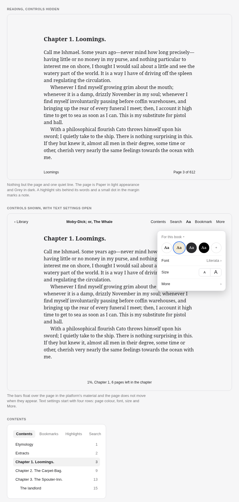
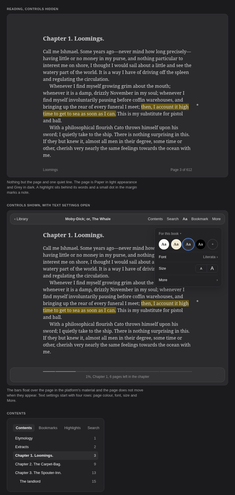

# Interface design: the reader

Part of [the interface design](interface.md). This page covers reading a book
of text: the page, the controls around it, the text settings, the contents and
highlights. It covers the core of
[READ-1 to READ-18](../requirements/04-reading.md#text). PDF pages, comics and
audio are listed [at the end](#not-designed-yet) and are not designed here.

[`interface-reader-sample.html`](interface-reader-sample.html) draws both
pictures. The frames are stand-ins.

## The idea

The library is where the reader chooses. The reader is where they stay, often
for hours. So it is the warmest place in the app and the plainest: a page of
text and nothing else until the reader asks.

- With the controls hidden, nothing is on screen but the page and, if the
  reader wants it, one quiet line at the foot.
- The controls are the platform's own, floating over the page in the platform's
  material: glass on Apple systems, the title bar and a command bar on Windows,
  a header bar on GNOME, app bars on Android.
- The page belongs to the book and the reader. The window's light or dark
  appearance sets only the default page colour.

## The page

| Part | Value |
|---|---|
| Line length | The text column aims for 60 to 70 characters at the reader's text size and is centred in the window. It never grows past 70 to fill a wide window. On a narrow screen or at a large text size it is as wide as the margins allow and the line is shorter. The text always reflows and is never clipped or scrolled sideways. |
| Columns | One. Two when the reader has turned two columns on and the window fits two columns of at least 60 characters. That is when two show; each column is still at most the line length above. The space between them is twice the side margin, 96 at the medium setting, so each column is as far from the next as the page's edge is from its first. Each column keeps the line length above, so in a wider window the pair is centred and the margins, and the space between the columns with them, grow. Never three. |
| Margins | At least 24 at each side on a phone and 48 elsewhere. The top and bottom margins are 1.5 times the side margin. The reader chooses narrow, medium or wide, which scale these by 0.75, 1 and 1.5. |
| Text | The book's own styles by default, in the reader's chosen font and size. Body text starts at 1.15 times the platform's body size with a line height of 1.5. |
| Alignment | Leading-aligned with a ragged trailing edge by default. Justified is a choice, and turns hyphenation on with it. |
| Paging | Pages by default. Continuous scrolling is a choice. |
| Foot line | One line at the foot, 16 above the bottom edge, in the caption size in the page's secondary colour: the chapter's name at the leading side and the place in the book at the trailing side. The reader can turn it off. It never shows the time or the battery. |

The page has no drawn edge, no shadow, no gutter shading and no page stack at
its side. On a wide window the page colour fills the window.

### Page colours

Four are built in. The reader can add their own.

| Name | Page | Text | Contrast | Secondary | Contrast | Default when the window is |
|---|---|---|---|---|---|---|
| White | `#ffffff` | `#1a1a1a` | 17.4:1 | `#767676` | 4.6:1 | |
| Paper | `#f4ecd8` | `#3b2f21` | 11.0:1 | `#736858` | 4.7:1 | Light |
| Grey | `#2b2b2e` | `#d6d6d8` | 9.7:1 | `#929294` | 4.5:1 | Dark |
| Black | `#000000` | `#c9c9c9` | 12.7:1 | `#797979` | 4.8:1 | |

- Secondary is the colour of everything on the page that is not the book's
  text: the foot line, the progress line and the note marker. For a page colour
  the reader made, it is the text colour mixed toward the page colour in sRGB,
  5% at a time, as far as it can go and still have 4.5:1 against the page.
- A page colour the reader makes is two colours, page and text, chosen with the
  platform's colour picker. The panel shows their contrast as a number and says
  in words when it is under 4.5:1. It does not stop the reader.

- Text on a dark page is off-white and not white. Full white on black glares in
  a dark room.
- A page colour can change by itself. The reader picks one for light and one
  for dark, and chooses whether the change follows the system's appearance or
  the time of day, with sunset to sunrise or two times they set.
- Links in the text are the text colour with an underline. They are never the
  accent colour, which would pull the eye across the page.
- An image in the book is shown as it is on every page colour. It is never
  inverted.
- Under More contrast, White becomes `#ffffff` with `#000000` and Black becomes
  `#000000` with `#ffffff`, and Paper and Grey are replaced by them.

### Fonts

- The font list is, in order: the book's own, then Literata, the platform's
  serif, the platform's sans serif, a face made for dyslexic readers, and any
  fonts the reader loaded.
- The default is Literata on every platform, so a book looks the same on each
  of the reader's devices. Its licence is checked under
  [LIC-1](../requirements/10-constraints.md#licences-of-parts).
- Size is a stepper with twelve steps from 0.8 to 2.5 times the default. The
  stepper shows a small and a large letter A and has no number.

## The controls

- The controls are hidden while reading. They appear on a tap or click in the
  middle third of the page, on any pointer movement to the top or bottom 64
  units of the window, on Escape, and on Tab. They hide on the next page turn,
  on a tap on the page, or after the pointer has been still over the page for
  three seconds.
- They never hide while the pointer is over them, while a menu or panel is
  open, or while one of them has keyboard focus. While a screen reader is
  running they do not hide at all. When they hide, focus returns to the page.
- Every control has a key, and the platform's own shortcut list shows them all:
  the Help menu on a Mac, the shortcuts window on GNOME, and a Keyboard
  shortcuts item in the menu elsewhere.
- A screen reader reads the book as one continuous text across pages and
  chapters. Turning the page for it is silent, and page numbers are not read
  out unless the reader asks where they are.
- They appear and leave with the platform's short fade. The page does not move
  or resize when they do, so the reader never loses their line.
- The top bar holds, from the leading side: back to the library, then the
  book's title in the UI font, then at the trailing side Contents, Search, Text
  settings, Bookmark, and a menu for the rest.
- The bottom bar holds the progress control: a line 2 units thick across the
  width of the text column, with the part read in the page's secondary colour and the
  rest in the text colour at 15%, and chapter marks as gaps of 2 units. Dragging along it shows the
  chapter and page under the pointer and moves there on release. With focus on
  it, the arrow keys move a page, Page Up and Page Down move a chapter, and Home
  and End go to the start and end. Its accessible value is the chapter and the
  page. Under it one line in the caption style says where the reader is, such as
  "62%, Chapter 12, 14 pages left in the chapter".
- Choosing that line opens the platform's popover with everything about the
  place: the percentage, the chapter, pages left in the chapter, time left in
  the chapter and in the book at the reader's own pace, and, when the book
  carries print page numbers, the page and the print edition they belong to.
- After a jump, Back to page 212 appears at the leading side of the bottom bar
  as a plain button and stays until the reader turns ten pages on.
- The bookmark control is the platform's bookmark symbol, filled when the page
  is bookmarked. A bookmarked page has no ribbon or corner fold drawn on it.

### Turning pages

- Tap or click the trailing quarter of the page for the next page and the
  leading quarter for the one before. Swipe on touch. The arrow keys, Space,
  and Page Up and Page Down do the same.
- In a book read right to left, the sides swap. The side follows the book and
  not the interface language.
- The turn is a slide of the whole page over the platform's standard duration.
  The reader can choose a cross-fade or none. There is no curl.
- In continuous scrolling a turn moves the text at once, whatever the reader
  chose for the page turn, and the setting's row says it applies in pages. In
  scrolling the reader moves the text themselves all the time, and three
  reviews each found another way an animated turn and that scrolling
  interfered. An animation designed against the reader's own scrolling is
  [#110](https://github.com/endqwerty/ebook-manager/issues/110).
- When the system asks for less motion the turn is none, whatever the reader
  chose.

## Text settings

Text settings open from the control marked with two letters A: the platform's
popover on a desktop or tablet and its bottom sheet on a phone. The page stays
visible behind, and every change shows on it at once.

The first level has four rows and nothing else.

1. Page colour: four round swatches, 36 across, each filled with its page
   colour and holding the letters Aa in its text colour. The chosen one has the
   platform's selection ring. Each has its name as its accessible name.
2. Font: the current font's name, opening the list.
3. Size: the stepper.
4. More: opens the second level.

The second level has font weight, line spacing, letter and word spacing,
margins, justification, hyphenation, columns, paged or scrolling, the page turn,
the foot line, when the page colour changes by itself, and Use the book's own
styles. After the four swatches on the first level a fifth, marked with a plus,
makes a page colour of the reader's own.

- At the top of both levels a line in the secondary colour says what the
  settings apply to, such as "For this book" or "For every book", with a menu to
  change it and Reset. This is the scope the requirements call for in READ-5.
  Until READ-5 is built there is one scope, so the line says "For every book"
  with no menu, and Reset is the last row of the second level.
- Each setting is the platform's own control: a stepper, a segmented control or
  a switch. There are no sliders, because a slider's value cannot be said back
  or repeated.

## Contents, bookmarks, highlights and search

- These four share one panel with the platform's segmented control at its top:
  Contents, Bookmarks, Highlights, Search. It is a sidebar at the leading edge
  on a wide window and a sheet on a narrow one.
- Contents is the book's table of contents as a list. A nested entry is
  indented by 16. The chapter being read is in the emphasised weight with the
  platform's selection. Page numbers, when the book has them, are at the
  trailing edge in tabular figures.
- When the book names landmarks, such as its cover, its start and its index,
  they are a short group above the table of contents under the header Go to.
- When the book carries a page list, a Go to page field is at the foot of
  Contents. It takes a page number as printed, including roman numerals.
- Highlights and Bookmarks use the highlight row from
  [the Highlights place](interface-screens.md#highlights), without the book's
  header.
- Search results are a list of passages with the matched words in the
  emphasised weight and the chapter's name under each in the secondary colour.
- Choosing a row moves the page there. On a narrow window the sheet closes.

## Highlights and notes on the page

- Selecting text shows the platform's own selection and its own menu, with
  Highlight, Note, Copy, Share and Look up in it. The app draws no menu.
- A highlight is a background behind the text with corners of 2 units. There
  are five colours and an underline. Each colour has a value for each page
  colour so the text stays readable.

| Colour | On White | On Paper | On Grey | On Black |
|---|---|---|---|---|
| Yellow | `#fbe58a` | `#eed684` | `#6b5a12` | `#5c4c00` |
| Green | `#bfe6b3` | `#b7d6a4` | `#2f5a2b` | `#1f4a1c` |
| Blue | `#b8d9f5` | `#b0cbe0` | `#28506e` | `#173f5e` |
| Pink | `#f7c4d4` | `#eab9c0` | `#6b2f45` | `#5a1f36` |
| Purple | `#dcc8f2` | `#d0bcdc` | `#4a3a6b` | `#3a2a5c` |

- The underline is 2 units in the text colour at 70%, 3 below the baseline.
- A passage with a note has a small filled circle, 6 across, in the margin at
  the trailing side of its first line. Choosing it
  opens the note in the platform's popover. The marker is in the page's secondary
  colour.
- A footnote opens in place in the platform's popover, or its sheet on a narrow
  window, set in the reader's font at the body size.

## Where the reader opens

- On a phone the reader takes the whole screen and the status bar hides with
  the controls.
- On a wide window the reader replaces the library in the same window, with
  back in the top bar. Open in new window is in the book's context menu, and is
  how two books sit side by side.
- A book opens at the place it was left, with the cover's travel described in
  [the base page](interface.md#motion). If another device read further, the
  platform's inline notice at the top of the page offers Go to page 212, and
  the page does not move until the reader says so.

## How the reader maps to a platform

| Part | Mac | iPhone and iPad | Windows 11 | GNOME | Android |
|---|---|---|---|---|---|
| Top controls | Toolbar that hides with the title bar in full screen | Navigation bar on glass | Title bar with a command bar under it | `AdwHeaderBar` in an `AdwToolbarView` with `reveal-top-bars`, and `extend-content-to-top-edge` so the page lies under the bar and does not move | Top app bar |
| Bottom controls | A glass bar at the foot | Toolbar at the foot on glass | A bar at the foot on the layer fill | A bottom bar in the same `AdwToolbarView`, with `reveal-bottom-bars` and `extend-content-to-bottom-edge` | Bottom app bar |
| Text settings | Popover | Sheet with detents on iPhone, popover on iPad | Flyout | Popover, `AdwBottomSheet` on a phone | Modal bottom sheet on a phone, a menu surface on a tablet |
| Contents panel | Sidebar of a `NavigationSplitView` | Sheet on iPhone, sidebar on iPad | `SplitView` pane | `AdwOverlaySplitView` sidebar | Modal navigation drawer, a pane from the expanded width up |
| Selection menu | The system's edit menu | The system's edit menu | The text control's context flyout | `GtkPopoverMenu` on the selection | The system's text toolbar |
| Note and footnote | Popover | Popover on iPad, sheet on iPhone | Flyout | `GtkPopover` | Bottom sheet |
| Full screen | The system's full screen | Always | F11 and the title bar's control | F11 and the header bar's control | Immersive mode |

## Decisions made without asking

1. **Paper is the default page in light appearance, not White.** White matches
   the rest of the system. Paper is the one warm surface in the app and the
   place where warmth costs nothing, because the frame is hidden.
2. **Literata is the default font on every platform.** The alternative is each
   platform's own serif. Reading the same book on a phone and a desk should
   look the same.
3. **Text is ragged right by default.** Justified text looks more like a
   printed book and, without good hyphenation, opens rivers of white space on a
   narrow screen.
4. **No page curl, page edge or book gutter.** They are the reader's version of
   a wooden shelf.
5. **Text settings show four rows first.** Every setting the requirements name
   is one level down.
6. **Links are not in the accent colour.** A page with blue words is a web
   page.
7. **No sliders in text settings.** Steppers and segments have values a reader
   can return to.

## Check on a device before relying on it

- How the highlight colours look on real screens. By calculation the text keeps
  at least 4.67:1 on every highlight on every page colour. The lowest is yellow
  on Grey.
- Whether each platform's web view lets the app add items to the system's
  selection menu, or the shell must supply its own.
- Whether the page stays still when bars appear over a web view on each
  platform, without the view resizing.
- Whether Literata covers the scripts the reader needs. A book in a script it
  lacks falls back to the platform's font for that script. Its licence is
  checked: the [SIL Open Font License 1.1](../requirements/10-constraints.md#licences-of-parts),
  with no reserved font name.

## Not designed yet

- PDF pages. The direction is the page shown whole on a neutral backdrop in the
  platform's secondary fill, with the cover's two-layer shadow under it, since a
  fixed page is an object in the way a cover is.
- Comics and manga, including panel view.
- The audio player and its place in the library window.
- Read aloud with highlighting.
- Two books side by side in one window.
- The reading ruler and line focus.
