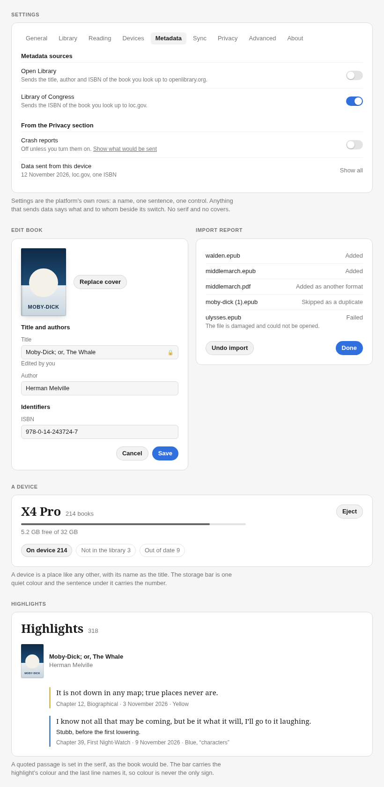
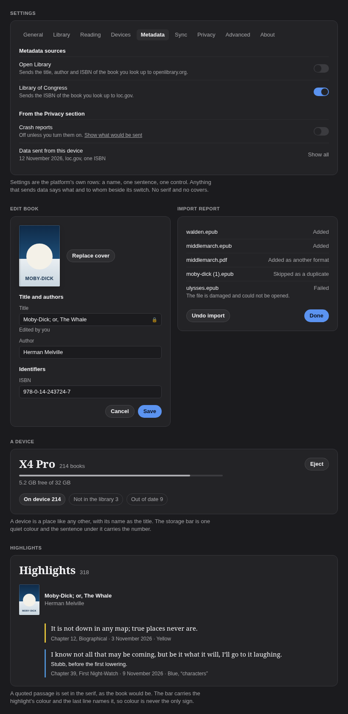

# Interface design: the other screens

Part of [the interface design](interface.md), whose rules apply to everything
here. [The ways to show books](interface-views.md) covers the grid, list, table
and shelf. This page covers every other screen outside the reader: search,
adding books, editing, devices, highlights, activity, settings and dialogs.

[`interface-screens-sample.html`](interface-screens-sample.html) draws both
pictures on plain surfaces. The frames around them are stand-ins.

## Rules for every screen here

These screens are for getting something done and then leaving. They are plainer
than the library.

- Forms, settings and dialogs are the platform's own, laid out the platform's
  way. They have no serif, no covers used as decoration and no custom drawing.
  Someone who knows the system's settings already knows these.
- A screen that is a place, with a name in the sidebar, has its title in the
  serif like any other place. A sheet, a dialog or a settings pane has the
  platform's own title.
- A change takes effect when it is made. There is no Save button in settings.
  A form that edits a book has the platform's confirm and cancel pair, because
  an edit to a book can be large and should be one step to undo.
- Offer undo before asking for confirmation. Ask only when the action cannot be
  undone, and say in the question what will be lost.
- A label is a noun or a short phrase. Help is one sentence under the control in
  the secondary colour. If a setting needs a paragraph to explain, the setting
  is wrong.
- Anything that sends data off the machine says so beside the control that turns
  it on: what is sent and to whom. This is
  [PRIV-1 to PRIV-4](../requirements/10-constraints.md#privacy).
- A result is said in words and never by colour alone. A failure names its
  cause and what the reader can do.

## Search

- Typing in the search field filters the place the reader is in at once, in the
  view they are in. It matches title, author, series and tags. Nothing new
  opens.
- The screen title stays, and a line under it in the secondary colour says what
  is shown, such as "12 books match melville".
- A scope control appears under the field while it has text, with This place
  and Whole library. It is the platform's scope bar or segmented control.
- When the field has two or more words, the platform's suggestion list offers
  matching authors, series and tags as tokens. Choosing one turns the word into
  a token in the field.
- Search inside books is a third scope, Text of books. Its results are a list.
  Each row is a book's small cover, its title, and under it up to three passages
  with the matched words in the emphasised weight and the chapter's name in the
  secondary colour. The passage is in the UI font, because it is a result and
  not a page.
- Above those results a line says how much of the library is indexed, such as
  "Searched the text of 1,102 of 1,284 books".
- Escape clears the field and returns the place to what it showed.

## Adding books

- Add opens the platform's file picker at once. Beside it a menu offers Add
  folder and Import a library from another app. Dropping files on the window
  does the same as picking them.
- The import runs in the background. The books appear in the library as they
  are added. Nothing covers the window.
- While any job runs, an activity control is in the bar: the platform's small
  progress indicator. Choosing it opens a popover that lists each job on a row,
  with its name, a progress bar, how many items are done, and Pause and Cancel.
  With no job running the control is absent.
- When an import ends with nothing wrong, nothing is shown. When some files need
  the reader, the activity popover keeps a row saying so, such as "3 files need
  attention", and Needs attention appears in the sidebar's Library group with
  its count. It is absent at zero.
- The import report is a list of files with one word of result each in the
  secondary colour: Added, Added as another format, Skipped as a duplicate, or
  Failed. A failed row has its reason under the file's name. The report's one
  prominent action is Done. Undo import is a plain button at the leading end.
- When a file looks like a new version of a book already in the library, the
  platform's sheet shows the two side by side, each with its cover, title,
  format, size and date. The choices are Keep both, Replace and Skip, with
  Apply to all as a checkbox. No choice is the default.
- Needs attention is a place shown as a list. Each row's third line is the
  reason, such as "No title found in the file".

## Editing a book

- Edit opens the platform's form: an inspector or sheet on a wide window and a
  full page on a narrow one. Its title is Edit book.
- The cover is at the top at the leading edge, 128 wide, with Replace cover as a
  plain button beside it. The fields follow in groups with the platform's group
  headers: Title and authors, Series, Publication, Tags, Identifiers, Description.
- A field's label is above it or at its leading side, wherever the platform's
  forms put labels. Fields are the platform's width. Do not right-align values.
- A field the reader has edited is locked against later fetches. A locked field
  has the platform's lock symbol inside its trailing end in the secondary
  colour. Choosing the symbol unlocks it. The symbol has a tooltip and an
  accessible name, Locked.
- Where a value came from is shown under the focused field in the secondary
  colour, such as "From the file" or "Edited by you". It is shown for one field
  at a time so the form stays quiet.
- A value that is not valid, such as an ISBN with a wrong check digit, gets the
  platform's field error with a sentence saying what is wrong. The form can
  still be saved.
- Editing several books shows only the fields that can be set for all of them.
  A field whose values differ shows "Several values" as its placeholder. Before
  the change is made, a preview lists each book with the old and the new value
  side by side, the new one in the emphasised weight. The prominent action is
  Change, with the number of books, and the change can be undone.

## A device

- A connected device is a place in the sidebar under Devices. Its screen title
  is the device's name.
- Under the title a storage line shows how full the device is: a bar 4 units
  thick as wide as the content, up to 480, with the used part in the secondary
  label colour and the rest in the separator colour, and under it a sentence
  such as "5.2 GB free of 32 GB". It is not coloured by how full it is. When
  under 5% is free the sentence says so in words.
- The device's books show in the same four views as any place. A filter at the
  top offers On device, Not in the library, and Out of date, each with a count.
- Sending starts from the books: select them anywhere and choose Send to
  device. The device's own screen has no prominent action. Eject is a plain
  button in the bar, and after a transfer the app reminds the reader to eject
  with the platform's inline notice.
- Before a transfer the platform's sheet lists what will be written: each book,
  the format it will be sent in, and its size, with the total and the free space
  at the foot. A book that will not fit or cannot be sent is listed apart with
  its reason. The prominent action is Send, with the number of books.
- Sending shows as a job in the activity popover. Each book in the device's
  list has a small progress indicator in its trailing slot until it is written.
- A device's settings, its profile, open from a plain button on its screen and
  follow the settings rules below.

## Highlights

- Highlights is a place in the sidebar. It lists every highlight, note and
  bookmark from every book, grouped by book and ordered by where they fall in
  the book.
- A group starts with the book's small cover, title and author, as a list row.
- A highlight is the quoted passage in the serif, in the body size, on up to six
  lines and then an ellipsis. This is the one place the library window shows a
  book's own words, so it is set as the book would be.
- A bar 3 units wide runs down the passage's leading edge in the highlight's
  colour. The colour's name, or the meaning the reader gave it, is in the line
  under the passage, so colour is never the only sign.
- A note the reader wrote is under the passage in the UI font, body style.
- The last line is in the caption style and secondary colour: the chapter, the
  date, and the colour's name.
- 16 separates one highlight from the next, with no rule between them. 28
  separates one book's group from the next.
- Choosing a highlight opens the book at that passage.
- The filter offers book, colour, tag, date and source. Export is a plain
  button in the bar.

## Settings

Settings use the container each platform gives its own settings, and nothing
about them is designed here beyond their order and words.

| Section | What is in it |
|---|---|
| General | Appearance on Linux. The view a new place starts in. Cover size. Language. |
| Library | Where the library is kept. Watched folders. What to do with a duplicate. Backups and restore. |
| Reading | The defaults the reader starts every book with. These are the reader's own settings and open the same panel. |
| Devices | A profile for each device the app has seen: formats, folders and file names. |
| Metadata | Sources, all off until turned on. Each row names the service and what is sent to it. |
| Sync | Which devices share this library. Off until set up. |
| Privacy | A list of every time data left the machine, with when, to which service and what kind of data. Crash reports, off by default, with a button that shows what would be sent. |
| Advanced | The index, the cache and the log. Things most readers never open. |
| About | The app's name, version, licence and the licences of its parts. |

- Sections are in this order on every platform. A section with nothing to
  offer on a platform is absent there.
- A setting is one row: its name, at most one sentence of help, and one
  control. A setting with choices that need explaining opens a second level.
- Switches say what is on when they are on. Avoid a switch whose label is a
  negative.
- Destructive actions, such as Delete the search index, are in Advanced, last
  in their group, in the platform's destructive style, and ask first.
- The Privacy list is the plainest screen in the app: a table of date, service
  and kind of data, newest first, with the sentence "Nothing has left this
  device." when it is empty.
- About shows the app's name in the serif. It is the one serif in Settings.

## Dialogs and messages

- A dialog is the platform's alert. Its title is a question naming the action
  and the thing, such as "Remove Moby-Dick from the library?". Its message says
  what happens to the file: "The file stays on this device." or "The file will
  be moved to the bin."
- Buttons are verbs: Remove and Cancel, never Yes and No or OK. The destructive
  one has the platform's destructive style. The safe one is the default for
  Return and Escape.
- Removing books from the library does not ask when the files stay. It shows
  the platform's undo, and the books go back where they were.
- A problem that needs a decision uses the inline notice named in
  [the base page's platform table](interface.md#how-each-rule-maps-to-a-platform).
  It says what happened, what the choices are, and stays until answered.
- A problem with one book shows on that book: in the list's third line, in book
  details under the title, and in Needs attention. It does not raise a dialog.

## First run

- There is no welcome tour, no sign-in and no permission asked before it is
  needed. The app opens on the empty library: "No books yet", the sentence, and
  Add.
- Under Add, a plain link offers "Import a library from another app". This is
  the one empty state with a second action.
- The first time a feature needs something from the reader, such as a folder
  grant or turning on a metadata source, it asks then, in place, and says why.

## How each screen maps to a platform

| Screen | Mac | iPhone and iPad | Windows 11 | GNOME | Android |
|---|---|---|---|---|---|
| Settings | A Settings window with a toolbar of sections, opened from the app menu | A sheet with a grouped `Form`, opened from the Library tab's menu | A page reached from the foot of `NavigationView`, with settings cards and expanders | `AdwPreferencesDialog` with pages, groups and rows | A full screen list with sub-screens |
| Setting row | `Form` rows with `LabeledContent` | `Form` rows | A settings card: name, description, control at the trailing end | `AdwSwitchRow`, `AdwComboRow`, `AdwActionRow` | List item with a trailing switch |
| Edit book | Sheet, or the inspector on a wide window | Sheet with a `Form` | A page in the content area, or `ContentDialog` for a short edit | `AdwDialog` with a preferences page | Full screen dialog |
| Confirm and cancel | Done and Cancel at the foot of the sheet | Done and Cancel in the navigation bar | Save and Cancel at the foot | Apply and Cancel in the header bar | Save in the top app bar, back to cancel |
| Activity | Toolbar item with a popover | Toolbar item with a popover on iPad, a sheet on iPhone | Title bar item with a flyout | Header bar button with a popover | Top app bar action with a bottom sheet |
| Duplicate and send sheets | Sheet | Sheet | `ContentDialog` | `AdwDialog` | Modal bottom sheet |
| Alert | `alert` | `alert` | `ContentDialog` | `AdwAlertDialog` | `AlertDialog` |
| Undo after removing | Edit menu's Undo | A shake or the three-finger gesture, and Undo in the toolbar's menu | `InfoBar` with Undo | `AdwToast` with Undo | Snackbar with Undo |
| Scope under search | Scope bar | `searchScopes` | Segmented control under the box | Toggle buttons under the search bar | Filter chips |

Undo after removing is the one message that dismisses itself. It offers a way
back and does not ask for a decision, so it does not conflict with the rule that
a decision stays until answered.

## Decisions made without asking

1. **Settings have no design of their own.** A themed settings screen would
   carry the library feel further and would be the first screen to look foreign
   on every platform.
2. **A finished import says nothing.** Carried from the base page. The report
   exists and is one click away in the activity popover.
3. **Quoted passages are in the serif.** This is the fifth and last place the
   serif appears. A highlight is the book's words and looks like them.
4. **The storage bar has no warning colour.** A red bar is the loudest thing a
   quiet window could show. The sentence says when space is short.
5. **No welcome tour.** The empty library with one button is the tour.

## Check on a device before relying on it

- Whether Windows has a first-party settings card control in the current
  Windows App SDK or only in the Windows Community Toolkit, and that toolkit's
  licence if so.
- Whether `AdwPreferencesDialog` suits nine sections or needs its search.
- How undo is offered after a removal on iPhone, where there is no menu bar.
- Whether the platform lock symbol inside a text field is reachable by keyboard
  and screen reader on each platform.
