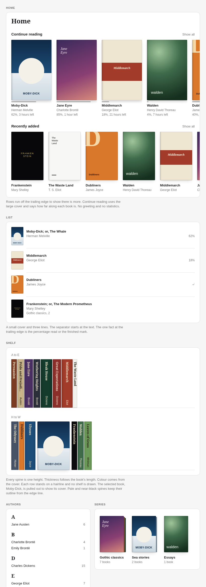

# Interface design: the ways to show books

Part of [the interface design](interface.md), whose rules for covers, type,
colour, shadows and motion apply to everything here. This page says how the same
books are shown as a grid, a list, a table and a shelf of spines, and how the
home screen and the author and series indexes are laid out. It covers
[LIB-20 to LIB-26](../requirements/01-library.md#finding-and-viewing).

[`interface-views-sample.html`](interface-views-sample.html) draws both
pictures. Its covers and spines are drawn stand-ins and not real artwork.

## Which view where

A place in the sidebar shows its books in one of four views. The reader picks,
and each place remembers its own view and sort.

| View | Best for | Offered on | Default for |
|---|---|---|---|
| Grid | Recognising a book by its cover | Everything | All books, collections, an author's or a series' books |
| List | Reading titles, on a narrow screen or at large text sizes | Everything | Needs attention, search results inside books |
| Table | Sorting and comparing many books by their facts | Windows at least 640 wide. Not on phones. | Nothing. The reader turns it on. |
| Shelf | Browsing a long run of books at a glance | Everything | Nothing. The reader turns it on. |

- When the system's text scale is 1.5 or more, a place set to Grid shows List
  instead, without changing the reader's setting.
- The grid is in [the base page](interface.md#covers). The other three are below.

## The controls above the books

These sit in the platform's bar, not in the content.

- **View.** One control with four choices, each an icon from the platform's set
  with its name as the tooltip and accessible name: Grid, List, Table, Shelf. Use
  the platform's segmented control where the bar has room and a menu where it
  has not. A choice the device does not offer is absent, not greyed.
- **Sort.** A menu beside View. It lists Title, Author, Series, Date added, Date
  published and Last read, then Ascending and Descending. The current choice has
  the platform's check mark. A second and third sort key are set in the table's
  headers.
- **Cover size.** Small, Medium and Large are in the View menu, not on a slider
  in the bar. They set the grid's cover width, the list's thumbnail and the
  shelf's spine height together.
- **Filter.** A button that opens the platform's popover on a wide window and its
  sheet on a narrow one, listing the facets with counts: author, series, tag,
  language, format, rating, reading status, source and device.
- A filter that is on shows as a row of the platform's removable tokens between
  the screen title and the books, starting at the leading edge, with Clear at
  the end of the row. The row is absent when no filter is on.

The order in the bar, from the leading side, is View, Sort, Filter, then
search and Add where the platform puts them.

## Home

Home is the first place in the sidebar. It shows what the reader is likely to
want next and nothing they have to manage.

- Home has up to three kinds of row, in this order: Continue reading, Recently
  added, then one row for each collection the reader pinned. A row with no books
  is left out. A library with no books shows the empty library state and no rows.
- A row is one line of covers that does not wrap, starting at the leading edge
  and running off the trailing edge to show there is more. It scrolls sideways
  on its own. On a pointer platform it moves with the scroll wheel and with the
  platform's paging buttons.
- Each row has a header: its name in the platform's third title style at the
  leading edge, and Show all at the trailing edge as a plain button. Show all
  goes to that place.
- Continue reading uses the large cover width, 160, and puts the progress line
  under each cover as the grid does. Its caption has a third line in the
  secondary colour saying how far the reader is, such as "62%, 3 hours left".
  It holds at most eight books, most recently read first.
- The other rows use the medium width, 128, with the grid's caption. Recently
  added holds the last twenty books.
- 28 separates a row's header from the row above and 12 separates it from its
  covers.
- Home has no greeting, no statistics and no suggestions from outside the
  library.

## List

A list row is a small cover and three lines of text. It is the platform's list
control with its own row background, separators, selection and swipe actions.

| Part | Value |
|---|---|
| Thumbnail | A 2:3 frame at the leading edge. 40 wide at the small size, 48 at medium and 60 at large. Corners of 2, the edge line and the contact shadow. No ambient shadow and no spine shade. |
| Row height | The thumbnail's height plus 12 above and below. |
| Text | 12 after the thumbnail. Line one is the title in the emphasised body style, on one line. Line two is the author in the body style, secondary colour. Line three is the series and the book's number in it, in the caption style, secondary colour, and is blank when the book has no series. |
| Trailing | One short fact in the caption style, secondary colour, in tabular figures: the percentage read for a book being read, a check mark for a finished one, and nothing otherwise. Then the platform's disclosure mark where its lists use one. |
| Separator | The platform's, starting at the text's leading edge and not under the thumbnail. |
| Progress | No line. The percentage at the trailing edge says it. |

- The three lines are centred against the thumbnail as a block.
- Sorting by a field that is not shown puts that field in the trailing slot. A
  list sorted by date added shows the date there.
- On touch, a swipe from the trailing edge offers Send to device, then Remove in
  the destructive style.

## Table

- The table is the platform's table control with its own headers, sort
  indicator, row height and selection.
- The reader chooses the columns from a menu on the header row and drags a
  header to reorder. The first set is Title, Author, Series, Added and Progress.
  Title cannot be removed.
- Title is in the emphasised body style and the rest are in the body style in
  the secondary label colour, so the title is what the eye finds in a row.
- Title carries a small cover at its leading edge, 2:3, as tall as the row less
  8 units, with the edge line, corners of 1 unit and no shadow or spine shade.
- Text columns align to the leading edge and number columns to the trailing
  edge. Dates count as text. Numbers and dates use tabular figures.
- Progress is a percentage, empty for an unread book and a check mark for a
  finished one.
- A click on a header sorts by it. A click with the platform's add-to-selection
  key makes it the second key, and the header shows a small 2.
- A column's width is remembered. A cell that does not fit is truncated at the
  end and shows whole in a tooltip.

## Shelf

The shelf shows books by their spines, standing in rows. It is the one place the
app draws a book from the side. It follows the same restraint as a cover: flat
colour, type and a hairline, with no wood and no texture.

| Part | Value |
|---|---|
| Height | Every spine in the view is the same height: 144 at the small size, 192 at medium and 240 at large. |
| Thickness | From the book's length, so a long book looks long: 16 plus one unit for each 12,000 words, between 16 and 48. A book of unknown length is 24. |
| Colour | The catalogue stores a spine colour for each book at import: the most common colour on the cover's leading tenth, or failing that on the whole cover. A book with no cover image uses its binding colour. |
| Type colour | `#f1e6cc` or `#23190a`, whichever has the higher contrast with the spine colour. If neither reaches 4.5:1, darken or lighten the spine colour in steps of 5% until one does. |
| Title | Runs down the spine from the top, turned a quarter turn clockwise, in the serif, semibold, 12 units, starting 10 from the top. One line, truncated at the end. Chinese, Japanese and Korean titles are set upright, one character under the next. |
| Author | The family name only, at the foot, 10 from the bottom, in the UI font at 10 units, turned the same way. Left out when the spine is under 24 thick or the title needs the room. |
| Edge | The cover's edge line, inside the spine's outline. |
| Round | A shade across the spine to suggest its curve: black at 10% on both long edges fading to nothing by a quarter of the thickness. Left out under 20 thick. |
| Corners | 1 unit at the top. Square at the foot, where the spine stands. |
| Gap | 2 between spines. |
| Line | Each row stands on a hairline in the platform's separator colour, as wide as the content. The row casts the cover's contact shadow onto it and no ambient shadow. |
| Rows | Spines fill a row from the leading edge and wrap. 28 separates a row's line from the next row's tops. |

- The type on a spine is artwork, like the type on a binding, and does not count
  as one of the interface's serif roles.
- A row never justifies. Space left at the trailing end stays empty, as on a
  shelf that is not full.
- When the sort has groups, such as an author's initial or a series, a new group
  starts a new row. Its name sits above the row at the leading edge in the
  caption style and secondary colour.
- Pointer over a spine: it rises 2 units, as a cover does, and a tooltip gives
  the title and author.
- Selecting a spine pulls the book out: the spine is replaced in place by the
  book's cover at the spine's height, facing out, and the spines after it move
  along. The cover has its usual shadow. Selecting another book puts the first
  back. With several books selected, each shows its cover.
- The pull animates the width from spine to cover with the platform's layout
  animation. When the system asks for less motion it cross-fades.
- Keyboard focus uses the collection control's focus ring around the spine.
- Opening works as in the grid: a double click or Return opens the reader, and a
  tap opens book details.
- Reading state is not drawn on a spine. It is in the tooltip, in book details
  and in the accessible name, which reads the title, the author and the state.
- Under More contrast the round shade, the edge line and the shadow are removed
  and each spine gets a 1 unit outline in the primary text colour.
- The shelf uses the system's text scale for nothing. Spine type is a fixed
  size, so the shelf is not the view for large text. At a text scale of 1.5 or
  more a place set to Shelf shows List, as Grid does.

## Authors and Series

Authors and Series are indexes: lists of names that lead to books.

### Authors

- An alphabetical list in one column on a narrow window and in as many columns
  as fit at 240 wide each on a wide one, filled down and then across.
- Each letter that has authors starts with the letter alone, in the serif, in
  the platform's second title style, at the leading edge with 20 above and 8
  below. A script without an alphabet groups by its own convention, such as kana
  rows for Japanese.
- A row is the author's name as the reader would say it, in the body style, and
  the number of their books at the trailing edge in tabular figures in the
  secondary colour. Rows are ordered by the name's sort form, so Herman Melville
  is under M.
- A row has no picture, no icon and no separator. The letters and the space do
  the grouping.
- On touch the platform's index strip runs down the trailing edge where the
  platform has one.
- Choosing an author shows their books in that place's own view, with the
  author's name as the screen title.

### Series

- A grid at the cover sizes. Each series is drawn as a stack: the cover of its
  first book in front, and behind it the edges of two more frames, each 4 units
  further toward the trailing side and 4 units lower at the top. The frames
  behind take the next two books' average colours and have the edge line. A
  series of one book has no frames behind, and one of two books has one.
- The stack's shadow is the cover's, cast by the front frame only.
- The caption is the series' name in the emphasised body style and the number
  of books in the secondary colour, such as "7 books".
- Choosing a series shows its books in order, with the series' name as the
  screen title. In the grid each caption starts with the book's number in the
  series in the secondary colour and tabular figures, then the title. In the
  list and the table the number is its own column.
- A number that is not a whole number, such as 1.5 or TPB1, is shown as stored.

### Collections on a phone

On a wide window collections are rows in the sidebar. On a phone they are a list
of their own. A row is three small covers overlapping by half at the leading
edge, 32 wide each, then the collection's name in the emphasised body style and
its number of books in the secondary colour. A smart collection has the
platform's gear or filter symbol after its name.

## How each view maps to a platform

| View | Mac | iPhone and iPad | Windows 11 | GNOME | Android |
|---|---|---|---|---|---|
| View control | Segmented control in the toolbar | A menu in the navigation bar | `SelectorBar` or segmented control in the header row | Linked toggle buttons in the header bar, a menu on a narrow window | A menu in the top app bar |
| Home rows | Horizontal collection view sections | `ScrollView(.horizontal)` rows | Horizontal `ItemsView` | `GtkListView` set horizontal in a `GtkScrolledWindow` | `LazyRow` |
| List | `List` | `List` | `ListView` | `GtkListView` with `.navigation-sidebar` left off | `LazyColumn` with list items |
| Table | `Table` | `Table` on iPad | `ListView` with column headers | `GtkColumnView` | Not offered |
| Shelf | AppKit collection view with a flow layout | UIKit collection view with a flow layout | `ItemsView` with a flow layout | `GtkFlowBox` for small places, a custom layout over a list model for large ones | `FlowRow` in a lazy column, one row per shelf |
| Filter | Popover from the toolbar | Sheet | Flyout | Popover, a bottom sheet on a narrow window | Modal bottom sheet |
| Filter tokens | Token field style buttons | The same | Removable buttons | Removable pill buttons | Input chips |
| Index strip for authors | None | `List` section index | None | None | None |

Sideways text on a spine is drawn by rotating a label on every platform. The
shelf with a hundred thousand books must meet
[LIB-71](../requirements/01-library.md#speed), so each shell uses a layout that
creates spines only for the rows on screen.

## Decisions made without asking

1. **Spines are all one height and vary only in thickness.** Different heights
   look more like a real shelf. They were turned down for the same reason covers
   became one size: unevenness that a reader of digital books has no reason for.
   Thickness stays because it carries a fact, the book's length.
2. **A selected spine turns to show its cover.** The alternative is a selection
   ring around the spine. Showing the cover answers the question a spine raises,
   which book is this, at the moment the reader asks it.
3. **The shelf stands on a hairline, with no shelf drawn.** A drawn board, even
   a flat one, is the first step toward decoration.
4. **Index letters are in the serif.** This adds a fourth place for the serif
   in the library window. A letter standing alone is the plainest library cue
   there is.
5. **Home has no statistics or greeting.** Reading statistics have their own
   requirements and will get their own place.
6. **No slider for cover size.** Three sizes in a menu keep the bar quiet and
   keep rows from landing on awkward widths.

## Check on a device before relying on it

- Whether each platform's collection control can lay out spines of different
  widths in wrapping rows and still create only the visible ones. WinUI's
  `ItemsView` takes custom layouts. GTK has no built-in virtualised flow layout.
- How sideways text is read by each screen reader. The accessible name should be
  read and the rotation ignored.
- Whether `SelectorBar` suits four icon-only choices on Windows.
- Whether a title set upright in Chinese, Japanese or Korean is laid out by the
  platform's text system or needs the shell to place each character.
