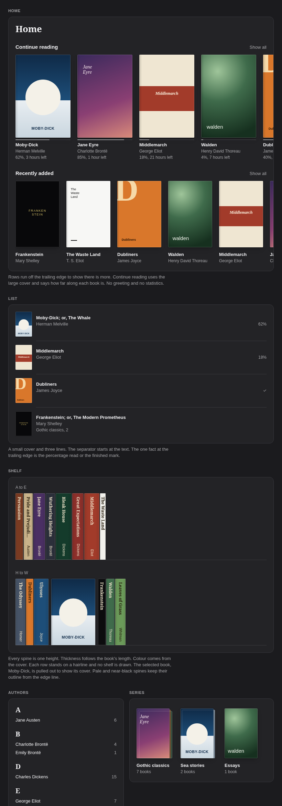

# Interface design: the ways to show books

Part of [the interface design](interface.md), whose rules for covers, type,
colour, shadows and motion apply to everything here. This page says how the same
books are shown as a grid, a list, a table and a shelf of spines, and how the
home screen and the author and series indexes are laid out. It covers
[LIB-20 to LIB-26](../requirements/01-library.md#finding-and-viewing).

[`interface-views-sample.html`](interface-views-sample.html) draws both
pictures. Its covers and spines are drawn stand-ins and not real artwork.

## Which view where

A place in the sidebar shows its books in one of four views. The reader picks.
Each place remembers its view, and remembers a sort for each view.

| View | Best for | Offered on | Default for |
|---|---|---|---|
| Grid | Recognising a book by its cover | Everything | All books, collections, an author's or a series' books |
| List | Reading titles, on a narrow screen or at large text sizes | Everything | Needs attention, search results inside books |
| Table | Sorting and comparing many books by their facts | Any window at least 640 wide, on every platform. Not on a narrower one. | Nothing. The reader turns it on. |
| Shelf | Browsing a long run of books at a glance | Everything | Nothing. The reader turns it on. |

- When the system's text scale is 1.5 or more, a place set to Grid shows List
  instead, without changing the reader's setting.
- The grid is in [the base page](interface.md#covers). The other three are below.

## The controls above the books

These sit in the platform's bar, not in the content.

- **View.** One control with four choices, each an icon from the platform's set
  with its name as the tooltip and accessible name: Grid, List, Table, Shelf. Use
  the platform's segmented control where the bar has room and a menu where it
  has not. A choice the device does not offer is absent, not greyed.
- **Sort.** A menu beside View. It lists Title, Author, Series, Date added, Date
  published and Last read, then Ascending and Descending, then More. The current
  choice has the platform's check mark. More opens the sort editor: three rows,
  each a field chosen from every field the library has and a direction. It is
  the platform's popover or sheet, works by keyboard and touch, and is the way
  to set a second and third key on a phone.
- **Cover size.** Small, Medium and Large are in the View menu, not on a slider
  in the bar. They set the grid's cover width, the list's thumbnail and the
  shelf's spine height together.
- **Filter.** A button that opens the platform's popover on a desktop or tablet
  and its sheet on a phone, listing the facets with counts: author, series, tag,
  language, format, rating, reading status, source, device and accessibility.
  Accessibility lists the plain statements a book's own metadata makes, such as
  "Has image descriptions", which
  [READ-73](../requirements/04-reading.md#access) requires.
- A filter that is on shows as a row of the platform's removable tokens between
  the screen title and the books, starting at the leading edge, with Clear at
  the end of the row. The row is absent when no filter is on.

The order in the bar, from the leading side, is View, Sort, Filter, then
search and Add where the platform puts them.

## Home

Home is the first place in the sidebar. It shows what the reader is likely to
want next and nothing they have to manage.

- Home has up to three kinds of row, in this order: Continue reading, Recently
  added, then one row for each collection the reader pinned. A row with no books
  is left out. A library with no books shows the empty library state and no rows.
- A row is one line of covers that does not wrap, starting at the leading edge
  and running off the trailing edge to show there is more. It scrolls sideways
  on its own. On a pointer platform it moves with the scroll wheel and with the
  platform's paging buttons.
- Each row has a header: its name in the platform's third title style at the
  leading edge, and Show all at the trailing edge as a plain button. Show all
  goes to that place.
- Continue reading uses the large cover width, 160, and puts the progress line
  under each cover as the grid does. Its caption has a third line in the
  secondary colour saying how far the reader is, such as "62%, 3 hours left".
  It holds at most eight books, most recently read first.
- The other rows use the medium width, 128, with the grid's caption. Recently
  added holds the last twenty books.
- 28 separates a row's header from the row above and 12 separates it from its
  covers.
- Home has no greeting, no statistics and no suggestions from outside the
  library.

## List

A list row is a small cover and three lines of text. It is the platform's list
control with its own row background, separators, selection and swipe actions.

| Part | Value |
|---|---|
| Thumbnail | A 2:3 frame at the leading edge. 40 wide at the small size, 48 at medium and 60 at large. Corners of 2, the edge line and the contact shadow. No ambient shadow and no spine shade. |
| Row height | The taller of the thumbnail and the three lines of text, plus 12 above and below. The row grows with the system's text size and the text is never clipped. |
| Text | 12 after the thumbnail. Line one is the title in the emphasised body style, on one line. Line two is the author in the body style, secondary colour. Line three is the series and the book's number in it, in the caption style, secondary colour, and is blank when the book has no series. |
| Trailing | One short fact in the caption style, secondary colour, in tabular figures: the percentage read for a book being read, a check mark for a finished one, and nothing otherwise. Then the platform's disclosure mark where its lists use one. |
| Separator | The platform's, starting at the text's leading edge and not under the thumbnail. |
| Progress | No line. The percentage at the trailing edge says it. |

- The three lines are centred against the thumbnail as a block.
- Sorting by a field that is not shown puts that field in the trailing slot. A
  list sorted by date added shows the date there.
- On touch, a swipe from the trailing edge offers Send to device, then Remove in
  the destructive style.

## Table

- The table is the platform's table control with its own headers, sort
  indicator, row height and selection.
- The reader chooses the columns from a menu on the header row. A header can be
  dragged to reorder, and its menu has Move toward the start and Move toward the
  end so the keyboard can do the same. The first set is Title, Author, Series,
  Added and Progress. Title cannot be removed.
- Title is in the emphasised body style and the rest are in the body style in
  the secondary label colour, so the title is what the eye finds in a row.
- Title carries a small cover at its leading edge, 2:3, as tall as the row less
  8 units, with the edge line, corners of 1 unit and no shadow or spine shade.
- Text columns align to the leading edge and number columns to the trailing
  edge. Dates count as text. Numbers and dates use tabular figures.
- Progress is a percentage, empty for an unread book and a check mark for a
  finished one.
- A click on a header, or Return with the header focused, sorts by it. A click
  with the platform's add-to-selection key adds it as the next key, up to
  three, and each such header shows a small 2 or 3. The sort editor sets the
  same keys.
- A column's width is remembered. A cell that does not fit is truncated at the
  end and shows whole in a tooltip.

## Shelf

The shelf shows books by their spines, standing in rows on shelves. It is the one
view meant to look like the real thing: the books have rounded spines, bands and
labels, they stand on a board with depth, and a selected book tips out from the
top as if a finger had hooked it. The books are bound in a soft cloth like
velvet, and the shelf is a recess with a back, sides in shadow and a board with
a top and a front. The realism comes from shape, light, shadow and one fine
cloth grain. There is no wood grain and no picture of any material, and every
colour has a value for light and for dark.

This look is the one to build ([LIB-29](../requirements/01-library.md#finding-and-viewing)).
The picture at the top of this page shows it in light and dark. The file
[`interface-views-sample.html`](interface-views-sample.html) draws it with CSS
gradients, one transform and one generated noise tile, and a shell can read the
exact values there. Where the sample and this table differ, the table is right.
The Linux shell draws it.

| Part | Value |
|---|---|
| Height | Every spine in the view is the same height: 144 at the small size, 192 at medium and 240 at large. |
| Thickness | From the book's length, so a long book looks long: 16 plus one unit for each 12,000 words, rounded to the nearest whole unit and never over 48. A book of 96,000 words is 24 and one of 384,000 or more is 48. A book of unknown length is 24, a middle value. The shelf does not mark it as unknown. |
| Colour | The catalogue stores a spine colour for each book at import: the most common colour on the cover's leading tenth, or failing that on the whole cover. A book with no cover image uses its binding colour. |
| Stamping | The type is pressed into the cloth. Light type has a line of black at 40% one unit below it, and dark type a line of white at 30%. Bands and labels have the same. |
| Type colour | `#f1e6cc` or `#23190a`, whichever has the higher contrast with the spine colour. If that is under 4.5:1, change the spine colour and keep the type: mix the spine colour toward white when the type is `#23190a` and toward black when it is `#f1e6cc`, in sRGB, 5% at a time, and stop at the first step that reaches 4.5:1. A spine of `#808080` takes `#23190a` at 4.38:1, so it becomes `#868686` at 4.77:1. |
| Title | One line in the serif, semibold, 12 units, laid out by the platform's text system in the title's own direction and then turned a quarter turn clockwise, so a left-to-right title reads from the top of the spine down. It starts 10 from the top. It is truncated with an ellipsis at the end of the title in reading order. A right-to-left title is laid out right to left before the turn, so it too begins at the top. Where the platform has vertical text layout, a Chinese, Japanese or Korean title uses it, with its characters upright and any Latin run turned. Where it has not, the title is turned like any other. |
| Author | The family name only, at the foot, 10 from the bottom, in the UI font at 10 units, turned the same way. Left out when the spine is under 24 thick, or when the title, the name and 24 between them do not fit the height. The title is truncated only after the author is gone. |
| Edge | The cover's edge line, inside the spine's outline. |
| Viewpoint | The shelf is seen from a little above eye level, so every book shows the top of its pages and the board shows its top surface. This is what lets a tipped book look right: it shows more of a top that every book already shows. |
| Top | Above each spine's top edge, a strip 4 units tall: the top of the book, going away from the reader. It is as wide as the spine at its near edge and 12% narrower at its far edge, centred. The outer 2 units at each side are the boards, in the spine colour darkened by 25%. Between them are the pages, `#ece5d6` in light appearance and `#bfb8a9` in dark, with lines of the same colour darkened by 18% every 3 units. |
| Cloth | Spines are bound in a soft cloth with a nap, like velvet. Velvet is darkest where it faces the reader and catches light where it curves away. Across the thickness, from one long edge to the other: black at 30% at the edge, white at 14% at 14% of the way, black at 6% at 38%, black at 10% in the middle, and the same mirrored. Down the height: white at 6% at the top fading to nothing at 40%, then to black at 8% at the foot. |
| Grain | Over the cloth, a fine even noise: a square tile 128 units across of monochrome noise with features about 1 unit wide, made once from a fixed seed, blended in overlay at 35%. It is the one texture in the app. It is made by the shell and is not a picture of any material. |
| Head and tail | A shade of black at 12% over the top 6 units and the bottom 6, fading toward the middle, where a spine turns over at its ends. |
| Bands | Each book has one of three spine styles, chosen by the same hash that picks a binding colour, taken modulo 3. Plain: nothing more. Banded: two rules 1 unit thick across the spine in the type colour at 45%, 8 and 12 from the top, and two more the same distances from the foot. Labelled: the title sits on a label, a block in the type colour with the spine colour as its type, 6 in from each long edge and 6 beyond the title at each end, with corners of 1. Use the plain style below 26 units or when the title line is taller than the label is wide, so the lettering stays readable. |
| Corners | 1 unit at the top. Square at the foot, where the spine stands. |
| Gap | 1 between spines, filled with black at 35%, the dark between two books that touch. |
| Board | Each row stands on a board as wide as the content. Its top surface shows as a strip 7 units tall under the spines' feet, and its front face as a strip 12 tall under that. Top surface: `#f1ece3` in light appearance and `#3b3a3e` in dark. Front face: from `#e3ddd2` at its top to `#d1cabd` at its foot in light, and from `#2c2b2e` to `#222124` in dark, with a line 1 unit thick at its top edge, white at 45% in light and 12% in dark. Under the board a shadow 10 units deep fades from black at 18% to nothing in light and from 50% in dark. |
| Back | Behind the spines, as wide as the content and 14 units taller than they are, the back of the shelf: `#d5cec2` in light appearance and `#2a292e` in dark, with the grain at 20%. Three shades give it depth. From the top, black at 24% fading to nothing halfway down, the shadow of the board above, 45% in dark. From each side, black at 14% fading to nothing by 8% of the width, 30% in dark. And each book casts a soft shadow onto the back toward the trailing side, 8 units out, black at 30%, which shows where a row ends. |
| Standing | Where the spines meet the board, the books cast a shade onto its top surface: black at 28% at their feet fading to nothing across the 7 units. Books do not float. |
| Rows | Spines fill a row from the leading edge and wrap. 28 separates the foot of one board's shadow from the tops of the next row. |

- The type on a spine is artwork, like the type on a binding, and does not count
  as one of the interface's serif roles.
- A row never justifies. Space left at the trailing end stays empty, as on a
  shelf that is not full.
- Three sorts have groups: Author groups by the first letter of the sort name,
  Series by series, and the date sorts by year. A new group starts a new row.
  Its name sits above the row at the leading edge in the caption style and
  secondary colour. Any other sort has no groups and the spines run on.
- Pointer over a spine: it tips 4 degrees and its top strip grows to 6, the
  start of the move below, and a tooltip gives the title and author.
- A selected book tips out from the top. The spine turns 10 degrees about its
  bottom edge, its top coming toward the reader, drawn in perspective from a
  distance of 800 units, so the top looks a little wider and nearer while the
  foot stays on the board. Its top strip grows from 4 units to 9, because more
  of the top now faces the reader.
- On the Linux software renderer the top lifts four units at full selection
  and the page strip grows to nine. The face stays flat so the title remains
  legible, and the foot stays on the board.
- A tipped book casts the cover's ambient shadow onto its neighbours and keeps
  its place. Nothing in the row moves along, so the row holds its shape while
  the reader moves through it or selects a run of books, each of which tips.
- The tip is a spring from the platform's standard set, without overshoot. When
  the system asks for less motion the book is shown tipped with no animation.
  The tip is a state and not only a movement.
- Tipping is the shelf's selection visual and replaces the collection control's
  own. Keyboard focus keeps the control's focus ring, drawn around the spine's
  untipped outline.
- The book's cover answers which book a spine is. With the details pane open it
  is there. Without the pane, the focused spine shows a preview above it: the
  cover 96 wide with the title and author under it, in the platform's popover or
  tooltip surface, pointing at the spine. It appears with focus or after the
  pointer rests, covers other spines without moving them, and goes when focus
  or the pointer leaves.
- Opening works as in the grid: a double click or Return opens the reader, and a
  tap opens book details.
- Reading state is not drawn on a spine. It is in the tooltip, in book details
  and in the accessible name, which reads the title, the author and the state.
- Under More contrast the cloth's shading, the grain, the head and standing
  shades, the back's shades and the shadows are removed, and the back and board
  take the platform's window colour. Each spine gets a 1 unit outline in the primary text
  colour and the board gets one too. A selected spine still tips and its
  outline is 2 units in the accent colour.
- The shelf uses the system's text scale for nothing. Spine type is a fixed
  size, so the shelf is not the view for large text. At a text scale of 1.5 or
  more a place set to Shelf shows List, as Grid does.

## Authors and Series

Authors and Series are indexes: lists of names that lead to books.

### Authors

- An alphabetical list in one column on a narrow window and in as many columns
  as fit at 240 wide each on a wide one, filled down and then across.
- Each letter that has authors starts with the letter alone, in the serif, in
  the platform's second title style, at the leading edge with 20 above and 8
  below. A script without an alphabet groups by its own convention, such as kana
  rows for Japanese.
- A row is the author's name as the reader would say it, in the body style, and
  the number of their books at the trailing edge in tabular figures in the
  secondary colour. Rows are ordered by the name's sort form, so Herman Melville
  is under M.
- A row has no picture, no icon and no separator. The letters and the space do
  the grouping.
- On touch the platform's index strip runs down the trailing edge where the
  platform has one.
- Choosing an author shows their books in that place's own view, with the
  author's name as the screen title.

### Series

- A grid at the cover sizes. Each series is drawn as a stack: the cover of its
  first book in front, and behind it the edges of two more frames, each 4 units
  further toward the trailing side and 4 units lower at the top. The frames
  behind take the next two books' average colours and have the edge line. A
  series of one book has no frames behind, and one of two books has one.
- The stack's shadow is the cover's, cast by the front frame only.
- The caption is the series' name in the emphasised body style and the number
  of books in the secondary colour, such as "7 books".
- Choosing a series shows its books in order, with the series' name as the
  screen title. In the grid each caption starts with the book's number in the
  series in the secondary colour and tabular figures, then the title. In the
  list and the table the number is its own column.
- A number that is not a whole number, such as 1.5 or TPB1, is shown as stored.

### Collections on a phone

On a wide window collections are rows in the sidebar. On a phone they are a list
of their own. A row is three small covers overlapping by half at the leading
edge, 32 wide each, then the collection's name in the emphasised body style and
its number of books in the secondary colour. A smart collection has the
platform's gear or filter symbol after its name.

## How each view maps to a platform

| View | Mac | iPhone and iPad | Windows 11 | GNOME | Android |
|---|---|---|---|---|---|
| View control | Segmented control in the toolbar | A menu in the navigation bar | `SelectorBar` or segmented control in the header row | Linked toggle buttons in the header bar, a menu on a narrow window | A menu in the top app bar |
| Home rows | Horizontal collection view sections | `ScrollView(.horizontal)` rows | Horizontal `ItemsView` | `GtkListView` set horizontal in a `GtkScrolledWindow` | `LazyRow` |
| List | `List` | `List` | `ListView` | `GtkListView` with `.navigation-sidebar` left off | `LazyColumn` with list items |
| Table | `Table` | `Table` on iPad | `ListView` with column headers | `GtkColumnView` | A lazy column with a fixed header row, from 640 wide |
| Shelf | AppKit collection view with a flow layout | UIKit collection view with a flow layout | `ItemsView` with a flow layout | `GtkFlowBox` for small places, a custom layout over a list model for large ones | `FlowRow` in a lazy column, one row per shelf |
| Tipping a spine | `rotation3DEffect` about the bottom edge with perspective | The same | A `PlaneProjection` or a composition 3D transform with perspective | A `GskTransform` with perspective and a rotation about the x axis | `graphicsLayer` with `rotationX`, `cameraDistance` and the transform origin at the bottom |
| Filter | Popover from the toolbar | Sheet on iPhone, popover on iPad | Flyout | Popover, a bottom sheet on a phone | Modal bottom sheet |
| Filter tokens | Token field style buttons | The same | Removable buttons | Removable pill buttons | Input chips |
| Index strip for authors | None | `List` section index | None | None | None |

Sideways text on a spine is drawn by rotating a label on every platform. The
shelf with a hundred thousand books must meet
[LIB-71](../requirements/01-library.md#speed). Creating spines only for the rows
on screen is not enough, because a row's contents depend on every spine before
it. So the shared core supplies, for the current sort, the thickness of every
book in order as one compact list and the positions where groups begin. A shell
computes row breaks for its width from that list without loading the books. On
a resize it recomputes the breaks and keeps the first fully visible book at the
top, moving it just far enough to keep the focused spine visible. Each shell
must show a grouped shelf of 100,000 books scrolling, resizing
and extending a selection without a dropped frame before the shelf ships there.

## Decisions made without asking

1. **Spines are all one height and vary only in thickness.** Different heights
   look more like a real shelf. They were turned down for the same reason covers
   became one size: unevenness that a reader of digital books has no reason for.
   Thickness stays because it carries a fact, the book's length.
2. **A selected book tips out from the top and keeps its place.** This was
   asked for. It also meets a reviewer's objection to an earlier version, which
   replaced a selected spine with its cover and reflowed the row. A tip is a
   transform, so the row does not change. A focused spine can still show its
   cover in a preview.
3. **The shelf is drawn as a real one, seen from a little above.** The first
   version stood flat spines on a hairline. Asked for a shelf that feels real,
   books with a velvety feel, a better background and a viewing angle that makes
   the tip look right, the page now draws cloth with a nap and a grain, the tops
   of the books, and a recess with a back and a board. Its colours are warm
   neutrals given for light and dark, in place of the platform's fill colours,
   which were flat and cold. Wood grain is still left out. The result was shown
   in the sample and accepted, so this is settled and no longer an open call.
4. **Index letters are in the serif.** This adds a fourth place for the serif
   in the library window. A letter standing alone is the plainest library cue
   there is.
5. **Home has no statistics or greeting.** Reading statistics have their own
   requirements and will get their own place.
6. **No slider for cover size.** Three sizes in a menu keep the bar quiet and
   keep rows from landing on awkward widths.

## Check on a device before relying on it

- Whether each platform's collection control can lay out spines of different
  widths in wrapping rows and still create only the visible ones. WinUI's
  `ItemsView` takes custom layouts. GTK has no built-in virtualised flow layout.
- How sideways text is read by each screen reader. The accessible name should be
  read and the rotation ignored.
- Whether `SelectorBar` suits four icon-only choices on Windows.
- Whether a title set upright in Chinese, Japanese or Korean is laid out by the
  platform's text system or needs the shell to place each character.
