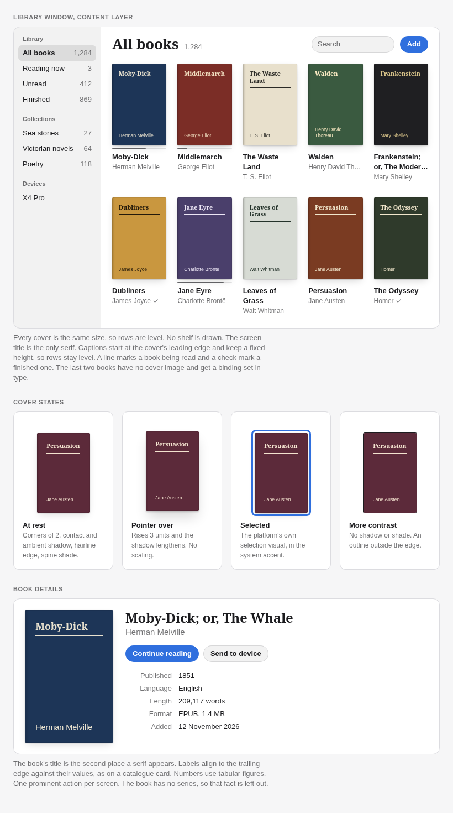
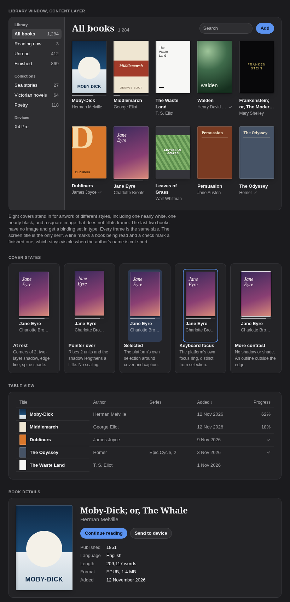

# Interface design: a library in each platform's own style

For [the interface guidelines issue](https://github.com/endqwerty/ebook-manager/issues/91).
Read this page before you design or build a screen in any shell. It gives the
rules every screen shares and covers the cover grid and book details. Three more
pages build on it:

- [The ways to show books](interface-views.md): home, list, table, a shelf of
  spines, and the author and series indexes.
- [The other screens](interface-screens.md): search, adding books, editing,
  devices, highlights, settings and dialogs.
- [The reader](interface-reader.md).

Someone opening the app should feel they are in a library: quiet, ordered and
warm, with the books as the thing they notice. The app should also look like it
came with their system. Both hold when the work is split in two.

- **The platform owns the frame.** Bars, sidebars, menus, sheets, controls,
  materials, the UI font and the accent colour are the system's standard parts,
  unmodified. On a Mac, iPhone and iPad that is Liquid Glass. On Windows 11 it is
  Mica and the WinUI controls. On GNOME it is libadwaita. On Android it is
  Material 3.
- **This page owns the content.** How covers are drawn, where things sit, what
  lines up with what, where a serif appears, which shadows exist and how a book
  opens. The library feel lives here and is the same on every platform.

The intent in one line: with the covers hidden the window could be one of the
system's own apps, and with them shown the books are what you look at. That is a
goal and not a test. A screen follows this page when its frame is built from the
controls named in [the platform table](#how-each-rule-maps-to-a-platform) with
no custom styling, and its content matches the rules below.

The pictures show the content rules on plain surfaces. Their sidebar, buttons
and outlined panels are stand-ins and not a mock-up of any platform's frame.
Eight covers are drawn stand-ins for artwork of different styles and are not
real cover art. The last two are bindings set in type. They also show the
table view and the states of a cover. [`interface-sample.html`](interface-sample.html) draws both.

## What makes it feel like a library

Four things, each of which you can measure on a screen.

| Quality | Where it comes from |
|---|---|
| Order | Every cover is the same size and rows are level. Every screen has one leading edge. Captions keep a fixed height. Numbers line up in columns. |
| Quiet | One prominent action per screen. No badges, and a message only for a problem that needs a decision. Nothing moves unless the reader caused it, apart from a cover fading in as it loads. |
| Warmth | A serif for the names of things. Covers drawn as objects with weight. Paper tones in the reader. |
| Books first | The frame takes its colour from the system. The only strong colour in the window is on the covers and the one prominent action. |

Things the app never draws: wood, leather, cloth or paper textures, page curls,
gilt, drop caps or ornaments in the interface, and book-shaped custom controls.
They date the app and fight the platform's materials. One view, the
[shelf](interface-views.md#shelf), draws books and their shelf with depth, from
shade and one fine cloth grain, and still without wood or any picture of a
material.

## Rules for the content layer

Lengths are in the platform's own unit: points on Apple systems, effective pixels
on Windows, CSS pixels in GTK and density-independent pixels on Android.

Leading and trailing follow the interface language: leading is left in English
and right in Arabic. The side of a cover that carries its spine follows the book
and not the interface. See [Covers](#covers).

### Placement

- On a wide window the sidebar lists places in four groups, in this order.
  Library: Home, All books, Reading now, Unread, Finished, and Needs attention
  when it is not empty. Browse: Authors, Series, Highlights. Then Collections,
  then Devices. A count sits at the trailing edge of each row that holds books.
- On a phone the platform's bar has four destinations: Home, Library,
  Collections and Devices. In Library, Reading now, Unread and Finished become a
  filter at the top, and Authors, Series and Highlights are in a Browse menu
  beside it.
- The screen's title names the place selected, with the number of books beside
  it. Where the platform's bar shows a large title that collapses on scroll, the
  bar owns the title. Elsewhere it sits at the top of the content at the leading
  edge, with the count on the same baseline. The title appears once, never in
  both places. See [the platform table](#how-each-rule-maps-to-a-platform).
- Search and Add go where the platform puts search and the primary action.
- A screen has at most one prominent action. On the library it is Add. On book details it
  is Read for a book not started, Continue reading for one partly read and Read
  again for a finished one. Every other action is plain, in a menu or in the
  context menu.
- Book details put the cover at the leading edge, 160 wide, and the rest beside
  it in this order: the title, the author, the series with the book's number in
  it, the prominent action with Send to device after it, then the facts. The
  facts are Published, Language, Length, Format with file size, Added, and
  Accessibility, which gives the book's own accessibility metadata in plain
  words, such as "Has image descriptions. No flashing content." Leave out a fact
  the book lacks.
- When the details area is under 480 wide, the cover moves above the title and
  stays at the leading edge, 40% of the width and no wider than 160. The order
  below it is unchanged. The screen has no heading of its own, because the
  book's title is the heading.
- A finished job shows no message. The reader sees the result: the books appear
  and the count changes. A running job shows progress where the platform puts it.
  Only a problem that needs a decision gets a message. It stays until the reader
  answers it and never dismisses itself.

### Alignment

- One leading edge per screen. The title, the first cover in each row, the first
  line of an empty state and, in book details, the title, the action and the
  fact labels start at the same x position.
- Every cover in a grid is the same size: a frame two wide by three tall, as
  wide as its column. Cover images come in many proportions, and
  [the cover table](#covers) says how an image goes into the frame. Never stretch
  an image.
- The caption starts at the cover's leading edge. It is never centred under the
  cover. The title takes up to two lines and the author one, directly under the
  title's last line. The caption block keeps the height of three lines even when
  the title needs one. Every item in a row is therefore the same height, and the
  next row starts level.
- The finished check mark sits at the trailing end of the author line in a slot
  of its own. Only the author's name is truncated, never the mark.
- Truncate at the end with an ellipsis. Wherever a title is truncated, the full
  title is available in a tooltip on pointer platforms and in book details
  everywhere. In book details the title and author wrap and are never truncated.
- In a table, text columns align to the leading edge and number columns to the
  trailing edge. Dates count as text.
- In book details the fact labels are a column at the leading edge, as wide as
  the longest label, in the secondary label colour. The values are a second
  column beside it. Both align to their own leading edge.

### Type

- The platform's UI font sets everything except the roles below. Use its named
  text styles. Never set a font size by hand, because named styles follow the
  user's text size setting and fixed sizes do not.
- A serif sets five things: the screen title, the book's title in book details,
  the headline of an empty state, the letters of an alphabetical index, and a
  passage quoted from a book. Nowhere else in the library window. Captions
  under covers, sidebar rows, buttons, menus and table cells stay in the UI font.
  The type on a binding drawn for a book with no cover is artwork and does not
  count.
- Under a cover the title uses the platform's emphasised body style and the
  author its caption style in the secondary label colour.
- The serif is never smaller than 17 units.
  Small serif text renders poorly on low-density Windows and Linux displays.
- The serif is semibold in titles. No italics, no small capitals and no all-capital
  labels anywhere in the interface.
- A title in a script the serif does not cover uses the platform's serif for
  that script. If that script has no serif, or none in semibold, the title uses
  the UI font. Never mix a fallback face into one title by hand. Let the
  platform's text system choose.
- Counts, sizes, dates in tables and anything that updates in place use tabular
  figures so digits do not shift.
- Capital letters follow each platform's own rule, so a string can differ between
  shells. See [the platform table](#how-each-rule-maps-to-a-platform). The rule
  applies only to scripts that have capitals.

### Colour

- Window, sidebar, bar and control colours are the platform's semantic colours.
  The app defines none of its own for them.
- The accent is the user's system accent, or the wallpaper-derived scheme on
  Android. The app does not set a brand accent. The accent appears on the
  prominent action, the selection and focus. It does not appear on text, progress
  marks or decoration.
- The app's own colours are the placeholder cover colours below and the app icon.
- State never depends on colour alone. A book being read has a progress line, a
  finished book has a check mark after the author's name, and both are announced
  to assistive technology in words.

### Light and dark

Every shell supports light and dark appearance on every device, and neither is
the lesser one. Design and review each screen in both.

- The app follows the system's setting and changes with it while running,
  without a restart. It never asks the reader to choose at first launch.
- The frame needs no work, because the platform's semantic colours and
  materials have both appearances. A colour written as a number has one, so the
  content layer may use a fixed colour only where this page gives its value for
  both appearances.
- Use the platform's own dark window colour, whatever it is. It is pure black on
  an iPhone and a dark grey on GNOME. Do not replace it or tint it warm.
- Cover artwork is shown as it is in both appearances. Never dim, invert or
  tint a cover.
- What the app draws around a cover changes: the shadow and the edge line have
  a value for each appearance, under [Covers](#covers) and
  [Shadows and depth](#shadows-and-depth). A shadow does not show on a dark
  window, so in dark appearance the edge line alone separates a dark cover from
  the window. It is never left out.
- Bindings set in type keep their colours in both appearances. Their text sits
  on the binding and not on the window, so its contrast does not change.
- The progress line, its track, the check mark and the loading block use
  semantic colours and follow by themselves.
- The serif roles keep their weight in both appearances.
- The reader's page colour is the reader's own setting and does not follow the
  window. Its default does: paper in light appearance and grey in dark.
- A pull request that changes a screen shows it in both appearances.

### Covers

A cover is the one thing in the window drawn as a physical object.

| Property | Value |
|---|---|
| Shape | A frame of 2:3, width to height, for every book. Corners of 2 units, 3 when the cover is 200 units wide or more. The platform's control radius never applies to a cover. |
| Image that fills | When the image's width is between 0.56 and 0.80 of its height, scale it to fill the frame and crop the overflow equally from both sides or from top and bottom. That takes in most book covers and both common paper sizes, and removes at most 8.5% from each side. |
| Image that does not fill | Any other image, such as a square audiobook cover or a wide comic, is scaled to fit whole and centred in the frame. The rest of the frame takes the platform's secondary fill colour. The spine shade is left out, and the edge line and shadow belong to the frame. |
| Unusable image | An image with transparency is drawn over white. An image that fails to decode, or would have to be enlarged to more than three times its pixel size, is not used, and the book gets a binding set in type. |
| Edge | A 1 unit line inside the frame's edge, drawn above everything else on the cover: white at 18% in dark appearance and black at 12% in light. It keeps the outline of a cover that is the colour of the window. |
| Spine | A shade over 5% of the width, black at 14% fading to nothing, on the side the book is bound: the left for a book read left to right and the right for one read right to left, whatever the interface language. Leave it out when the cover is under 64 units wide. |
| Widths | Small 96, medium 128, large 160. Medium is the default. With a row W wide and a chosen width c, the grid has floor((W + 20) / (c + 20)) columns, and one when that gives none. The columns share the row equally up to a cover width of 1.25 c. Past that, covers stay 1.25 c wide and the grid keeps to the leading edge. A cover is never wider than the row. |
| Gaps | 20 between columns. 12 from cover to caption. 28 from the caption block to the next row. The larger gap between rows makes each row read as a shelf. |
| Progress | A line 2 units thick in the middle of the gap between cover and caption, as wide as the cover: a track in the separator colour, filled from the leading edge in the secondary label colour. Drawn only while a book is partly read. The gap is the same for every book. |
| Loading | The catalogue stores each cover's average colour when the book is imported. Until the image is decoded, fill the frame with that colour, then cross-fade. If the catalogue has none, use the platform's secondary fill colour. A cover never pops in and never shows a spinner. |

A book with no usable cover image gets a binding set in type. It is 2:3, a flat
colour, with padding of 12% of its width. The title is at the top in the serif,
semibold, at 11% of the cover's width, on up to four lines and then an ellipsis.
A hairline rule in the text colour follows it. The author is at the bottom in the
UI font at 9% of the width, on up to two lines. Leave the author out when it is
unknown or when the cover is under 110 units wide, where the type would be too
small to read.

Pick the colour so a book keeps it on every device. Take the SHA-256 of the
book's identifier as UTF-8, read the first four bytes as an unsigned big-endian
number, and take it modulo 8. The result indexes this list from zero.

| Name | Colour | Text | Contrast |
|---|---|---|---|
| Navy | `#24405c` | `#f1e6cc` | 8.6:1 |
| Oxblood | `#6f2a2a` | `#f1e6cc` | 8.3:1 |
| Forest | `#315047` | `#f1e6cc` | 7.1:1 |
| Umber | `#7a3b22` | `#f1e6cc` | 6.8:1 |
| Plum | `#51446b` | `#f1e6cc` | 7.1:1 |
| Ochre | `#b98a3c` | `#23190a` | 5.6:1 |
| Slate | `#465366` | `#f1e6cc` | 6.3:1 |
| Moss | `#2f3a2b` | `#f1e6cc` | 9.6:1 |

### Shadows and depth

- Covers cast a shadow. So do the platform's own floating parts, which bring
  their own. Nothing else the app draws has a shadow: no cards, panels or rows.
- A cover's shadow has two layers. A contact shadow sits 1 unit below with a
  2 unit blur. An ambient shadow sits 6 units below with a 14 unit blur, pulled in
  by 4 units so it stays under the cover.
- In light appearance both layers are black at 16%. In dark appearance they are
  black at 28%. They add a little depth on a dark grey window and nothing on a
  black one, which is why the edge line carries the outline there.
- Light comes from above. Shadows fall straight down and never to the side.
- Group content with space and alignment first, a hairline second. Boxes are for
  the platform's own grouped lists.

### Selection, focus and commands

- Selection and keyboard focus are two states and both are always visible. Each
  uses the collection control's own visual around the whole item, cover and
  caption together. The app draws neither. Do not restyle them to match the
  cover's corners.
- With a pointer, a click selects the book, and book details follow the selection
  when the details pane is open. A double click or Return opens the reader. Space
  opens or closes the details pane. In a window too narrow for a pane, Space
  opens book details as a page and Escape goes back.
- Arrow keys move focus through the grid in reading order and Tab moves between
  the sidebar, the grid and the details pane. Selecting several books uses the
  platform's own gestures and keys.
- With touch, a tap opens book details and the prominent action there opens the
  reader. A long press opens the context menu. Selecting several books uses the
  platform's selection mode.
- With several books selected, the details pane shows the number of books as its
  title, such as "3 books", in the serif, then the facts the books share. It has
  no cover and no Read action. Its actions are the ones that apply to all the
  books: Send to device, Add to collection and Edit.
- A command from a menu, the toolbar or the keyboard acts on the selection. A
  context menu opened on a book outside the selection acts on that book alone
  and leaves the selection as it was.
- The context menu is in this order: Read, a separator, Show details, Edit, Add
  to collection, Send to device, a separator, Remove from library. Remove uses
  the platform's destructive style and is always last.

### Drag and drop

- Files and folders dropped anywhere on the window are added to the library.
  The drop target is the whole content area, shown with the platform's own drop
  highlight. The app draws no overlay or dashed box.
- Books dragged from the grid can be dropped on a collection or a device in the
  sidebar. The row under the pointer shows the platform's drop highlight. A row
  that cannot take the books shows nothing.
- The thing dragged is the cover, at the size it had in the grid. Several books
  are the platform's stack with a count. The covers left behind stay in place
  at half opacity until the drop.

### Other views

The same books can be shown as a list, a table or a shelf of spines. Those are in
[The ways to show books](interface-views.md), and the rules in this section
about selection, commands and dragging apply to all of them.

### Motion

- Every animation answers something the reader did, with one exception: a cover
  cross-fades in when its image arrives, over the platform's short control
  duration. Nothing loops, pulses or plays on arrival. Rows do not animate in
  when a screen opens.
- Pointer over a cover: it rises 2 units and its shadow lengthens a little, the
  contact layer to 2 units below with a 3 unit blur and the ambient layer to 9
  below with an 18 unit blur. It does not scale. Use the platform's short control
  duration. The movement shows in dark appearance too, where the shadow does not.
- Press: the cover settles back to rest.
- Opening book details as a page, or the reader from anywhere: the cover travels
  from where it was to its place in the destination, using the platform's
  shared-element transition where it has one. Closing reverses it to the same
  cover. If the cover has scrolled out of view, or the platform has no such
  transition, cross-fade instead. A details pane beside the grid changes its
  content with a cross-fade and nothing travels.
- Sorting, filtering and resizing move covers to their new places with the
  platform's standard layout animation. With more than about 200 covers changing
  place, cross-fade the grid instead.
- Use the platform's named durations and springs. Do not invent timing values.
- When the system asks for less motion, replace the rise, the shared-element
  travel and the layout moves with a cross-fade or nothing.

### Words and empty states

- Plain words in the reader's language: Library, Collection, Book, Author,
  Series, Add, Read. No bookish vocabulary such as tome, shelf-mate or bibliophile.
- No exclamation marks. No praise for routine actions.
- A place with nothing to show has a serif headline of a few words, one sentence
  in the UI font and at most one action. There are three cases and they are never
  confused.

| Case | Headline | Sentence | Action |
|---|---|---|---|
| The catalogue is still loading | None. Show nothing for 300 ms, then the platform's indeterminate progress indicator. | None | None |
| The library has no books | No books yet | Add EPUB files or a folder to start your library. | Add |
| A search or filter matches nothing | No books match | Names what was searched for or which filter is on. | Clear search, or Clear filter |

### Settings that change the look

[READ-70 to READ-72](../requirements/04-reading.md#access) require these to work.
The platform's standard parts follow them without help. The covers, the serif
roles and the motion above are drawn by the app, so the app must follow them.

| Setting | What the content layer does |
|---|---|
| Dark appearance | As described under [Light and dark](#light-and-dark). |
| Larger text | The serif roles and captions scale with it. Multiply the chosen cover width by the system's text scale before counting columns, so the grid loses columns as text grows, down to one. |
| More contrast | The inner edge line, the spine shade and both shadows are removed. A 1 unit outline in the platform's primary text colour is drawn outside the cover's edge, where artwork cannot hide it. Selection, focus and the pointer rise are unchanged. Bindings set in type keep their colours, which already meet 4.5:1. |
| Less transparency | Nothing in the content layer is translucent, so nothing changes. |
| Less motion | As described under [Motion](#motion). |
| Bold text | The serif roles step up one weight, as the UI font does. |

## How each rule maps to a platform

| Rule | Mac | iPhone and iPad | Windows 11 | GNOME | Android |
|---|---|---|---|---|---|
| Window structure | `NavigationSplitView` with a sidebar and an inspector for details | Tab bar on iPhone with Home, Library, Collections, Devices and Search. Sidebar on iPad. | `NavigationView` at the left under a Mica window | `AdwNavigationSplitView`, with an `AdwToolbarView` inside each pane | `NavigationSuiteScaffold` with Home, Library, Collections and Devices, and a list-detail layout from the expanded width up |
| Screen title and count | At the top of the content. The toolbar shows no title. | The navigation bar's large title in the serif design | `NavigationView`'s header, at the top of the content | At the top of the content. The header bar shows no title. | The title and subtitle of a large flexible top app bar |
| Library filter on a phone | Not needed | A menu in the navigation bar | Not needed | A menu in the header bar on a narrow window | Filter chips under the top app bar |
| Add | Toolbar, trailing, `.glassProminent` | Navigation bar, trailing, `.glassProminent` | An accent button at the trailing end of the header row | A labelled button at the start of the header bar, not accented, as GNOME header bars are | An extended floating action button |
| Search | Toolbar search field | The search tab, `Tab(role: .search)` | `AutoSuggestBox` in the title bar | Search button in the header bar that reveals a search bar | A search action in the top app bar that opens the search view |
| Serif | New York, through the system serif design | New York | Sitka | A bundled serif | A bundled serif |
| Grid | AppKit collection view | `LazyVGrid` or a UIKit collection view | `ItemsView` or `GridView` | `GtkGridView` | `LazyVerticalGrid` |
| Table | `Table` | `Table` on iPad. Not offered on iPhone. | `ListView` with column headers | `GtkColumnView` | Not offered on phones |
| Pointer over a cover | The rise above | iPad pointer only | The rise above | The rise above | None |
| Caption title, then author | Body in semibold, Callout | Subheadline in semibold, Footnote | Body Strong, Caption | `.heading`, `.caption` with `.dimmed` | `titleSmall`, `bodySmall` |
| Details author, then facts | Title 3 in the secondary colour, Body | The same | Body Large in `TextFillColorSecondaryBrush`, Body | `.title-4` with `.dimmed`, the default label style | `titleMedium` in `onSurfaceVariant`, `bodyMedium` |
| Opening a book | Cross-fade. SwiftUI's zoom transition is not offered on macOS. | `navigationTransition(.zoom)` from a `matchedTransitionSource` | Connected animation | The navigation view's push, with a cross-fade of the cover | `sharedElement` in a `SharedTransitionLayout` |
| Empty state | `ContentUnavailableView` | The same | A centred text block in the content layer | `AdwStatusPage` | A centred text block |
| Progress of a running job | Toolbar | Navigation bar | Title bar | Header bar | Top app bar |
| A problem that needs a decision | A plain row at the top of the content | The same | `InfoBar` at the top of the content | `AdwBanner` | A plain row at the top of the content. A snackbar dismisses itself, so it is not used. |
| Button and menu capitals | Title Case | Title Case | Sentence case | Header Capitalisation | Sentence case |
| Following light and dark | Semantic colours and asset catalogue colours with both appearances | The same | Theme resources, with `RequestedTheme` on the application and the root element left at the default, and the title bar's `PreferredTheme` following the system | `AdwStyleManager` at its default colour scheme, and `prefers-color-scheme` in the app's CSS | `isSystemInDarkTheme()` choosing between the light and dark colour scheme |
| Icons | SF Symbols | SF Symbols | Segoe Fluent Icons | Symbolic icons from GTK and the Icon Library | Material Symbols |

### Mac, iPhone and iPad: Liquid Glass

The current systems are version 27, which refined the material introduced in
version 26. An app built on the standard components picks the refinements up
without changes.

- Glass belongs to the layer of navigation and controls that floats above
  content. Covers, captions, table rows and book details are content and never
  get a glass background. Apple says to keep custom glass to a few important
  functional elements and never to put glass on glass.
- Use the standard sidebar, toolbar, tab bar, sheet, popover and menu, and remove
  any custom background behind them. A custom bar background stops the system's
  material and its scroll edge effect from working.
- Content scrolls under the bars. The system's scroll edge effect keeps the bar
  legible, so the grid needs no fade or rule of its own at the top. Use the hard
  edge style above a table's pinned column headers.
- From version 27 the sidebar reaches the window's edges and its icons take the
  accent colour. Leave both alone.
- In a bar, tint only the prominent action, Add, with
  `.buttonStyle(.glassProminent)`. Every other toolbar control is untinted glass.
  The prominent action in book details sits in the content, so it is a standard
  prominent button with no glass.
- Let toolbar items group themselves. Separate the view switch and sort from Add
  with a `ToolbarSpacer`.
- On iPhone the tab bar shrinks as the grid scrolls,
  `.tabBarMinimizeBehavior(.onScrollDown)`. If audio playback arrives, its
  controls go in `.tabViewBottomAccessory`.
- Shapes the app adds near the frame, such as an inspector's grouped box, use
  concentric corners (`ConcentricRectangle`). Covers keep their 2 unit corners
  because they are content and not part of the frame.
- At rest no cover should sit half under a floating control. Size the top inset
  so the first row clears the toolbar.
- On iPhone and iPad the screen title is the navigation bar's large title, which
  collapses as the grid scrolls. On the Mac the toolbar shows no title and the
  screen title is the first line of the content.
- Use the text styles: Large Title for the screen title and Title 1 for the
  book's title, both with the serif design. The author under the book's title is
  Title 3 in the secondary colour. Fact labels and values are Body. On a Mac those are 26 and 22 points.
  The Mac has no Dynamic Type, so the app offers no text size of its own in the
  library.
- Under a cover the Mac uses Body in semibold and Callout, 13 and 12 points,
  because its Subheadline and Footnote are 11 and 10. iPhone and iPad use
  Subheadline in semibold and Footnote.
- Springs are the default animation. Use `.smooth` for the cover's rise and for
  layout moves. On iPhone and iPad a book opens with the system's zoom
  transition. SwiftUI does not offer it on macOS, so the Mac cross-fades.
- The system adapts glass to Reduce Transparency, Increase Contrast and Reduce
  Motion, and to the user's clear-to-tinted glass setting. Test the covers and the
  serif roles under each, because the system does not adapt those.
- The app icon is layered artwork made in Icon Composer, with default, dark, clear
  and tinted appearances.

### Windows 11

The current release is 26H2, with Windows App SDK 2.7.

- The window's base layer is Mica (`MicaBackdrop`). Navigation and commands sit
  on it. The content area is one layer on top, filled with
  `LayerFillColorDefaultBrush`. The grid sits directly on that layer.
- Do not wrap books in cards. Windows gives a card an elevation of 8 with a
  stroke, which would put a box around every cover.
- Acrylic is for menus and flyouts, which bring it themselves. Never use it
  behind the grid.
- Corners are 8 for windows, flyouts and dialogs and 4 for controls. These come
  from `OverlayCornerRadius` and `ControlCornerRadius`. Covers keep 2.
- Use the `TitleBar` control at its tall height of 48, with the search box in it.
  Keep everything clear of the caption buttons.
- `NavigationView` in its automatic mode collapses at 1008 and 640 effective
  pixels. Give the content 24 of margin, 12 in minimal mode.
- Type comes from the Windows ramp: Title, 28 on a 36 line, for the screen title
  and the book's title in Sitka. Under a cover the title is Body Strong and the
  author is Caption in `TextFillColorSecondaryBrush`.
- The app leaves `RequestedTheme` at its default on the application and on the
  root element, so the window follows the system's light or dark setting.
- Under a contrast theme the outline around a cover is
  `TextFillColorPrimaryBrush`, which becomes the system's window text colour.
- The cover's rise uses `ControlFastAnimationDuration`, 167 ms. Page changes use
  the transition `NavigationView` recommends.
- Colours come from theme resources only, such as `TextFillColorPrimaryBrush` and
  `TextFillColorSecondaryBrush`. Those switch to system colours under a contrast
  theme. A colour written as a number does not.
- Mica and Acrylic fall back to solid colours by themselves when transparency is
  off or a contrast theme is on.

### GNOME

The current releases are GNOME 51 and libadwaita 1.10.

- The header bar of the content pane shows no title, because the screen title
  is the first line of the content. Add is a labelled button at its start,
  without the accent, as GNOME header bars are.
- `AdwNavigationSplitView` holds the sidebar and the content, and collapses to a
  navigation stack on a narrow window. Each side is an `AdwToolbarView` with an
  `AdwHeaderBar` in the flat style, which shows a shadow only when content has
  scrolled under it.
- Book details open in an `AdwOverlaySplitView` utility pane on a wide window and
  as a pushed page on a narrow one.
- The grid is a `GtkGridView` over a list model, placed directly in a
  `GtkScrolledWindow` so it recycles its widgets. Keep per-book state in the
  model.
- Do not put books in `.card` boxes. A card has an outline and two shadows of its
  own.
- Colours come from libadwaita's CSS variables. The app follows the system accent
  and dark style, which is the default behaviour, and sets no accent of its own.
- Use the type classes: `.title-1` for the screen title and the book's title with
  the bundled serif as the family, `.caption` for the author line, `.numeric` for
  counts, and `.dimmed` for secondary text. They are relative sizes and follow
  the user's font setting.
- Write the cover's CSS for `prefers-contrast: more` and for dark appearance.
  Standard widgets handle both. Custom drawing does not.
- Animate with `AdwTimedAnimation` or `AdwSpringAnimation`. They skip themselves
  when animations are turned off. Reduced motion is a separate setting,
  `gtk-interface-reduced-motion`, which the app checks for the cover's rise.
- Support a window 360 wide, which GNOME asks of apps that suit a phone.
- Off GNOME, GTK reads what settings the desktop shares and libadwaita chooses
  light when it learns no preference. So that dark appearance is available on
  every desktop, the Linux shell has an Appearance setting with Follow system,
  Light and Dark, which GNOME's guidelines allow for apps used for long periods.
  Follow system is the default. When
  `AdwStyleManager:system-supports-color-schemes` is false, the desktop shares
  no preference: remove only the Follow system option, keep Light and Dark, and
  start on Light.

### Android

The current releases are Android 17 and Compose Material 3 1.5.

- Colour follows the wallpaper through `dynamicLightColorScheme` and
  `dynamicDarkColorScheme` on Android 12 and later. Earlier versions get a light
  and a dark scheme built from the Forest placeholder colour.
- Covers sit directly on `surface`. Do not wrap them in `Card`. The shape scale,
  where a card is 12, does not apply to a cover.
- Navigation is a bar on a compact width and a rail from medium up, through
  `NavigationSuiteScaffold`. From the expanded width, 840, the library and book
  details show side by side.
- The app draws edge to edge, which Android 15 and later enforce for an app
  that targets SDK 35 or higher. Give the grid the padding its `Scaffold` passes
  in, which already accounts for the system bars. Adding the window insets again
  would inset it twice. System bar icons follow light and dark with the app.
- The compact navigation bar holds Home, Library, Collections and Devices. Reading
  now, Unread and Finished are filter chips under the top app bar in Library.
- Add is an extended floating action button, the Material place for a screen's
  primary action.
- The screen title is `headlineMedium` in a large flexible top app bar that
  collapses as the grid scrolls, with the count as its subtitle. Search is an
  action in that bar that opens the search view. The book's title is `headlineSmall`. Both take
  the bundled serif through per-role `TextStyle` in `Typography`. Under a cover
  the title is `titleSmall` and the author `bodySmall`.
- Motion uses the standard `MotionScheme`, not the expressive one. Its spatial
  springs are damped at 0.9, against 0.6 to 0.8 in the expressive scheme, so they
  settle with little overshoot.
- Leave out the Expressive shape-morphing components and the wavy progress
  indicators.
- Every touch target is at least 48 by 48, including a cover in the small grid
  and its context menu.
- The app draws the cover, so it applies the More contrast rule itself. On
  Android 14 and later, read `UiModeManager.getContrast()`, treat 0.5 or more as
  more contrast, and listen for changes with `addContrastChangeListener`.
  Earlier versions have no such setting and use the ordinary treatment.

## Decisions made without asking

Each was the default taken to finish this page. Any can change.

1. **Follow the system accent, with no brand colour in the frame.** The
   alternative is a fixed library green on the prominent action. It was turned
   down because it breaks the first check on this page and fights the user's own
   choice on four of the five platforms.
2. **The serif appears in five roles only.** Setting every book title under
   every cover in a serif would be more bookish, and also noisier and worse on
   low-density displays.
3. **Every cover is the same size, 2:3.** Showing each image at its own
   proportions, with tops at different heights like books on a shelf, was the
   first version. It was turned down because it made the grid look uneven for
   no reason a reader of digital books would recognise. The cost is a crop of
   up to 6% a side on covers close to 2:3.
4. **A faint spine shade stays.** It is the only drawn hint that a cover is a
   book. Remove it if it reads as decoration on real covers.
5. **Bundle one serif on GNOME and Android.** Neither guarantees a serif. Literata
   is the candidate. It needs the [LIC-1](../requirements/10-constraints.md#licences-of-parts)
   check and an entry in the release manifest before it ships. Using it on every
   platform would make titles identical everywhere, and was turned down because
   New York and Sitka are what those systems' own apps use.
6. **No message when a job finishes.** The result on screen is the message. A
   toast for every import would be the loudest thing in a quiet window.
7. **A tap on a phone opens book details, not the reader.** Opening the reader
   at once is faster for reading and gives no way to reach a book's facts or
   send it to a device without a long press.
8. **Fact labels align to the leading edge.** The first version aligned them to
   the trailing edge so labels and values met at one line, as on a catalogue
   card and in the Mac's own inspectors. Two reviewers found it broke the single
   leading edge and squeezed values in a narrow pane.
9. **The edge line is strong enough to see: white at 18% in dark appearance.**
   A fainter line is more elegant on most covers and loses a black cover on a
   dark window.

## Check on a device before relying on it

The research for this page read each platform's documentation. These points were
not confirmed there, or the documentation contradicts itself.

- Whether a native Mac app gets New York from the serif font design. Apple's
  guidelines confirm it for iPhone, iPad and Mac Catalyst.
- Each glass API's minimum system version.
- Whether the navigation bar's large title takes the serif design through
  SwiftUI alone or needs the UIKit appearance API.
- The iPhone sizes of the text styles. The Mac sizes above are from Apple's table.
- Whether Sitka picks its optical size from the font size by itself or the app
  must choose between Sitka Text, Heading and Display.
- Whether Mica falls back to a solid colour under Battery Saver. Two Microsoft
  pages disagree.
- Whether Apple's guidelines offer a standard part for a notice inside content.
  The page assumes none and uses a plain row.
- How Windows connected animations and the app's own implicit animations respond
  when animation effects are turned off. Microsoft's material points to
  `UISettings.AnimationsEnabled`.
- The exact sizes of libadwaita's type classes. The values seen came from an
  installed 1.10 stylesheet: `.title-1` is 181% at weight 800.
- What accent and fonts libadwaita uses on KDE Plasma and on compositors with no
  settings portal.
- Whether Compose's shared transition APIs are stable in the current release, and
  how Compose animations follow Android's Remove animations setting.
- Whether `titleLarge` is regular or medium weight. Google's guide and the
  library's tokens disagree, so this page avoids that role.

## Sources

Read on 18 November 2026.

- Apple: [Adopting Liquid Glass](https://developer.apple.com/documentation/technologyoverviews/adopting-liquid-glass),
  [Typography](https://developer.apple.com/design/human-interface-guidelines/typography),
  [Accessibility](https://developer.apple.com/design/human-interface-guidelines/accessibility),
  [Meet Liquid Glass](https://developer.apple.com/videos/play/wwdc2025/219/),
  [Build a SwiftUI app with the new design](https://developer.apple.com/videos/play/wwdc2025/323/),
  [the 2026 design update](https://developer.apple.com/videos/play/wwdc2026/102/),
  [Animate with springs](https://developer.apple.com/videos/play/wwdc2023/10156/).
- Microsoft: [Mica](https://learn.microsoft.com/en-us/windows/apps/design/style/mica),
  [materials](https://learn.microsoft.com/en-us/windows/apps/develop/ui/materials),
  [layering and elevation](https://learn.microsoft.com/en-us/windows/apps/design/signature-experiences/layering),
  [geometry](https://learn.microsoft.com/en-us/windows/apps/design/signature-experiences/geometry),
  [title bar](https://learn.microsoft.com/en-us/windows/apps/develop/title-bar),
  [NavigationView](https://learn.microsoft.com/en-us/windows/apps/develop/ui/controls/navigationview),
  [list view and grid view](https://learn.microsoft.com/en-us/windows/apps/develop/ui/controls/listview-and-gridview),
  [Windows 11 font list](https://learn.microsoft.com/en-us/typography/fonts/windows_11_font_list),
  [Fluent typography](https://fluent2.microsoft.design/typography),
  [WinUI theme resources](https://github.com/microsoft/microsoft-ui-xaml/blob/main/controls/dev/CommonStyles/Common_themeresources_any.xaml).
- GNOME: [adaptive layouts](https://gnome.pages.gitlab.gnome.org/libadwaita/doc/1.10/adaptive-layouts.html),
  [styles and appearance](https://gnome.pages.gitlab.gnome.org/libadwaita/doc/1.10/styles-and-appearance.html),
  [CSS variables](https://gnome.pages.gitlab.gnome.org/libadwaita/doc/1.10/css-variables.html),
  [toolbar styles](https://gnome.pages.gitlab.gnome.org/libadwaita/doc/1.10/enum.ToolbarStyle.html),
  [AdwAnimation](https://gnome.pages.gitlab.gnome.org/libadwaita/doc/1.10/class.Animation.html),
  [GTK list widgets](https://docs.gtk.org/gtk4/section-list-widget.html),
  [reduced motion setting](https://docs.gtk.org/gtk4/property.Settings.gtk-interface-reduced-motion.html),
  and the guidelines on [typography](https://developer.gnome.org/hig/guidelines/typography.html),
  [writing style](https://developer.gnome.org/hig/guidelines/writing-style.html),
  [grid views](https://developer.gnome.org/hig/patterns/containers/grid-views.html)
  and [adaptive design](https://developer.gnome.org/hig/guidelines/adaptive.html).
- Android: [Material 3 in Compose](https://developer.android.com/develop/ui/compose/designsystems/material3),
  [Compose Material 3 releases](https://developer.android.com/jetpack/androidx/releases/compose-material3),
  [window size classes](https://developer.android.com/develop/adaptive-apps/guides/use-window-size-classes),
  [window insets](https://developer.android.com/develop/ui/compose/system/insets),
  [fonts](https://developer.android.com/develop/ui/compose/text/fonts),
  [accessibility](https://developer.android.com/guide/topics/ui/accessibility/apps),
  [UiModeManager](https://developer.android.com/reference/android/app/UiModeManager),
  [MotionScheme source](https://android.googlesource.com/platform/frameworks/support/+/268d841a45644cadf438fc335c793869728449ec/compose/material3/material3/src/commonMain/kotlin/androidx/compose/material3/MotionScheme.kt).
