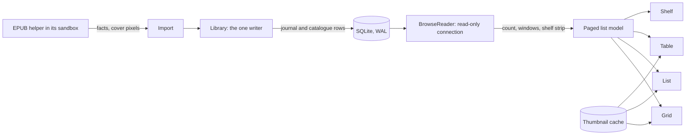
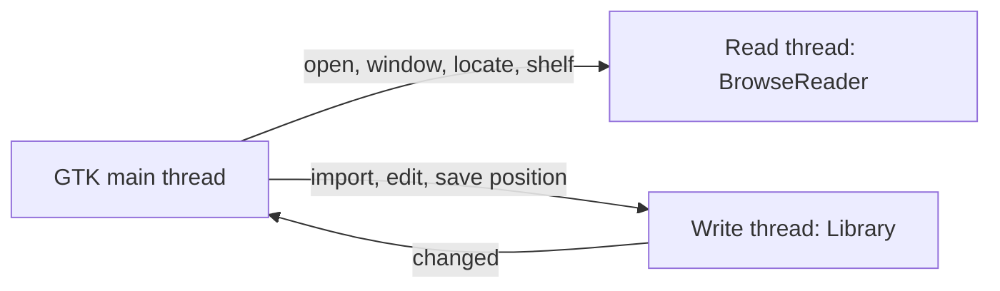

# Browsing a large library

For [browsing in grid, list and table](https://github.com/endqwerty/ebook-manager/issues/25),
[the shelf view](https://github.com/endqwerty/ebook-manager/issues/93) and
[staying fast at 100,000 books](https://github.com/endqwerty/ebook-manager/issues/28).
How the views look is settled in [the interface design](interface.md) and
[the ways to show books](interface-views.md). This page says how the library
core, the EPUB helper and the Linux shell supply them.

## Problem

The desktop app shows every book as a row in one box, rebuilt on each
keystroke. The library reads every book record to answer a search, reads every
book again on each import, and reads every journal file each time it opens.
That works for a few hundred books. A reader with 100,000 books waits on all
three. The app also knows only a title and authors for each book, so it cannot
sort by series or date, show a cover, or draw a spine.

## Goals

- Show the library as a cover grid, a list, a table and a shelf of spines, each
  with its own remembered sort of up to three keys
  ([LIB-20](../requirements/01-library.md#finding-and-viewing), LIB-21, LIB-29).
- Typing in the search box filters by title, author and series
  ([LIB-22](../requirements/01-library.md#finding-and-viewing)).
- Every action works from the keyboard
  ([LIB-28](../requirements/01-library.md#finding-and-viewing)).
- With 100,000 books the window shows the library within 2 seconds of launch
  and a search answers within 100 ms. With 1,000,000 the app still works
  ([LIB-70 to LIB-72](../requirements/01-library.md#speed)).
- A series with a text position that sorts correctly
  ([LIB-3](../requirements/01-library.md#organising)).

## Non-goals

- Collections, tags, several files per book and the rest of the LIB-1 field
  list. They have their own issues
  ([collections](https://github.com/endqwerty/ebook-manager/issues/44),
  [editions](https://github.com/endqwerty/ebook-manager/issues/50),
  [metadata records](https://github.com/endqwerty/ebook-manager/issues/56)).
- The sidebar, Home, the Authors and Series indexes, the details pane, the
  Filter button and its facets, drag and drop, and the Appearance setting. This
  work builds one place, All books.
- A query language and full-text search
  ([search](https://github.com/endqwerty/ebook-manager/issues/45)).
- Reading status as its own record
  ([reading sessions](https://github.com/endqwerty/ebook-manager/issues/36)).
  This work stores only how far the current version has been read and when.
- A new journal file layout. One file per change stays, although it will not
  suit a million books with reading history. See [Open questions](#open-questions).
- Shells other than Linux.

## Plan



### What a book record holds

`Book` keeps its identities and gains the facts the views need. The journal
snapshot (`Change::Book`) carries all of them, so a rebuild from the portable
folder restores them without opening any EPUB.

| Fact | Where it comes from | Edited by the reader |
|---|---|---|
| Title, authors | The helper, as today | Yes |
| Sort title | Absent unless the reader sets it. The catalogue derives the filing form from the title. | Yes |
| Author sort names | The EPUB's `file-as`, else derived, per author | Yes |
| Series memberships: name and position text, in order. The first is the primary series. | EPUB 3 `belongs-to-collection` with `collection-type` `series` and `group-position`. For EPUB 2, the `calibre:series` and `calibre:series_index` `meta` names, known from inspecting files that calibre writes, which [Rule 1](../../AGENTS.md#rule-1-never-look-at-calibres-source-code) allows. | Yes |
| Date added | The library, at first import, in UTC. A replacement keeps it. | No |
| Date published, as the text the file gives, and first language | The helper | No |
| Length in words | The helper, counting the text of linear spine documents. Unknown if any chapter was skipped or truncated. | No |
| Cover facts: average colour, spine colour, digest of the thumbnail pixels | The helper. See [Covers](#covers). | No |

Helper-supplied values live in `Book.imported` as today, and the reader's
edits in the fields beside it. A journal entry written before this change
lacks the new fields and reads with them absent.

`Change::Position` gains the time of reading in UTC and a fraction read from
0 to 1. The desktop reader computes the fraction as chapters before this one
plus the fraction of this chapter scrolled, over the number of linear
chapters. A book is finished when the reader has shown the end of the last
chapter, which stores a fraction of exactly 1.

### The catalogue in SQLite

SQLite stays a projection that the journal can rebuild. It opens in WAL mode,
so reading never waits for an import.

```text
book(n INTEGER PRIMARY KEY,        -- private row number, never shown or exported
     id TEXT UNIQUE, sha256, identifier, data TEXT,   -- data is the Book JSON
     title, authors, series, position,                -- display text
     title_key BLOB, author_key BLOB, series_key BLOB, position_key BLOB,
     added INTEGER, published TEXT, last_read INTEGER, progress REAL,
     words INTEGER, language TEXT, spine_rgb INTEGER, cover_rgb INTEGER, cover_digest TEXT)
search(n INTEGER PRIMARY KEY, folded TEXT)   -- title, authors, series names
positions, sources, journal                  -- as today
meta(key PRIMARY KEY, value)                 -- change counter, key profile, published tip
```

Indexes on `sha256`, `identifier`, `sources.id` and each key column. Import
looks up its duplicate and review candidates through those indexes and no
longer lists the shelf. Applying a journal change writes `book`, `search` and
the change counter in the same transaction as the journal row.

**Sort keys** are bytes that compare with `memcmp`, so SQLite sorts and
indexes them with no callback.

- Text keys are ICU collation sort keys from `icu_collator` for the system
  locale, with numeric ordering on so `Book 2` sorts before `Book 10`.
- A title's filing form drops one leading article chosen by the book's first
  language from a small table in `sortkey.rs` (English, French, German,
  Spanish, Italian, Dutch, Portuguese). A book with no language, or a language
  not in the table, drops nothing. A sort title set by the reader is used as
  it is.
- An author key comes from the first author's sort name. A derived sort name
  moves the last word to the front: `Herman Melville` gives `Melville, Herman`.
- A position key splits the text into runs of digits and runs of other
  characters. Digit runs compare by value and sort before text runs.
  Punctuation separates runs and is otherwise ignored. So `1.5` sorts before
  `2`, `2.2.1` before `2.10.1`, `1-5` after `1`, and `TPB1` after every number
  and before `TPB10`.
- A missing value sorts last in both directions.

`meta` records the locale and a key version. When either differs at open, the
library rebuilds the key columns from `data`.

**Search text** is the title, each author and each series name, case-folded
with Unicode NFKD and marks removed, joined by a separator that cannot be
typed. A search splits the typed text on spaces and every word must appear
somewhere in it.

### Opening without reading the journal

`Library::open` no longer reads every journal file. It compares one thing: the
newest published journal file named by `meta` must exist with the same bytes
as the catalogue's row, and the file after it must not exist. If so, the
catalogue is current and open returns. Otherwise, or when SQLite is missing,
it runs today's full replay. `Library::refresh`, behind the Refresh button,
still verifies the whole chain.

### Asking for books

```rust
pub struct BrowseQuery { pub text: String, pub sort: SortOrder }
pub struct SortOrder(/* one to three distinct fields */);
pub struct SortTerm { pub field: Field, pub descending: bool }
pub enum Field { Title, Author, Series, Added, Published, LastRead, Progress }

pub struct OpenView { pub token: ViewToken, pub count: u32, pub first: Vec<BrowseRow> }
pub struct BrowseRow {            // everything a grid cell, list row or table row shows
    pub id: String, pub version_id: String, pub title: String, pub authors: String,
    pub series: Option<(String, String)>, pub added: i64, pub published: Option<String>,
    pub last_read: Option<i64>, pub progress: Option<f32>,
    pub cover: Option<CoverRef>, pub cover_rgb: Option<u32>, pub spine_rgb: Option<u32>,
}
pub struct ShelfStrip {
    pub thickness: Box<[u8]>,          // one per book, in view order
    pub groups: Box<[(u32, String)]>,  // rank where a group starts, and its name
}

impl Library { pub fn browse_reader(&self) -> Result<BrowseReader>; }
impl BrowseReader {
    pub fn open(&mut self, query: &BrowseQuery, cancel: &Cancel) -> Result<OpenView>;
    pub fn window(&mut self, view: ViewToken, start: u32, len: u32) -> Result<Vec<BrowseRow>>;
    pub fn locate(&mut self, view: ViewToken, ids: &[String]) -> Result<Vec<Option<u32>>>;
    pub fn shelf(&mut self, view: ViewToken) -> Result<ShelfStrip>;
    pub fn changed(&mut self) -> Result<bool>;   // has the catalogue changed since the view opened
}
```

A rank is a zero-based position in one view. A `BrowseReader` owns a read-only
SQLite connection and can move to another thread. It holds one view at a time.

`open` works in two steps, and keeps the result of the first between calls.

1. **Order.** For the sort, one query returns every book's `n` in order, as a
   `Vec<u32>`. A million books is 4 MB. A sort on one indexed key reads the
   index. Any other sort is sorted by SQLite on the key bytes. The tie-break is
   always `n`. The order is reused until the sort or the catalogue changes.
2. **Filter.** Empty text shows the order as it is. Otherwise one scan of
   `search` marks the matching `n` in a bitmap, and a pass over the order keeps
   the marked ones. The view is that list.

`window` fetches the rows for a slice of the view by primary key. `locate`
gives the ranks of books by ID, for keeping selection and scroll position.
`shelf` returns each book's spine thickness in view order,
`min(48, 16 + round(words / 12000))` or 24 when the length is unknown, and
the group starts for a first sort key of Author (first letter of the sort
name), Series (series name) or a date (year). Any other first key has no
groups.

A call with a token from an earlier `open` fails with `StaleView`. `open`
checks `cancel` between steps and during the scan, and returns `Cancelled`.

**Limits and risks.** Each keystroke scans `search` once: about 5 MB of text
at 100,000 books. At 1,000,000 the scan and the pass over the order are
expected to take a few hundred milliseconds. If the benchmark shows a search
over 100 ms at 100,000 books, the next step is an in-memory copy of the
folded text, and after that a trigram index. Neither is built until a
measurement asks for it.

### Covers

A cover image is untrusted data from the book file, so it is decoded only in
the helper's sandbox.

- A new helper request finds the cover the package declares (the manifest
  item with the `cover-image` property, else the item named by the EPUB 2
  `cover` `meta`), limits its compressed size and its decoded pixels, decodes
  JPEG, PNG, GIF or WebP, draws transparency over white, and scales it to fit
  within 256 by 384. It returns raw RGB pixels with their width and height,
  the average colour, and the spine colour: the most common colour, after
  rounding each channel to 5 bits, on the tenth of the image at the bound
  side, else on the whole image. The bound side is the left unless the
  package's page progression is right to left.
- The host checks that the byte length equals width times height times 3 and
  that neither side exceeds the limit, then writes the pixels as a PNG to
  `cache/thumbs/<digest>.png` under the app data folder, where the digest is
  the SHA-256 of the raw pixels. The library stores the digest and colours in
  the book record. The shell reads thumbnails straight from that folder on a
  loader thread and never through the library's writer.
- A book whose cover is missing, fails to decode or would need enlarging by
  more than three times is still imported, with no cover facts. The shell
  draws its binding set in type.
- The thumbnail folder is a cache. When a book has a digest and no file, the
  shell shows the average colour and asks for the thumbnail again from the
  managed EPUB in the background.
- At startup the desktop queues a low-priority survey of books that have no
  word count and no cover facts recorded as attempted, so books imported
  before this change gain them. The record notes that the survey ran, so a
  book with no cover is not surveyed twice.

### The Linux window

The window becomes an `AdwApplicationWindow` with an `AdwToolbarView`. The
screen title, `All books` with the count, is the first line of the content in
the serif. The header bar holds, from the start: Add (a menu with Files and
Folder), then the view switch as linked toggle buttons, the Sort menu, and a
search button that reveals a `GtkSearchBar`. Typing anywhere in the content
starts a search.



- **One model for every view.** `BookListModel` implements `GListModel`,
  `GtkSelectionModel` and `GtkSectionModel` over the current view. `n_items`
  is the view's count. `item(rank)` returns a `BookObject` at once. If its row
  is not loaded, the model asks the read thread for the page of 128 that holds
  it, and fills the object's properties when the page arrives. Bound widgets
  update through property notifications. Loaded pages sit in a small cache,
  and live objects are found again through weak references.
- **Changing the query.** A new search or sort cancels the one in flight and
  opens a view. The model swaps the count, the first page and the token
  together and emits one `items-changed`.
- **Selection and focus** are kept by book ID in the model. After a view is
  replaced, `locate` finds where the selected and focused books went. Books no
  longer in the view leave the selection.
- **When the catalogue changes** (an import, an edit, a saved position), the
  write thread tells the window. The model coalesces these, reopens the same
  query off the main thread, and swaps as above. During an import it reopens
  at most once a second.
- **Grid** is a `GtkGridView`. A cell is a custom `Cover` widget and a caption.
  `Cover` draws the frame, image, edge line, spine shade and shadows from
  [the cover table](interface.md#covers), the binding set in type for a book
  with no cover, and the More contrast variant. The grid sets its column count
  from the width by the formula in that table.
- **List** is a `GtkListView` and **Table** a `GtkColumnView`, as
  [their sections](interface-views.md#list) describe. A click on a table
  header changes the model's sort. The table never sorts rows itself. The
  table is offered only when the window is at least 640 wide.
- **Shelf** is a custom scrollable widget. It asks for the `ShelfStrip` once
  per view, packs rows for its width (a new row when the next spine does not
  fit, and at each group start), and stores each row's first rank and y
  offset. Packing a million bytes takes about a millisecond, so a resize
  repacks at once and keeps the first fully visible book at the top. It
  creates spine widgets only for the rows on screen and a little beyond, and
  reuses them. Each spine widget has an accessible name with the title, author
  and reading state, takes focus, and draws itself as
  [the shelf table](interface-views.md#shelf) says. Selection tips the spine
  with a perspective transform and moves nothing else.
- **Actions** are `GAction`s on the window with accelerators, also offered in
  the context menu on a book and the Menu key: Read (Return, double click),
  Edit, Send to device, and the view, sort and search commands. The Edit
  window gains sort title, author sort names, series and position.
- **Remembered choices**: the view, the sort for each view, the cover size and
  the table's columns, order and widths are saved in `settings.json` in the
  app's config folder.
- A text scale of 1.5 or more shows List in place of Grid or Shelf without
  changing the saved choice.

### The benchmark

`crates/ebook-library` gains a `fixture` feature with a generator that writes
a catalogue of N made-up books through the same function that applies a
journal change, in large transactions, without writing journal files. It
varies title length and script, repeats authors, puts a third of the books in
series, leaves some dates empty and repeats some sort keys. It records the
published tip as empty so that open takes the fast path.

A `scale` test binary, built in release, generates 100,000 and 1,000,000
books and measures, each as the median of several runs:

| Sample | What one sample is | Limit at 100,000 | Limit at 1,000,000 |
|---|---|---|---|
| Open | `Library::open` on the existing catalogue, then `open` of the default view and its first page | 1 s | 5 s |
| Search | `open` of a query to its count and first page, for a one-letter query, a common word, a rare word and no match | 100 ms | 1 s |
| Window | Thirty random pages of 128, the last page included | 20 ms each | 50 ms each |
| Shelf | `shelf` for the default view | 200 ms | 2 s |
| Re-sort | `open` with a three-key sort not used before | 1 s | 10 s |

Each sample checks its result against an answer computed from the generator's
own list, so a fast wrong answer fails. CI runs it as a separate job from the
tests. The limits are first proposals, to be replaced with measured values
and their margin when the benchmark first runs. The limits at 1,000,000 mean
"still works", not "fast".

The window's own start is measured in the desktop smoke run: with a 100,000
book catalogue in place, the time from starting the process to the first
titles being readable through the accessibility tree must be under 2 seconds
plus the driver's own polling interval.

## Behaviour

Tests in `crates/ebook-library/tests/browse.rs` unless another file is named.

1. When a library holds books and a view opens with empty text, then the count
   is the number of books and the rows come in the order of the sort, with
   ties in a stable order. `orders_by_each_field_in_both_directions`.
2. When titles begin with an article in the book's language, contain numbers,
   or differ only in case or accents, then they sort as a person would file
   them. `titles_file_without_articles_and_with_numbers_by_value`.
3. When series positions are `1`, `1.5`, `2`, `2.2.1`, `2.10.1`, `10` and
   `TPB1`, then a series sort returns them in that order.
   `series_positions_sort_by_parts`.
4. When a sort has a second and third key, then books equal on the earlier
   keys are ordered by the later ones. `later_keys_order_ties`.
5. When a value is missing, then the book sorts after those that have it, in
   both directions. `missing_values_sort_last`.
6. When text is typed, then the view holds exactly the books whose title, an
   author or a series name contains every word, whatever its case or accents,
   in the current sort. `search_matches_every_word_across_fields`.
7. When a window is asked for anywhere in the view, the last rows included,
   then it returns the same rows as the whole view sliced, and an empty list
   past the end. `any_window_matches_the_whole_view`.
8. When a view is replaced, then a call with the old token fails with
   `StaleView`. `an_old_token_is_refused`.
9. When a book is imported, edited or read after a view opened, then `changed`
   reports true and a reopened view shows the new values in the right place.
   `a_reopened_view_reflects_changes`.
10. When `locate` is given IDs, then it returns each book's rank, and none for
    a book the filter hides. `locate_finds_books_by_id`.
11. When the first sort key is Author, Series or a date, then `shelf` returns
    one thickness per book in view order and a group start wherever the
    letter, series or year changes. `shelf_strip_matches_the_view`.
12. When a library is closed and opened again, then no journal file except
    the newest is read. When the newest file is missing, changed or followed
    by another, then open replays the journal.
    `reopen_reads_one_journal_file_unless_the_tip_moved`
    in `tests/library.rs`.
13. When the catalogue is rebuilt from the portable folder alone, then every
    new fact, sort and reading fraction is as before.
    `portable_only_rebuild_restores_bytes_metadata_and_position` in
    `tests/library.rs`, extended.
14. When a second copy of a known file, path or package identifier is
    imported into a large library, then the outcome is as today and the import
    lists no books. The existing import tests, and the `scale` binary's import
    sample.
15. When an EPUB declares a series, a sort name, a date and a cover, then the
    helper returns them, and a cover that is too large, corrupt or an
    unsupported type yields no cover and no failure.
    `crates/ebook-reader/tests/reading.rs` and `tests/failures.rs`.
16. When the library has 100,000 or 1,000,000 books, then each sample in
    [the benchmark](#the-benchmark) is within its limit and correct. The
    `scale` binary.
17. When the reader switches between Grid, List, Table and Shelf, sorts, types
    a search, and opens, edits and exports a book using only the keyboard,
    then each works, and the view and sort are as left after a restart.
    `apps/desktop/tests/smoke.py`.
18. When the shelf is resized, then the first fully visible book stays at the
    top, and when a book is selected then only that spine changes.
    `apps/desktop/tests/smoke.py`, and a unit test of the row packing.

## Alternatives

- **`LIMIT` and `OFFSET` for each window.** Simple, but dragging the scroll
  bar to the end of a million rows repeats work in proportion to the depth,
  and it cannot say where a selected book went after a re-sort.
- **Keyset paging.** Fast for the next page and unable to jump to a rank,
  which a scroll bar and the shelf both need.
- **Sorting in the shell with `GtkSortListModel`.** It needs every row in
  memory as an object.
- **An index of one-, two- and three-letter fragments with a bitmap of ranks**,
  which answers a search without a scan and counts and seeks by bit
  arithmetic. It was the other design considered. It is the faster design at
  a million books and several times the code. The scan meets the target at
  100,000 by arithmetic, and the benchmark will say if that is wrong.
- **A registered SQLite collation in place of key bytes.** Every comparison
  would call back into ICU, and an index would be unusable by any tool that
  opens the file without the callback.
- **Reading thumbnails through the library.** A scroll would queue behind an
  import.
- **Decoding covers in the app.** Image decoders are a common place for memory
  faults, and the book file is untrusted.

## Implementation

| File | Change |
|---|---|
| `crates/ebook-library/src/lib.rs` | Split into the modules below. `Library` keeps its public calls. |
| `…/record.rs` | `Book`, its new facts, `ReadingPosition`, validation. |
| `…/journal.rs` | Commit, publish, replay, and the fast open. |
| `…/catalogue.rs` | Schema, applying a change to `book` and `search`, import lookups. |
| `…/sortkey.rs` | Filing form, article table, collation keys, position keys, folding. |
| `…/browse.rs` | `BrowseReader` and its types. |
| `…/fixture.rs` | The generator, behind the `fixture` feature. |
| `crates/ebook-library/tests/browse.rs`, `tests/scale.rs` | Behaviour 1 to 11 and 16. |
| `crates/ebook-reader` | Series, sort names, date, direction and word count in `Metadata`; the cover request; decoders run only in the helper. |
| `apps/desktop/src/main.rs` | The window, header bar and actions. |
| `…/browse.rs` | The read thread and `BookListModel`. |
| `…/cover.rs` | The `Cover` widget and the thumbnail loader. |
| `…/views/grid.rs`, `list.rs`, `table.rs`, `shelf.rs` | One file per view. |
| `…/settings.rs` | Remembered choices. |
| `…/imports.rs`, `reader.rs` | Pass the new facts in; save the fraction read. |
| `.github/workflows/check.yml` | The benchmark job. |
| `specs/` | `library-mvp.md` and `desktop-mvp.md` updated, each in the pull request that changes the behaviour. |

## Tasks

Four pull requests. The first two touch different crates and are built at the
same time.

1. **Catalogue and benchmark** (open). The record's new fields with nothing
   yet filling the helper-supplied ones, the catalogue tables, sort keys, fast
   open, indexed import lookups, `BrowseReader`, the fixture and the benchmark
   job. The desktop keeps its current window and calls `open` and `window` in
   place of `search`. Behaviour 1 to 14 and 16.
   Closes [#28](https://github.com/endqwerty/ebook-manager/issues/28).
2. **Helper facts and covers** (open). Everything under `crates/ebook-reader`.
   Behaviour 15.
3. **The window** (open). After 1 and 2. Import passes the facts in, the
   thumbnail cache, the survey, the model, Grid, List and Table, the controls,
   actions and remembered choices. Behaviour 17 without the shelf.
   Closes [#25](https://github.com/endqwerty/ebook-manager/issues/25).
4. **The shelf** (open). After 3. Behaviour 18.
   Closes [#93](https://github.com/endqwerty/ebook-manager/issues/93).

## Open questions

- **Does `icu_collator` produce sort keys in its current release?** Assumed
  yes. If it does not, register a collation instead and note the cost in this
  page.
- **How should words be counted in Chinese, Japanese and Korean text?**
  Assumed: each Han, kana or hangul character counts as half a word.
- **Is one journal file per change workable at a million books?** Assumed
  not, and left alone here. Reading positions make it worse than the book
  count suggests. It needs its own design before sync.
- **Which decoders does the helper link?** Assumed the `image` crate with only
  its JPEG, PNG, GIF and WebP features, subject to the
  [licence check](https://github.com/endqwerty/ebook-manager/issues/21).
