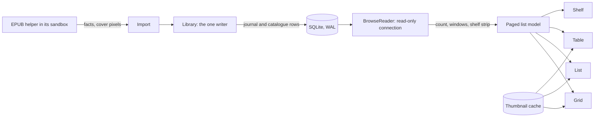
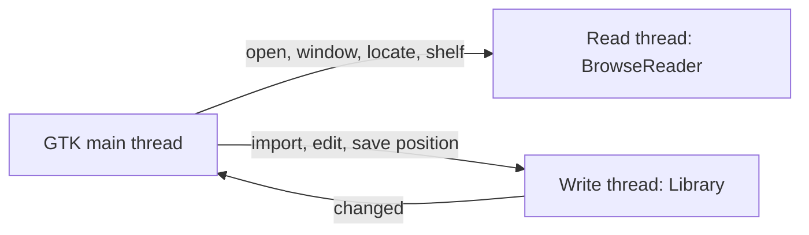

# Browsing a large library

For [browsing in grid, list and table](https://github.com/endqwerty/ebook-manager/issues/25),
[the shelf view](https://github.com/endqwerty/ebook-manager/issues/93) and
[staying fast at 100,000 books](https://github.com/endqwerty/ebook-manager/issues/28).
How the views look is settled in [the interface design](interface.md) and
[the ways to show books](interface-views.md). This page says how the library
core, the EPUB helper and the Linux shell supply them.

## Problem

The desktop app shows every book as a row in one box, rebuilt on each
keystroke. The library reads every book record to answer a search, reads every
book again on each import, and reads every journal file each time it opens.
That works for a few hundred books. A reader with 100,000 books waits on all
three. The catalogue also keeps only a title, authors and a package identifier
for each book. The helper already returns languages and each author's sort
name, and import discards them. Nothing reads a series, a date, a cover or a
length, so the app cannot sort by them, show a cover or draw a spine.

## Goals

- Show the library as a cover grid, a list, a table and a shelf of spines, each
  with its own remembered sort of up to three keys
  ([LIB-20](../requirements/01-library.md#finding-and-viewing), LIB-21, LIB-29).
- Typing in the search box filters by title, author and series
  ([LIB-22](../requirements/01-library.md#finding-and-viewing)). Tags are the
  one field LIB-22 names that this leaves out, because the catalogue has none
  yet.
- Every action works from the keyboard
  ([LIB-28](../requirements/01-library.md#finding-and-viewing)).
- With 100,000 books the window shows the library within 2 seconds of launch
  and a search answers within 100 ms. With 1,000,000 the app still works
  ([LIB-70 to LIB-72](../requirements/01-library.md#speed)).
- A series with a text position that sorts correctly
  ([LIB-3](../requirements/01-library.md#organising)).

## Non-goals

- Collections, tags, several files per book and the rest of the LIB-1 field
  list. They have their own issues
  ([collections](https://github.com/endqwerty/ebook-manager/issues/44),
  [editions](https://github.com/endqwerty/ebook-manager/issues/50),
  [metadata records](https://github.com/endqwerty/ebook-manager/issues/56)).
- The sidebar, Home, the Authors and Series indexes, the details pane, the
  Filter button and its facets, drag and drop, and the Appearance setting. This
  work builds one place, All books.
- A query language and full-text search
  ([search](https://github.com/endqwerty/ebook-manager/issues/45)).
- Reading status as its own record
  ([reading sessions](https://github.com/endqwerty/ebook-manager/issues/36)).
  This work stores only how far the current version has been read and when.
- A new journal file layout. One file per change stays, although it will not
  suit a million books with reading history. See [Open questions](#open-questions).
- Shells other than Linux.

## Plan



### What a book record holds

`Book` keeps its identities and gains the facts the views need. The journal
snapshot (`Change::Book`) carries all of them, so a rebuild from the portable
folder restores them without opening any EPUB.

| Fact | Where it comes from | Edited by the reader |
|---|---|---|
| Title, authors | The helper, as today | Yes |
| Sort title | Absent unless the reader sets it. The catalogue derives the filing form from the title. | Yes |
| Author sort names | The `sort_name` the helper already returns, else derived, per author | Yes |
| Series memberships: name and position text, in order. The first is the primary series. | EPUB 3 `belongs-to-collection` with `collection-type` `series` and `group-position`. For EPUB 2, the `calibre:series` and `calibre:series_index` `meta` names, known from inspecting files that calibre writes, which [Rule 1](../../AGENTS.md#rule-1-never-look-at-calibres-source-code) allows. An index such as `3.0` is given as `3`. | Yes |
| Date added | The library, at first import, in UTC. A replacement keeps it. | No |
| Date published, as the text the file gives, first language, and whether pages run right to left | The helper | No |
| Survey version | The library, when the helper's word count and cover facts were last asked for. See [Covers](#covers). | No |
| Length in words | The helper, counting the text of linear spine documents. Unknown if any chapter was skipped or truncated. | No |
| Cover facts: average colour, spine colour, digest of the thumbnail | The helper. See [Covers](#covers). | No |

Helper-supplied values live in `Book.imported` as today, and the reader's
edits in the fields beside it. Every new field is optional and is left out of
the JSON when absent, so a record written before this change serialises to the
same bytes and its sidecar keeps its name. A journal entry written before this
change reads with the new fields absent, the date added included, and such a
book sorts last by date added. A replacement keeps
the reader's edits and the date added, as it keeps the title and authors
today, and takes the new file's helper facts. A journal entry larger than the
8 MiB that replay accepts is refused when it is written.

`Change::Position` keeps its chapter and offset, which the reader resumes
from, and gains the time of reading in UTC and a fraction read from 0 to 1.
Saving the same chapter, offset and fraction again writes no new entry,
whatever the time. The fraction is part of that comparison because the end of
a long last block changes the fraction and not the offset. The fraction is whatever the reader reports, and the library
stores it as given. [The reader's design](https://github.com/endqwerty/ebook-manager/issues/29)
weighs chapters by their size. A position in a chapter that is not linear
counts as the start of the next linear one. A book is finished when the reader has shown the end of
the last linear chapter, which stores a fraction of exactly 1. A replaced
version's position is not shown: the catalogue row's progress and last read
are cleared when the version changes.

### The catalogue in SQLite

SQLite stays a projection that the journal can rebuild. It opens in WAL mode,
so reading never waits for an import.

```text
book(n INTEGER PRIMARY KEY,        -- private row number, never shown or exported
     id TEXT UNIQUE, sha256, identifier, data TEXT,   -- data is the Book JSON
     title, authors, series, position,                -- display text
     title_key BLOB, author_key BLOB, series_key BLOB, position_key BLOB,
     added INTEGER, published TEXT, last_read INTEGER, progress REAL,
     words INTEGER, language TEXT, spine_rgb INTEGER, cover_rgb INTEGER, cover_digest TEXT)
search(n INTEGER PRIMARY KEY, folded TEXT)   -- title, authors, series names
positions, sources, journal                  -- as today
meta(key PRIMARY KEY, value)                 -- change counter, key profile, published tip
```

Indexes on `sha256`, `identifier` and `sources.id`. Import looks up its
duplicate and review candidates through those indexes, returns them in title
order as today, and no longer lists the shelf. Applying a journal change
writes `book`, `search` and the change counter in the same transaction as the
journal row. A changed book is updated in place and never deleted and
inserted again, so its `n` does not change while the catalogue file lives.

`meta` also records a catalogue version. A catalogue file with no version or
another version, which includes every catalogue written before this change,
is renamed aside as `library.sqlite.old-<uuid>` and a new one is rebuilt from
the portable folder, as when SQLite is missing. That loses what only SQLite
held: changes not yet published and the source paths, so a changed file at a
known path is no longer sent to review. The project has no users yet, and
that is the reason this is acceptable. The old `books` table is not carried
over.

**Sort keys** are bytes that compare with `memcmp`, so SQLite sorts and
indexes them with no callback.

- Text keys are ICU collation sort keys from `icu_collator` for the system
  locale, with numeric ordering on so `Book 2` sorts before `Book 10`.
- A title's filing form drops one leading article chosen by the book's first
  language from a small table in `sortkey.rs` (English, French, German,
  Spanish, Italian, Dutch, Portuguese). A book with no language, or a language
  not in the table, drops nothing. A sort title set by the reader is used as
  it is.
- An author key comes from the first author's sort name. A derived sort name
  moves the last word to the front: `Herman Melville` gives `Melville, Herman`.
- A position key splits the text into runs of digits and runs of other
  characters. Digit runs compare by value and sort before text runs.
  Punctuation separates runs and is otherwise ignored. So `1.5` sorts before
  `2`, `2.2.1` before `2.10.1`, `1-5` after `1`, and `TPB1` after every number
  and before `TPB10`.
- A date published sorts as text when it begins with a four-digit year, as
  ISO 8601 dates do. Any other text counts as missing.
- A sort by Series orders by the primary series' name, then its position.
- A missing value sorts last in both directions.
- A place with no saved sort uses Title, ascending.

`meta` records the locale and a key version. When either differs at open, the
library rebuilds the key columns from `data`.

**Search text** is the title, each author and each series name, case-folded
with Unicode NFKD and marks removed, joined by a separator that cannot be
typed. A search folds the typed text the same way, splits it on whitespace,
and every word must appear somewhere in the book's text. Text that is empty or
only whitespace is no filter. Removing marks makes some scripts match more
than a reader of them would expect: a kana search ignores voicing marks and a
Devanagari search ignores vowel signs. A ligature letter such as `Œ` is not
found by typing `oe`.

### Opening without reading the journal

`Library::open` no longer reads every journal file. `meta` holds the published
tip: the sequence number of the newest journal row whose file and sidecar are
installed. Publication advances it only after both are flushed, in the order
used today. At open the library checks that the tip's file exists with the
same bytes as its journal row and that the file after it does not exist. If
both hold, it publishes any rows after the tip, as today's open does for
pending changes, and returns. A library with no changes has no tip and passes
when file 1 does not exist. Otherwise it runs today's `refresh`, which
compares every file with its SQLite row, applies files SQLite lacks, and
publishes rows that have no file, so a missing file never discards a
committed change. A rebuild from the portable folder sets the tip to the last
file it applied. A separate marker records the first successful recovery.
Until then, reopening retries the full check, including when file 1 is absent.

A file changed or removed earlier in the chain is no longer noticed at open.
`Library::refresh`, which the window keeps as Refresh library, still verifies
the whole chain.

### Asking for books

```rust
pub struct BrowseQuery { pub text: String, pub sort: SortOrder }
pub struct SortOrder(/* one to three distinct fields */);
pub struct SortTerm { pub field: Field, pub descending: bool }
pub enum Field { Title, Author, Series, Added, Published, LastRead, Progress }

pub struct OpenView { pub token: ViewToken, pub count: u32, pub first: Vec<BrowseRow> }
pub struct BrowseRow {            // everything a grid cell, list row, table row or spine shows
    pub id: String, pub version_id: String, pub title: String, pub authors: String,
    pub author_sort: Option<String>,   // the first author's sort name
    pub series: Option<(String, String)>, pub added: Option<i64>, pub published: Option<String>,
    pub last_read: Option<i64>, pub progress: Option<f32>,
    pub cover: Option<CoverRef>, pub cover_rgb: Option<u32>, pub spine_rgb: Option<u32>,
    pub right_to_left: bool,
}
pub struct ShelfStrip {
    pub thickness: Box<[u8]>,          // one per book, in view order
    pub groups: Box<[(u32, String)]>,  // rank where a group starts, and its name
}

impl Library {
    pub fn browse_reader(&self) -> Result<BrowseReader>;
    pub fn book(&self, id: &str) -> Result<Book>;   // the full record, for Edit and Export
}
impl BrowseReader {
    pub fn open(&mut self, query: &BrowseQuery, cancel: &Cancel) -> Result<OpenView>;
    pub fn window(&mut self, view: ViewToken, start: u32, len: u32) -> Result<Vec<BrowseRow>>;
    pub fn locate(&mut self, view: ViewToken, ids: &[String]) -> Result<Vec<Option<u32>>>;
    pub fn shelf(&mut self, view: ViewToken) -> Result<ShelfStrip>;
    pub fn changed(&mut self) -> Result<bool>;   // has the catalogue changed since the view opened
}
```

A rank is a zero-based position in one view. A `BrowseReader` owns a read-only
SQLite connection and can move to another thread. It holds one view at a time.
`first` is the first 128 rows.

`open` does all its reading in one read transaction, so the order, the filter
and the first page see one state of the catalogue, and it records that state's
change counter in the view. `changed` compares the counter and is the signal
to open the query again.

A view stays readable after the catalogue changes. `window`, `locate` and
`shelf` each read in their own transaction and refuse only a token that is
not the reader's current view. Between reopens a view shows current rows at
the ranks they had when it opened, and a book added since is absent until the
next `open`. This is safe because rows are fetched by the private row number
`n`, which never moves to another book, and a row is never deleted: a rank
can show values newer than the order, and never a different book. An import
writes in a stream, and a view that a write made unusable could never be
read on a large library, where a write always lands before an open returns.

This holds for one catalogue file. A file rebuilt from the portable folder
numbers its rows afresh, so a view of the old file must never be answered
from the new one. Each catalogue file gets a random identity in `meta` when
it is created. A view records it at `open`, and `window`, `locate` and
`shelf` read it in the same transaction as their rows. When it differs or
cannot be read they fail with `CatalogueReplaced`. `open` and `changed` fail
the same way when the file at the catalogue's path is no longer the one the
reader opened, because its connection would go on reading the old file and
never see a change. The shell drops that reader, asks the library for a new
one and opens its query again. `a_view_does_not_outlive_its_catalogue_file`.

Deleting a book will break this. A view can then hold a row number that no
longer exists, and `window`, `locate` and `shelf` will have to tolerate a
missing row.

`open` works in two steps, and keeps the result of the first between calls.

1. **Order.** For the sort, one query returns every book's `n` in order, as a
   `Vec<u32>`. A million books is 4 MB. SQLite sorts on the key bytes, with
   the missing values last and `n` as the final tie-break. The order is reused
   until the sort or the change counter changes. No key column has an index
   to start with. If the Open sample misses its limit, the first step is an
   index for the default sort.
2. **Filter.** Empty text shows the order as it is. Otherwise one scan of
   `search` marks the matching `n` in a bitmap, and a pass over the order keeps
   the marked ones. The view is that list.

`window` fetches the rows for a slice of the view by primary key. `locate`
gives the ranks of books by ID, for keeping selection and scroll position.
`shelf` returns each book's spine thickness in view order,
`min(48, 16 + round(words / 12000))` or 24 when the length is unknown, and
the group starts for a first sort key of Author (the first letter of the sort
name; see below), Series (series name) or a date (year). Any other first key has no
groups.

A group for books with no author is named `Unknown author`, with no series
`No series`, and with no date `No date`.

An author's letter is the first character of the sort name, compared as the
locale compares letters, so `A`, `a` and in English `Å` are one group and in
Swedish `Å` is its own. Where the locale files the first two characters
differently from the first alone, the pair is the letter: Danish `Aa`, Czech
`Ch`, Welsh `Ng`. A name that begins with anything but a letter is in the
group `#`. The name is read in composed form and marks before its first
letter are skipped. This is a rule of thumb and not a locale's alphabet. It
does not know a letter of three characters (Hungarian `Dzs` is with `Dz`), a
doubled pair (`Ccs`), or which of two letters filed together names the group
(Swedish `Ü` with `Y`, a ligature such as `Æ` in English, a Thai vowel
written before its consonant), and it capitalises without the locale's rules
(Turkish dotted `i`). In those cases a caption can differ from what a reader
of that language expects or appear twice. A locale's own index is
[its own issue](https://github.com/endqwerty/ebook-manager/issues/100).

A call with a token from an earlier `open` fails with `StaleView`. `open`
checks `cancel` between steps and during the scan, and returns `Cancelled`.
A cancelled or failed `open` leaves the earlier view in place and usable.

**Limits and risks.** Each keystroke scans `search` once: about 5 MB of text
at 100,000 books. At 1,000,000 the scan and the pass over the order are
expected to take a few hundred milliseconds. If the benchmark shows a search
over 100 ms at 100,000 books, the next step is an in-memory copy of the
folded text, and after that a trigram index. Neither is built until a
measurement asks for it.

### Covers

A cover image is untrusted data from the book file, so it is decoded only in
the helper's sandbox.

- A new helper request finds the cover the package declares (the manifest
  item with the `cover-image` property, else the item named by the EPUB 2
  `cover` `meta`), limits its compressed size and its decoded pixels, decodes
  JPEG, PNG, GIF or WebP, draws transparency over white, and scales it to fit
  within 256 by 384 by averaging areas. It refuses a cover whose image file,
  as unpacked from the EPUB, is over 20 MiB, or whose decoded size is over 40
  million pixels. The helper's existing limits on unpacked bytes, reply size,
  memory and time apply as they do to any request. Both caps are fields of
  `Limits` (`max_cover_bytes`, `max_cover_pixels`), and the pixel count is
  checked from the header before decoding. It returns raw RGB pixels with their width and height,
  the average colour of the thumbnail, and the spine colour: the most common colour, after
  rounding each channel to 5 bits, on the tenth of the thumbnail's width at the bound
  side, or on all of it when it is under 10 pixels wide, given as the mean
  of the pixels in that colour. The bound side is the left unless the
  package's page progression is right to left.
- The host checks that both sides are at least 1 and within the limit and
  that the byte length equals width times height times 3, computed without
  overflow. `ebook-reader` hands the desktop a checked thumbnail value. The
  desktop writes it as a PNG to `cache/thumbs/<digest>.png` under the app data
  folder, through a temporary file and a rename. The digest is the SHA-256 of
  the width and height as big-endian 32-bit numbers followed by the pixels.
  The library stores the digest and colours in the book record. The shell
  reads thumbnails straight from that folder on a loader thread and never
  through the library's writer. The app writes one kind of file there and
  reads only that kind: a regular file and not a link, of at most 512 KiB,
  made of a PNG header, image data and an end and no other chunk, whose
  header, read before anything is decoded, says eight bits a channel of
  red, green and blue, no alpha, not interlaced, and no larger than 256 by
  384. The app writes and reads these files with the `png` crate, so a
  file holds nothing a palette or transparency chunk could change. Its pixels must hash to the digest it is named
  by, and the picture shown is made from those hashed pixels. Any other
  file counts as missing.
- A book whose cover is missing, fails to decode or would need enlarging by
  more than three times is still imported, with no cover facts. The shell
  draws its binding set in type.
- The thumbnail folder is a cache. When a book has a digest and no file, the
  shell shows the average colour and asks for the thumbnail again from the
  managed EPUB in the background. It installs the result only if its digest
  equals the one in the record. Two books can share a cover. Each that has asked
  for it by the time a repair fails is tried before the cover is given up,
  and a book that asks later is tried then.
- The word count and cover facts come from one helper request, the survey.
  The two results are independent: a cover that cannot be used leaves the
  word count, and an unknown word count leaves the cover. The count is
  unknown when any linear spine item could not be resolved, was skipped or
  was truncated. A spine item that is a picture adds no words. A picture
  standing on its own adds none either, and one in a block that also holds text counts
  as its text alternative, as it reads. The cover is read first and the text
  takes what remains of the call's 64 MiB unpacking allowance, so a book whose
  cover and text exceed it has an unknown count. A protected book surveys as
  an unknown count and no cover, a result, so it is not asked again. A helper that times out, crashes or cannot start is an error
  and not a result.
- Import runs the survey after the metadata request and passes its facts in
  with the metadata. The record stores the survey version that ran, 1 for
  now, whether or not a cover was found. A survey that ended in an error
  stores nothing and the book is imported without it.
  `Library::set_survey(id, version_id, facts)` stores a later result only if
  the book still has that version, and changes nothing else in the record.
  `Library::unsurveyed(limit)` lists books whose survey version is absent or
  older. At
  startup the desktop asks for unsurveyed books a page at a time and surveys
  them one at a time on a background thread. A book whose survey ended in an
  error is left unmarked and tried at the next start.

The types that cross between the crates, and who owns them:

```rust
// ebook-reader (pull request 2)
pub struct SeriesMembership { pub name: String, pub position: Option<String> }
pub struct Metadata { /* as today, and: */ pub series: Vec<SeriesMembership>,
                      pub published: Option<String>, pub right_to_left: bool }
pub struct Thumbnail { /* checked: width, height, RGB pixels */ }
pub struct Survey { pub words: Option<u32>, pub cover: Option<SurveyedCover> }
pub struct SurveyedCover { pub thumbnail: Thumbnail, pub average: Rgb, pub spine: Rgb }
pub struct Rgb { pub r: u8, pub g: u8, pub b: u8 }   // Rgb::to_u32 gives 0xRRGGBB
impl Reader { pub fn survey(&self, epub: &Path) -> Result<Survey, ReaderError>; }

// ebook-library (pull request 1)
pub struct ParsedMetadata { /* as today, and: */ pub author_sorts: Vec<Option<String>>,
    pub series: Vec<(String, Option<String>)>, pub published: Option<String>,
    pub language: Option<String>, pub right_to_left: bool, pub survey: Option<SurveyFacts> }
pub struct SurveyFacts { pub version: u32, pub words: Option<u32>, pub cover: Option<CoverFacts> }
pub struct CoverFacts { pub digest: String, pub average: u32, pub spine: u32 }
```

Neither crate depends on the other. The desktop converts one to the other in
the third pull request, as it converts `Metadata` to `ParsedMetadata` today,
computes the digest, and keeps the pixels to write the thumbnail.

### The Linux window

The window becomes an `AdwApplicationWindow` with an `AdwToolbarView`. The
screen title, `All books` with the count, is the first line of the content in
the serif. The header bar holds Add (a menu with Files and Folder) at its start,
where [the GNOME mapping](interface.md#how-each-rule-maps-to-a-platform) puts
it. At its end, in the order [the controls section](interface-views.md#the-controls-above-the-books)
gives, are the view switch as linked toggle buttons, the Sort menu, a search
button that reveals a `GtkSearchBar`, and the window menu, which holds Small,
Medium and Large cover sizes and Refresh library. On a window under 640 wide
the view switch is a menu and Table is absent from it. Typing anywhere in the
content opens the search bar with the typed text and moves focus to it.
The window passes each key press and release to the search field's own key
handling until the field is on screen with the focus, so the keys go
through its input method and none typed while the bar opens is lost. The
bar opens when there is text, so a dead key waits for its letter, and
while it waits Escape and Backspace cancel it and Space completes it.
The Sort menu's More opens the sort editor, a dialog of three rows. It is a
dialog and not a popover because each row holds drop-downs, whose own lists
are popovers, and GTK closes a popover when a choice is made in one nested in
it. Every menu, the editor and the table's column menu opens and works from
the keyboard.



- **One model for every view.** `BookListModel` implements `GListModel`,
  `GtkSelectionModel` and `GtkSectionModel` over the current view. `n_items`
  is the view's count. `item(rank)` returns a `BookObject` at once. If its row
  is not loaded, the model asks the read thread for the page of 128 that holds
  it, and fills the object's properties when the page arrives. Bound widgets
  update through property notifications. Loaded pages sit in a small cache,
  and live objects are found again through weak references. Every reply
  carries its token, and the model drops a reply for a view it has replaced.
  An object always knows its rank, and an action on a book whose row has not
  arrived waits for that page.
- **Changing the query.** A new search or sort cancels the one in flight and
  opens a view. The model swaps the count, the first page and the token
  together. It reports the swap as a removal of every item and then an
  addition. Given both in one `items-changed`, a GTK list asks the model for
  every added item to see which rows it can keep, which is 100,000 calls.
- **Selection, focus and scroll position** are kept by book ID in the model:
  the selected books, the focused book and the first book on screen. After a
  view is replaced, `locate` finds where they went. Books no longer in the
  view leave the selection, and the view scrolls to keep the focused book on
  screen if it is still there, else the first book that was on screen, else
  the top. A view replaced because the catalogue changed, and not by the
  reader, keeps the first book on screen where it was and does not scroll to
  the focused one. With no book focused, the one found again is the first
  selected.
- **The selection is a set of book IDs.** A row says whether its book is
  selected when it arrives, so a new view is shown without finding the
  selected books in it and cannot show a selection that is out of date. A
  place selected before its row arrives is held by its rank until the row
  comes, and is dropped if the view is replaced first. After a view is
  shown the model asks which selected books it holds and drops the rest,
  which is safe whenever the answer comes because it only removes books
  that are not there.
- **Placing the reader has one rule.** Their place is found in a view
  before the view is shown; if they scrolled or moved the focus while it
  was being found, the view is shown, the place they moved to is found
  once, and if they have moved again by then the view stays where they
  put it. The scroll correction that follows a placement a frame or two
  later gives way the same way, to any wheel, pointer or key in the books.
- **A command acts on the books selected when it is given.** It takes
  their IDs then, and the places whose rows have not arrived, and acts on
  those whatever is selected by the time the rows come.
- **The model's state is data.** `browse/core.rs` holds it as one enum and
  handles everything that can happen to it in one function, from a state
  and an event to a state and a list of effects, with no GTK in it. The
  GObject calls the function and carries out the effects. The states are
  loading, with an open in flight; showing a view, with or without an open
  in flight; lost, a view that can no longer be read with the open that
  will replace it; and error, with its text. The enum cannot hold a lost
  view with nothing coming, an error beside a view, or loading with
  nothing asked for.
- **When a view cannot be read.** The read thread answers every request,
  with what was asked for or with a refusal, and drops none. An open names
  the view the model is showing, and the read thread says `Unchanged` only
  of that view: asked about any other, it gives the view it holds or opens
  one. For a view the model has already replaced a refusal means nothing.
  For the view on screen it means the view is lost: its loaded rows stay,
  each place waiting for a row is told none will come, a command waiting
  on one says so, and the query is opened again. When the newest open
  fails the window shows why, with Try Again and without the rows of an
  older query, and a change to the catalogue or Try Again opens it afresh.
  Try Again starts a new read thread if the last one stopped. When the
  catalogue file is replaced the read thread asks for a new reader.
  `the_model_and_the_read_thread_always_settle` drives the function and
  the real read thread through several thousand seeded steps and checks,
  each time the replies have drained, that the model shows the reader's
  own view for its own query or an error, and that no place is left
  waiting.
- **When the catalogue changes** (an import, an edit, a saved position), the
  write thread tells the window after each job. The model asks the read
  thread whether the catalogue changed and, if so, reopens the same query
  there and swaps as above. It shows such a refresh at most once a second.
- **Grid** is a `GtkGridView`. A cell is a custom `Cover` widget and a caption.
  `Cover` draws the frame, image, edge line, spine shade and shadows from
  [the cover table](interface.md#covers), the binding set in type for a book
  with no cover, and the More contrast variant. The grid sets its column count
  from the width by the formula in that table.
- **List** is a `GtkListView` and **Table** a `GtkColumnView`, as
  [their sections](interface-views.md#list) describe. A click on a table
  header changes the model's sort. The table never sorts rows itself. The
  table is offered only when the window is at least 640 wide. One view is
  built at a time over the model, and a view built anew goes on screen when
  the model has its books, so the old one can still say where the reader is.
  GTK's column headers take no keyboard focus, so the table gives it to
  them: Up from the first row reaches a header, the arrows move along them,
  Return and Control+Return sort, and the Menu key opens the header's menu.
  Show, hide, move and width commands update the live columns while GTK
  keeps the header and its menu alive. Width commands step by 24 within
  the same saved-width limits as a drag.
  A list row's separator is the app's own line in the platform's border
  colour, because the platform's runs under the cover. The view switch uses
  `view-dual-symbolic` for the table until an icon is drawn for it.
  Bindings set in type use a flat colour in List and Table because the type
  would be unreadable at those cover sizes.
  The three cover sizes are in the main menu because the GNOME view switch
  is a row of toggle buttons with no menu of its own.
  List rows omit the trailing Send to device and Remove swipe actions
  because this shell has no touch target yet.
- **A sort the reader asks for** starts at the book they were on, if one is
  selected or focused, and otherwise at the top. Switching layouts keeps
  selection and book focus and places the previous top book in the first
  visible row. In the grid that row can also contain earlier books. The
  scroll position stays within the end of the catalogue.
- **Shelf** is a custom scrollable widget. It asks for the `ShelfStrip` once
  per view, packs rows for its width (a new row when the next spine does not
  fit, and at each group start), and stores each row's first rank and y
  offset. Every row is the same height, from the shelf table's spine, top
  strip, board and gap, plus one caption line when the row starts a group. A
  spine wider than the row has a row to itself. On a resize it repacks, then
  scrolls so that the row now holding the book that was first on screen is
  the top row, or as near as the end of the content allows. Up and Down move
  focus to the spine in the next row whose centre is nearest. The family name
  on a spine is the text before the comma in `author_sort`, and the spine
  style and binding colour hash the book's `id`. It
  creates spine widgets only for the rows on screen and a little beyond, and
  reuses them. Each spine widget has an accessible name with the title, author
  and reading state, takes focus, and draws itself as
  [the shelf table](interface-views.md#shelf) says. Selection tips the spine
  with a perspective transform and moves nothing else.
- **Actions** are `GAction`s on the window with accelerators, also offered in
  the context menu on a book and the Menu key: Read (Return, double click),
  Edit, Send to device, and the view, sort and search commands. Every key,
  Return included, acts on the selection, and a book's menu on that book. An
  action takes the book's ID and fetches the full record with `Library::book`. The
  Edit window gains sort title, author sort names, series and position.
- **Remembered choices**: the view, the sort for each view, the cover size and
  the table's columns, order and widths are saved in `settings.json` in the
  app's config folder. Each view's sort and each column are read
  independently. The file is written only when the choices change.
- A text scale of 1.5 or more shows List in place of Grid or Shelf without
  changing the saved choice.

### The benchmark

`crates/ebook-library` gains a `fixture` feature with a generator that writes
a catalogue of N made-up books through the same function that applies a
journal change, in large transactions, without writing journal files. It
varies title length and script, repeats authors, puts a third of the books in
series, leaves some dates empty and repeats some sort keys. It records the
published tip as the last generated change, marks every row published, and
writes that one change's journal file. Open's tip check therefore passes
through the production code, and the desktop can open the same folder. The
folder is not a complete portable copy, and `refresh` on it reports a gap.

A `scale` test binary, built in release, generates 100,000 and 1,000,000
books and measures each sample below five times with the file cache warm. The
median must be within the limit:

Each cell gives the median and range in milliseconds across five warm repetitions,
followed by the enforced median limit. The window sample uses the slowest of
30 pages in each repetition, including the final page.

| Sample | 100,000 books, median [range] / limit | 1,000,000 books, median [range] / limit |
|---|---:|---:|
| Open writer, default order and first page | 76.7 [63.1–108.9] / 300 | 658 [650–769] / 3,500 |
| Search for `a` | 28.2 [15.1–28.5] / 85 | 150 [148–157] / 800 |
| Search for `atlas` | 28.4 [15.6–28.5] / 85 | 152 [150–182] / 800 |
| Search for `book 4094` | 29.6 [16.0–30.7] / 85 | 167 [158–258] / 800 |
| Search with no match | 27.3 [14.6–28.3] / 85 | 150 [146–303] / 800 |
| Window of 128 rows | 0.59 [0.35–0.67] / 2 | 0.53 [0.47–0.59] / 3 |
| Shelf | 54.3 [29.5–55.7] / 150 | 281 [278–301] / 1,500 |
| Re-sort by date added, author, title | 120 [74–137] / 400 | 929 [893–1,435] / 5,000 |
| Import lookups by digest, source and identifier | 0.107 [0.089–0.131] / 1 | 0.095 [0.092–0.137] / 1 |

The limits allow roughly five times the upper end of the first local run,
rounded to practical units for a shared runner. The table shows a subsequent
run against those limits. Including fixture creation and an incremental
release build, the step took 68 seconds locally. It checks IDs, counts,
window contents, shelf thicknesses and all three import matches against the
fixture's inputs. The import sample gives each lookup a different matching book.

A separate 100,000-book run measured CPU time and read calls on Linux.
Opening took 59 ms wall time and 59 ms CPU. Re-sorting took 75 ms for each.
Both read cached pages and sorted keys on one thread. Searches spent 16–17 ms
scanning and filtering, including about 1,000–1,200 reads per query. Shelf
read the book rows in row-number order (20,050 reads, 28 ms CPU). A window
needed 135 reads for its primary-key fetches and import needed 25 for its
indexed lookups. None of these samples fetched bytes from physical storage.
CI reports the step as **Scale benchmark**.

The window's own start is measured by `apps/desktop/tests/scale.py`, which CI
runs as **Desktop at 100,000 books**. With a generated catalogue of 100,000
books in place it starts the app five times after one uncounted start. The
median time from starting the process to the first titles being readable
through the accessibility tree must be under 2 seconds plus the time the
driver's own look takes, which was up to 0.07 seconds. Locally the median is
0.26 seconds, with a range of 0.25 to 0.30, so the limit is about eight times
the measurement. A launch is bounded by GTK starting, 0.1 seconds, and by the
catalogue putting the books in order on one thread, 0.06 seconds. The rest
builds and draws the first rows. The check switches between each pair of
views after scrolling, searches, jumps to the last row, and imports 400
generated EPUBs. During that import the count on screen
must change no more often than once a second, and the books on screen and the
selected one must be the same after three refreshes.

## Behaviour

Tests in `crates/ebook-library/tests/browse.rs` unless another file is named.

1. When a library holds books and a view opens with empty text, then the count
   is the number of books and the rows come in the order of the sort, with
   ties in a stable order. `orders_by_each_field_in_both_directions`.
2. When titles begin with an article in the book's language, contain numbers,
   or differ only in case or accents, then they sort as a person would file
   them. `titles_file_without_articles_and_with_numbers_by_value`.
3. When series positions are `1`, `1.5`, `2`, `2.2.1`, `2.10.1`, `10` and
   `TPB1`, then a series sort returns them in that order.
   `series_positions_sort_by_parts`.
4. When a sort has a second and third key, then books equal on the earlier
   keys are ordered by the later ones. `later_keys_order_ties`.
5. When a value is missing, then the book sorts after those that have it, in
   both directions. `missing_values_sort_last`.
6. When text is typed, then the view holds exactly the books whose title, an
   author or a series name contains every word, whatever its case or accents,
   in the current sort. `search_matches_every_word_across_fields`.
7. When a window is asked for anywhere in the view, the last rows included,
   then it returns the same rows as the whole view sliced, and an empty list
   past the end. `any_window_matches_the_whole_view`.
8. When a view is replaced, then a call with the old token fails with
   `StaleView`. `an_old_token_is_refused`.
9. When a book is imported, edited or read after a view opened, then `changed`
   reports true, the open view still returns its books at their ranks with
   their new values and without the added book, and a reopened view shows
   the new order. `a_reopened_view_reflects_changes`. A write after `open`
   does not stop `locate`. `a_write_after_open_does_not_stop_locate`.
10. When `locate` is given IDs, then it returns each book's rank, and none for
    a book the filter hides. `locate_finds_books_by_id`.
11. When the first sort key is Author, Series or a date, then `shelf` returns
    one thickness per book in view order and a group start wherever the
    letter, series or year changes. `shelf_strip_matches_the_view`.
12. When a library is closed and opened again, then no journal file except
    the newest is read. When the newest file is missing, changed or followed
    by another, then open replays the journal.
    `reopen_reads_one_journal_file_unless_the_tip_moved`
    in `tests/library.rs`.
13. When the catalogue is rebuilt from the portable folder alone, then every
    new fact, the order each sort gives and the reading fraction are as
    before. When a change was committed and the app stopped before its file
    was installed, then the next open installs it without Refresh.
    `portable_only_rebuild_restores_bytes_metadata_and_position` in
    `tests/library.rs`, extended, and a new test there,
    `reopen_alone_publishes_an_interrupted_import`, which interrupts an import
    before and after its journal file is installed, reopens without calling
    `refresh`, and checks the managed bytes, the source association, the
    journal sequence and the sidecar. `a_record_from_before_keeps_its_sidecar`
    replays a journal and an edited sidecar written in the earlier format.
14. When a second copy of a known file, path or package identifier is
    imported into a large library, then the outcome is as today and the import
    lists no books. The existing import tests, and the `scale` binary's import
    sample.
15. When an EPUB declares a series, a sort name, a date and a cover, then the
    helper returns them, and a cover that is too large, corrupt or an
    unsupported type yields no cover and no failure.
    `crates/ebook-reader/tests/reading.rs` and `tests/failures.rs`.
16. When the library has 100,000 or 1,000,000 books, then each sample in
    [the benchmark](#the-benchmark) is within its limit and correct. The
    `scale` binary.
17. When the reader switches between Grid, List, Table and Shelf, sorts, types
    a search, and opens, edits and exports a book using only the keyboard,
    then each works, and the view and sort are as left after a restart.
    `apps/desktop/tests/smoke.py`, for all but the shelf.
18. When the shelf is resized, then the first fully visible book stays at the
    top, and when a book is selected then only that spine changes.
    `apps/desktop/tests/smoke.py`, and a unit test of the row packing.

## Alternatives

- **`LIMIT` and `OFFSET` for each window.** Simple, but dragging the scroll
  bar to the end of a million rows repeats work in proportion to the depth,
  and it cannot say where a selected book went after a re-sort.
- **Keyset paging.** Fast for the next page and unable to jump to a rank,
  which a scroll bar and the shelf both need.
- **Sorting in the shell with `GtkSortListModel`.** It needs every row in
  memory as an object.
- **An index of one-, two- and three-letter fragments with a bitmap of ranks**,
  which answers a search without a scan and counts and seeks by bit
  arithmetic. It was the other design considered. It is the faster design at
  a million books and several times the code. The scan meets the target at
  100,000 by arithmetic, and the benchmark will say if that is wrong.
- **A registered SQLite collation in place of key bytes.** Every comparison
  would call back into ICU, and an index would be unusable by any tool that
  opens the file without the callback. ICU4X 2.4.0 exposes numeric ordering and directly emits comparable bytes. [Numeric ordering](https://docs.rs/icu_collator/2.4.0/icu_collator/struct.CollatorPreferences.html#structfield.numeric_ordering) and [sort-key output](https://docs.rs/icu_collator/2.4.0/icu_collator/struct.CollatorBorrowed.html#method.write_sort_key_to).
- **Reading thumbnails through the library.** A scroll would queue behind an
  import.
- **Decoding covers in the app.** Image decoders are a common place for memory
  faults, and the book file is untrusted.

## Implementation

| File | Change |
|---|---|
| `crates/ebook-library/src/lib.rs` | Split into the modules below. `Library` keeps its public calls. |
| `…/record.rs` | `Book`, its new facts, `ReadingPosition`, validation. |
| `…/journal.rs` | Commit, publish, replay, and the fast open. |
| `…/catalogue.rs` | Schema, applying a change to `book` and `search`, import lookups. |
| `…/sortkey.rs` | Filing form, article table, collation keys, position keys, folding. |
| `…/browse.rs` | `BrowseReader` and its types. |
| `…/fixture.rs` | The generator, behind the `fixture` feature. |
| `crates/ebook-library/tests/browse.rs`, `src/bin/scale.rs` | Behaviour 1 to 11 and 16. |
| `crates/ebook-reader` | Series, date and page direction in `Metadata`; the survey request for word count and cover; decoders run only in the helper. |
| `apps/desktop/src/main.rs` | The window, header bar and actions. |
| `…/browse.rs` | The read thread and `BookListModel`. |
| `…/cover.rs` | The `Cover` widget and the thumbnail loader. |
| `…/views/grid.rs`, `list.rs`, `table.rs`, `shelf.rs` | One file per view. |
| `…/settings.rs` | Remembered choices. |
| `…/imports.rs`, `reader.rs` | Pass the new facts in; save the fraction read. |
| `.github/workflows/check.yml` | The benchmark step. |
| `specs/` | `library-mvp.md` and `desktop-mvp.md` updated, each in the pull request that changes the behaviour. |

## Tasks

Four pull requests. The first two touch different crates and are built at the
same time.

1. **Catalogue and benchmark** (done). The record's new fields and
   `set_survey`, with nothing yet filling the helper-supplied ones, the
   catalogue tables, sort keys, fast open, indexed import lookups,
   `BrowseReader`, `Library::book`, `unsurveyed`, the fixture and the
   benchmark step. The desktop changes only where it must to compile, filling
   new fields with empty values, and `Library::search` stays for it until the
   third pull request deletes it. Behaviour 1 to 14 and 16.
   Closes [#28](https://github.com/endqwerty/ebook-manager/issues/28).
2. **Helper facts and covers** (done). Everything under `crates/ebook-reader`.
   Behaviour 15.
3. **The window** (done, in two pull requests). After 1 and 2. Behaviour 17
   without the shelf.
   Closes [#25](https://github.com/endqwerty/ebook-manager/issues/25).
   - First: import passes the helper's facts into `ParsedMetadata`, the
     reader saves the fraction read, the thumbnail cache, the survey, the
     model, Grid, search, the actions and their keys, the Edit window's
     filing fields, and the launch time check. `Library::search` is deleted.
     A view stays readable after the catalogue changes, which the first
     pull request's contract did not allow and an import needs.
   - Second: List and Table, the view switch, the Sort menu and its
     editor, the cover sizes and the remembered choices.
4. **The shelf** (open). After 3. Behaviour 18.
   Closes [#93](https://github.com/endqwerty/ebook-manager/issues/93).

## Open questions

- **How should words be counted in Chinese, Japanese and Korean text?**
  Assumed: each Han, kana or hangul character counts as half a word.
- **Is one journal file per change workable at a million books?** Assumed
  not, and left alone here. Reading positions make it worse than the book
  count suggests. It needs its own design before sync.
- **Which decoders does the helper link?** The `image` crate with only its
  JPEG, PNG, GIF and WebP features, all pure Rust. It brings `zune-jpeg`,
  `png`, `gif`, `image-webp`, `moxcms` and their dependencies, licensed MIT,
  Apache-2.0, Zlib, BSD-3-Clause or Unlicense; the
  [licence check](https://github.com/endqwerty/ebook-manager/issues/21) has
  the final word.
